<div align="center">

[Current T4 keyboard assembly for SolidWorks](hardware/mechanical-rfq/rev-b2-t4/Omar-Keyboard-full-T4.step) · [USB-C carrier fabrication and assembly files](hardware/usb-c-carrier/README.md) · [Assembly specification](hardware/assembly-design-specification.md).

# Omar-Keyboard

**A keyboard made for [Omarchy](https://omarchy.org/).** Desks, windows and launchers get labeled keys of their own, arranged around a standard US layout.

[**Visit the site**](https://monstercameron.github.io/OmarKeyboard/) &nbsp;·&nbsp; [Try it in your browser](https://monstercameron.github.io/OmarKeyboard/#try) &nbsp;·&nbsp; [Explore the circuit board](https://monstercameron.github.io/OmarKeyboard/#circuit) &nbsp;·&nbsp; [Configure the firmware](https://monstercameron.github.io/OmarKeyboard/#configure)

[](https://monstercameron.github.io/OmarKeyboard/)

</div>

## What it does

Omarchy runs on keyboard shortcuts. Omar-Keyboard puts the most-used ones on keys that say what they do, so you don't need to remember a chord.

- **Five desk keys** above the number row. Tap **Desk 3** to go there. Press **Send & Stay**, then **Desk 3**, to move the window and keep working where you are.
- **Launchers on the left edge.** Terminal, Browser, Files, Guide and Menu each have a key. Menu sits at home-row height.
- **Window controls on the right edge.** Hold **Focus** or **Swap** and press an arrow to move between tiles. Float, Fullscreen and Flip Split have keys of their own.
- **A wide roller** in place of the navigation block. Pull it toward you to scroll down. Hold Fn while rolling to move a page at a time.
- **Two dials.** The left one sets volume and mutes when pressed. The right one sets brightness.
- **A light under every key.** The 90 per-key lights show the active desk, a muted microphone and Caps Lock.

The typing block is an ordinary US QWERTY layout, with the full number row, two Super keys and a Ctrl key on either side. The included Omarchy profile defaults to five desktops per monitor. Caps works as Fn when held. The [full keymap](docs/design/keymap.md) covers alternate legends and cancelling a move.

[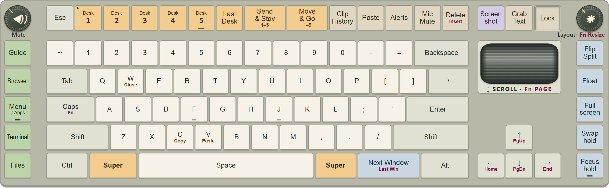](https://monstercameron.github.io/OmarKeyboard/#desks)

## A tour of the site

[The site](https://monstercameron.github.io/OmarKeyboard/) walks through the keyboard one part at a time. The 3D board turns as you scroll, and hand-drawn notes point out the parts worth a look. Each picture below links to its section.

[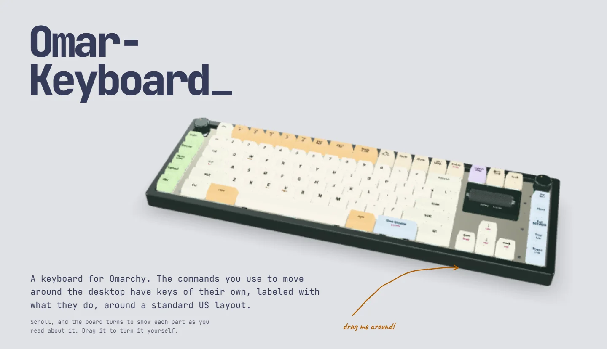](https://monstercameron.github.io/OmarKeyboard/)

### [Try it](https://monstercameron.github.io/OmarKeyboard/#try)

Press the keys on the board and a simulated Omarchy screen above it responds. Send a window to Desk 3, follow it, or hold Focus and press an arrow. What you type goes to the focused terminal. The [full-screen prototype](https://monstercameron.github.io/OmarKeyboard/prototype/OMAR-KEYBOARD-PROTOTYPE.html) can also print the layout at full size, so you can check reach on paper.

[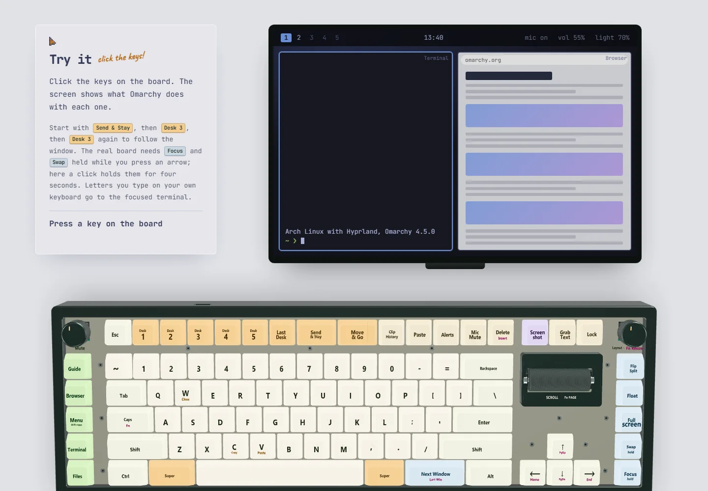](https://monstercameron.github.io/OmarKeyboard/#try)

### [The print model](https://monstercameron.github.io/OmarKeyboard/#print)

The T4 assembly the prints are made from, exported from SolidCraft with every legend modeled as raised geometry. The site loads a 5-million-triangle copy, 10.8 MB, only when you press **Load the print model**. Then you can turn it, zoom in on the legends, or jump to the roller and the front edge.

[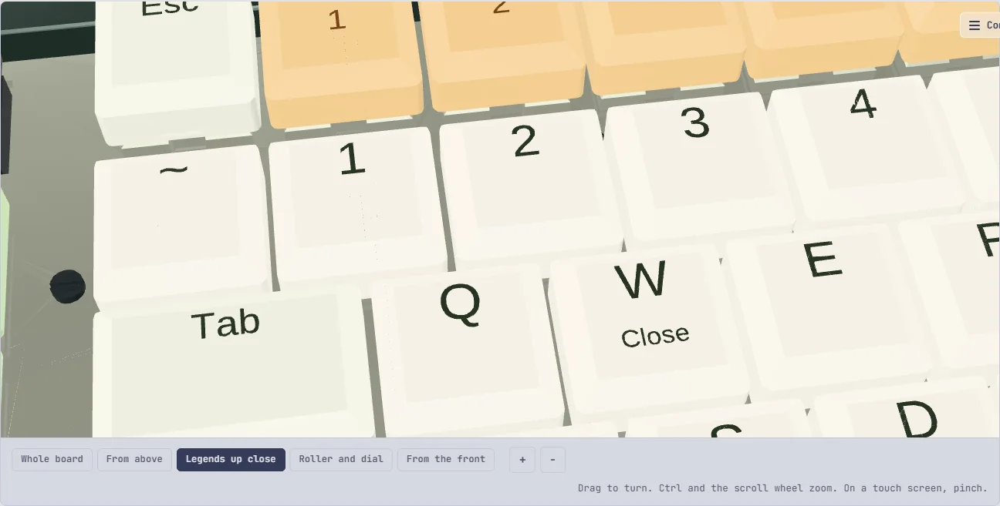](https://monstercameron.github.io/OmarKeyboard/#print)

### [The circuit board](https://monstercameron.github.io/OmarKeyboard/#circuit)

The routed Rev B.1 board is drawn from the KiCad files, with the top copper in orange and the bottom in blue. Pulses follow the USB data and the light chain. Hand-drawn notes mark where USB comes in, where the 90 lights start and where the controller sits. Choose a part to zoom to it.

[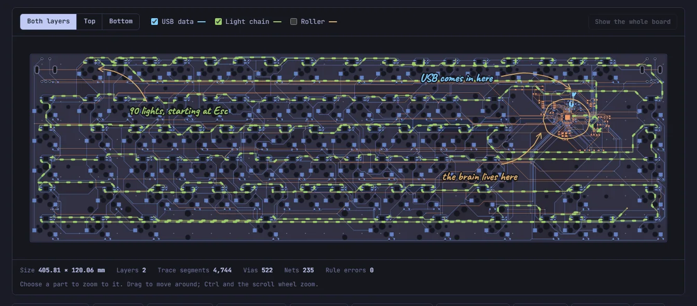](https://monstercameron.github.io/OmarKeyboard/#circuit)

### [Controller pins and schematics](https://monstercameron.github.io/OmarKeyboard/#mcu-title)

The RP2040 is shown from above, with all 56 pins labeled. Choose a group or point at a pin to see where it goes. Beside it are the 14 schematic sheets, six of them for the lights.

[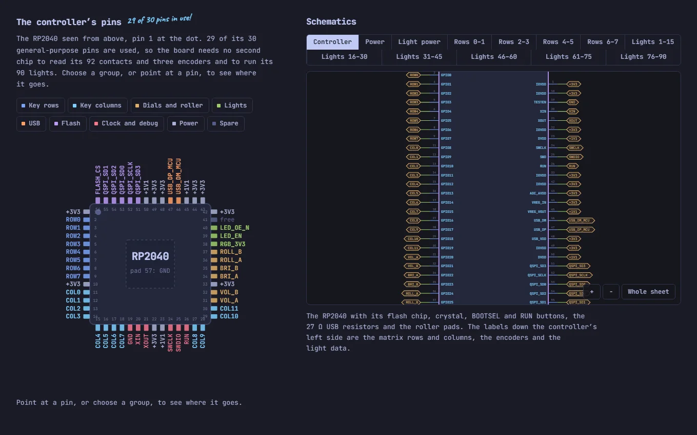](https://monstercameron.github.io/OmarKeyboard/#mcu-title)

### [A light under every key](https://monstercameron.github.io/OmarKeyboard/#lights)

Each of the 90 keys has an SK6812MINI-E under it. Switch between the states the board shows: the active desk in cyan, a pending move, Caps Lock, a muted microphone and a held Focus key. The brightness controls show the current the whole board would draw.

[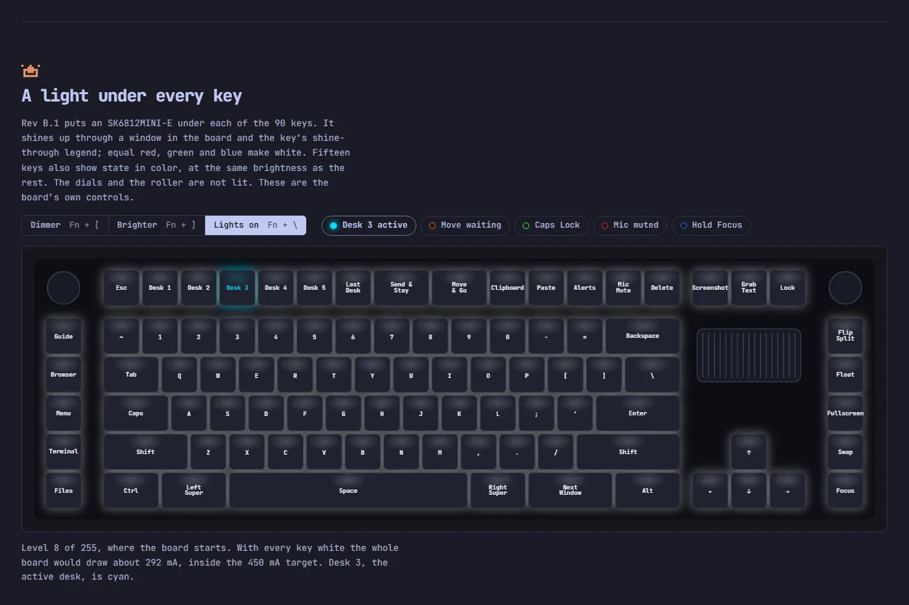](https://monstercameron.github.io/OmarKeyboard/#lights)

### [Parts and what the board needs](https://monstercameron.github.io/OmarKeyboard/#parts)

The table lists all 403 parts with their package, their side of the board and what each one does. Prices for the encoders, lights and sockets come from the JLCPCB quote, and the rest are estimates. **Show** zooms the board drawing to that part.

[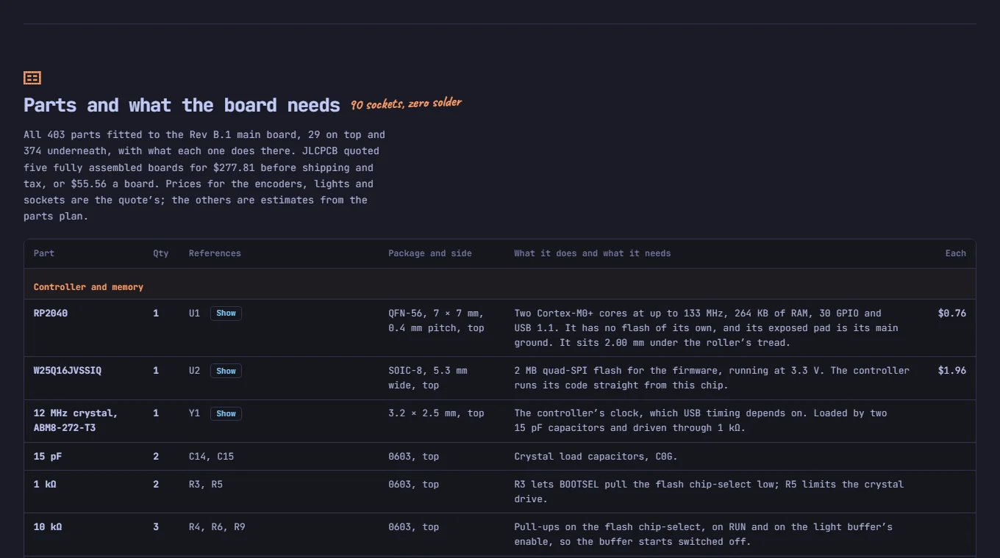](https://monstercameron.github.io/OmarKeyboard/#parts)

### [Configure the firmware](https://monstercameron.github.io/OmarKeyboard/#configure)

Choose a key to see its keycode, its place in the switch matrix and what Omarchy receives. Change assignments, tapping term and brightness, then copy the generated `keymap.c`, `config.h`, `rules.mk` and `keymap.json`. A board running VIA can be read and written over USB.

[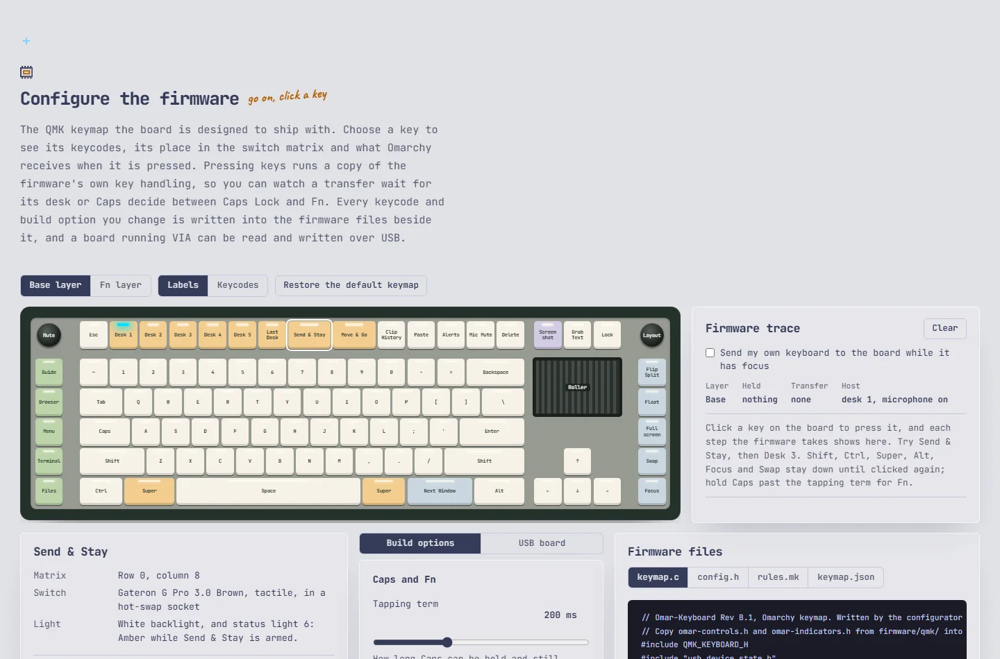](https://monstercameron.github.io/OmarKeyboard/#configure)

### [Where it's heading](https://monstercameron.github.io/OmarKeyboard/#roadmap)

The roadmap is drawn like a trace on the board. Solid steps are done, and the dashed ones still have to be routed. The rear USB-C carrier is routed. Its plating, assembly and service fit await supplier confirmation and first-article tests.

[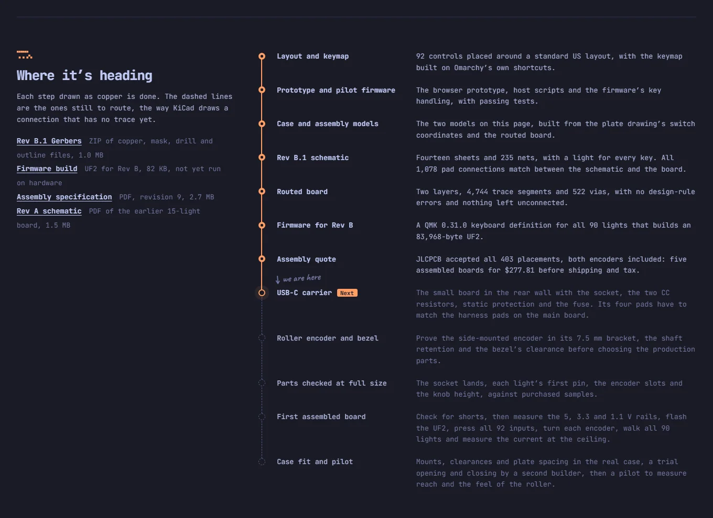](https://monstercameron.github.io/OmarKeyboard/#roadmap)

## Current prototype hardware

[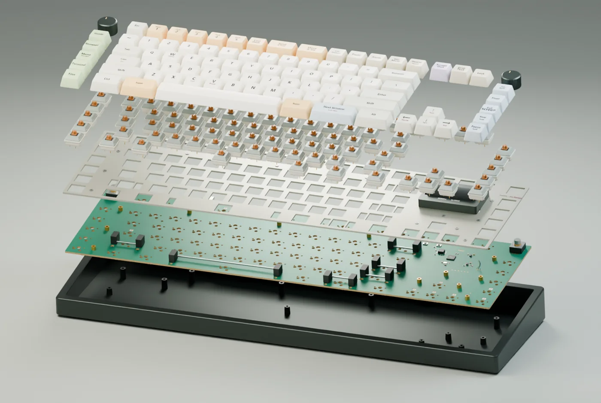](https://monstercameron.github.io/OmarKeyboard/#inside)

| Part | B.2 mainboard, T3 roller and T4 USB-C carrier |
| --- | --- |
| Controller | RP2040 reading an 8 × 12 key matrix, with USB-C at the rear |
| Switches | 89 Gateron G Pro 3.0 Brown, and a Cherry MX Grey for Lock |
| Dials | Two Bourns PEC11R encoders with 24 detents |
| Lights | 90 SK6812MINI-E per-key LEDs on one chain, starting at Esc. A load switch turns the light rail off. |
| Power | Estimated 292 mA at default white and 393 mA at the 16/255 ceiling. First-article target ≤450 mA at the host |
| Board | 405 placements, including the two roller pull-ups. Native KiCad DRC passes. |
| Cost | The historical B.1 quote was $277.81 for five 403-placement boards. B.2 needs a fresh quote. |
| Firmware | QMK, target `omar_keyboard/rev_b` |

The current hardware pairs a 405-placement Rev B.2 mainboard with a separate soldered roller card and T3 mechanical assembly. The four-layer T4 USB-C carrier completes the three-board set. All three native DRC reports pass. Card, harness and screw fit have been checked in CAD. A populated physical sample remains to be tested. [Rev B.2 board](hardware/mainboard-rev-b2/README.md) · [Encoder card](hardware/roller-encoder-card/README.md) · [T3 roller assembly](hardware/mechanical-rfq/rev-b2-t3/README.md)

### Drawings

These drawings come from the [assembly design specification](hardware/assembly-design-specification.md).

[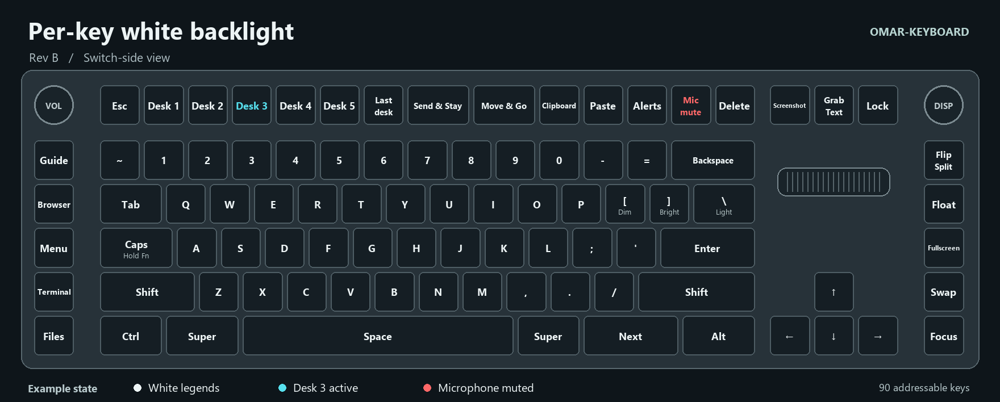](https://monstercameron.github.io/OmarKeyboard/#lights)

[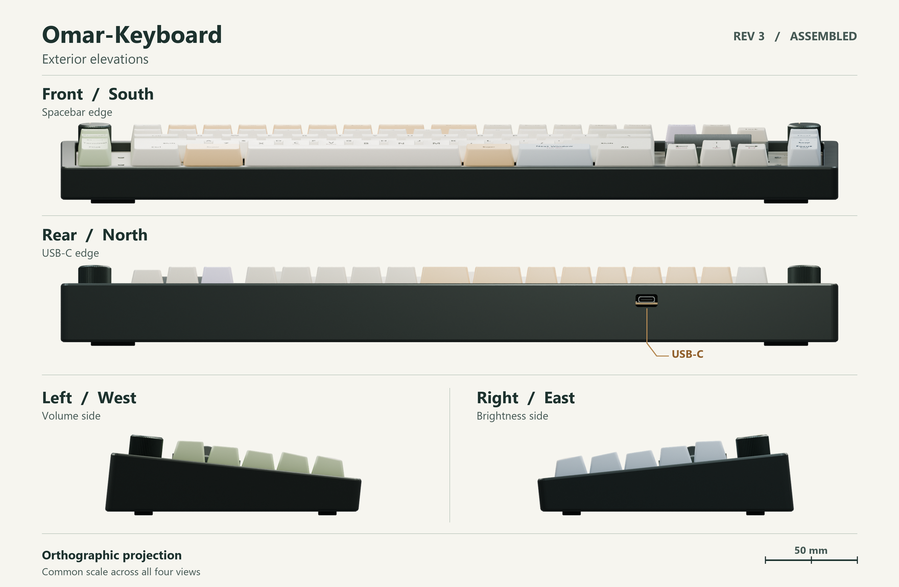](hardware/assembly-design-specification.md)

<p>
  <a href="hardware/assembly-design-specification.md">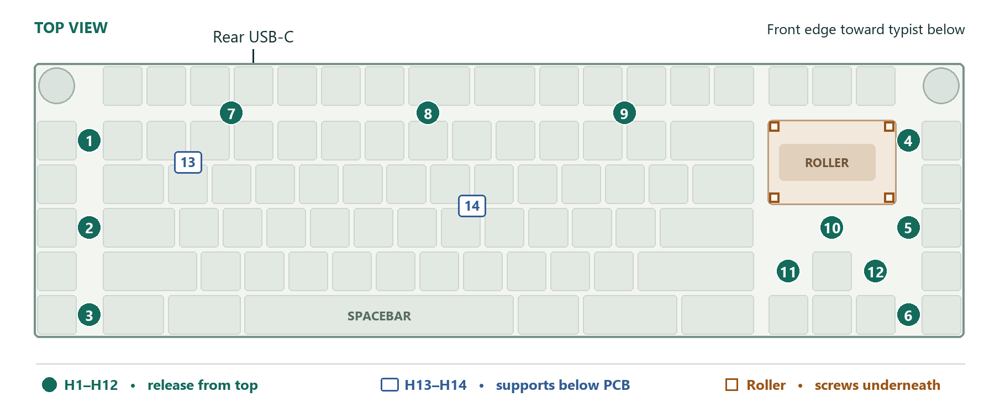</a>
  <a href="hardware/assembly-design-specification.md">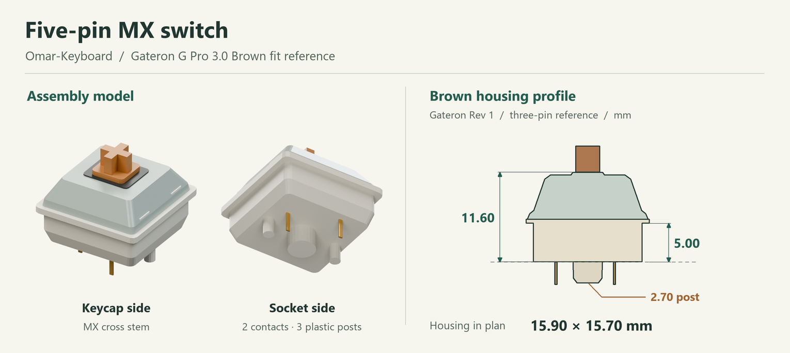</a>
</p>

[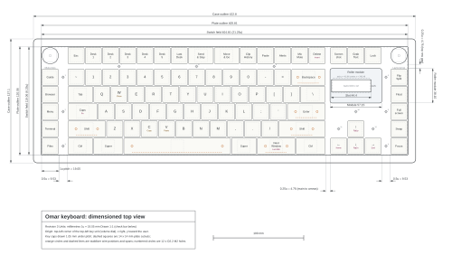](hardware/specification.md)

## Try it yourself

- **In a browser.** The [Try it section](https://monstercameron.github.io/OmarKeyboard/#try) and the [full-screen prototype](https://monstercameron.github.io/OmarKeyboard/prototype/OMAR-KEYBOARD-PROTOTYPE.html) run with nothing to install. In the prototype, try **Send & Stay** and then **Move & Go** with the same desk to compare them. **Print full-size fit template** prints the layout at true scale. Measure both 100 mm bars on the printout before you judge the fit.
- **In 3D.** The [site](https://monstercameron.github.io/OmarKeyboard/#inside) shows the outside and the internal assembly. The [offline viewer](hardware/model/View-Omar-Keyboard.html) works without a network connection. The [Blender assembly](hardware/model/Omar-Keyboard.blend) and the [GLB](docs/assets/omar-keyboard.glb) are editable.
- **On a keyboard you already own.** The [build pilot](docs/build/pilot.md) maps the controls onto an existing QMK board. The [Omarchy bindings](host/omarchy/) target Omarchy v4.5.0.
- **With your own keymap.** The [firmware configurator](https://monstercameron.github.io/OmarKeyboard/#configure) writes a `keymap.c` you can compile with QMK.

To run the site locally, serve `docs/` from the repository root:

```sh
python -m http.server 8000 --bind 127.0.0.1 --directory docs
```

Then open `http://127.0.0.1:8000/`.

## Inside the repository

| To do this | Start here |
| --- | --- |
| Build or review the full assembly | [Assembly design specification](hardware/assembly-design-specification.md) · [Illustrated PDF](hardware/assembly-design-specification.pdf) |
| Open the current T3 plate and roller | [Positioned STEP, revised parts and fit checks](hardware/mechanical-rfq/rev-b2-t3/README.md) |
| Review the earlier T2 quotations | [STEP assembly, part drawings and plate quotations](hardware/mechanical-rfq/rev-b1-t2/README.md) |
| Order or review the Rev B.1 board | [KiCad project, BOM and quotes](hardware/mainboard-rev-b/README.md) · [Rev B firmware](firmware/qmk/omar_keyboard/rev_b/) |
| Look at the earlier Rev A board | [Rev A mainboard](hardware/mainboard/README.md) · [Verification report](hardware/mainboard/verification.md) · [Rev A firmware](firmware/qmk/omar_keyboard/rev_a/) |
| Check dimensions, switch positions or parts | [Hardware specification](hardware/specification.md) · [Parts and cost plan](hardware/parts-plan.md) · [Switch coordinates](hardware/layout/omar-switches.csv) · [Dimensioned drawing](docs/assets/omar-dimensions.svg) |
| See inside the case | [Internal assembly](hardware/model/internals/README.md) · [Offline internal viewer](hardware/model/internals/View-Internals.html) · [Tray STL](hardware/model/Omar-Keyboard-Tray.stl) |
| Print the case and keycaps | [T4 print files](hardware/mechanical-rfq/rev-b2-t4/README.md) · [One-piece tray STL](hardware/mechanical-rfq/rev-b2-t4/T4-One-piece-tray.stl) · [High-detail print model, GLB](docs/assets/omar-print-model.glb) |
| Run a reach or usability session | [Validation tasks and acceptance criteria](docs/design/validation.md) |
| Understand the design decisions | [Omarchy interaction patterns](docs/research/omarchy.md) · [Stock shortcuts](docs/research/stock-shortcuts.md) · [Keyboard market study](docs/research/keyboards.md) · [Controllers and firmware](docs/research/controllers.md) |
| Change the layout, model or site | [Contributor and verification guide](CONTRIBUTING.md) |
| See how the design started | [First layout](archive/first-layout.md) · [Earlier drafts](archive/earlier-drafts/) |

## License

The original code, hardware designs and documentation are released under the [MIT License](LICENSE). The bundled 3D viewer runtime has its own license, listed in the [third-party notices](THIRD_PARTY_NOTICES.md).
