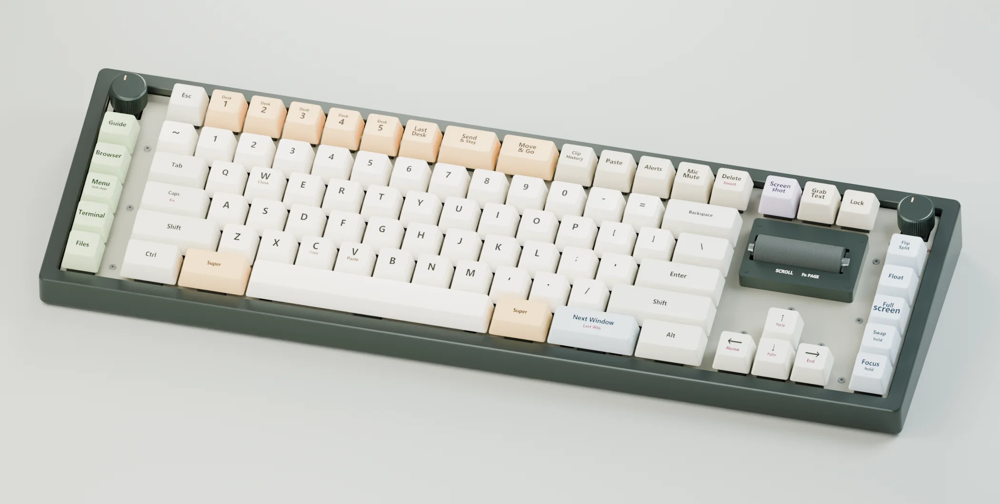

# Omar-Keyboard

Omar-Keyboard is a tenkeyless-style USB keyboard for [Omarchy](https://omarchy.org/). Its five desktop keys sit above the number row, its window controls sit beside the arrows, and a wide roller takes the place of the navigation block. Press **Send & Stay**, then **Desk 3**, to move a window there and keep working on your current desk.

**Revision 3 is a dimensioned prototype.** You can try the interactions in a browser, print the layout at full size, inspect the Blender assembly, or map the pilot controls onto an existing QMK board. Physical reach, roller feel and electrical behavior still need a hardware trial. The [Rev A mainboard](hardware/mainboard/README.md) has editable KiCad sources and a compiled QMK target. Its [verification report](hardware/mainboard/verification.md) tracks the remaining fabrication and bench checks.

**Rev B.1 uses Bourns volume and brightness encoders and per-key white backlighting.** The 90 MX switches share one addressable RGB chain. Desk, mute and window-control feedback use the same LEDs. The engineering package includes the [Rev B PCB and parts](hardware/mainboard-rev-b/README.md) and [firmware](firmware/qmk/omar_keyboard/rev_b/).

## Try the keyboard

1. Open the [interactive keyboard](docs/prototype/OMAR-KEYBOARD-PROTOTYPE.html) from a local checkout. Try sending a window, then use **Move & Go** with the same destination to feel the difference. Select **Print full-size fit template** to check reach on paper. Measure both 100 mm bars before judging the fit.
2. Open the [self-contained 3D viewer](hardware/model/View-Omar-Keyboard.html) locally to orbit the case or look straight down at the roller. It works offline. The [editable Blender assembly](hardware/model/Omar-Keyboard.blend) and [portable GLB](docs/assets/omar-keyboard.glb) are included.
3. To browse the product site, run `python -m http.server 8000 --bind 127.0.0.1 --directory docs` from the repository root and open `http://127.0.0.1:8000/`. A browser is enough for the simulation. The live desktop bindings target Omarchy v4.5.0.

Inspect the [internal assembly](hardware/model/internals/README.md) to separate the keycaps, switches, plate, main PCB and tray. The [offline internal viewer](hardware/model/internals/View-Internals.html) shows the rear USB-C inlet, the socket side and the controller beneath the scroll roller. The [dimensioned fit section](hardware/model/internals/Controller-fit.png) and [one-piece tray STL](hardware/model/Omar-Keyboard-Tray.stl) accompany the Rev A assembly.

## At your fingertips

| To do this | Use this control |
| --- | --- |
| Open a terminal, browser or file manager | Press its labeled key on the left edge. Menu sits at home-row height. |
| Visit a desk or return to the previous one | Tap **Desk 1–5** or **Last Desk**. Each monitor has its own desks. |
| Focus a neighboring tile or swap places with it | Hold **Focus** or **Swap** on the right edge and press an arrow. Release to return the arrows to typing. |
| Read a long page | Pull the roller toward you to scroll down. Hold **Fn** while rolling for page steps in the keyboard-focused app. |
| Adjust sound or light | Turn the left dial for volume and the right for brightness. Press the left dial to mute the speakers. |
| Capture the screen or extract text | Press **Screenshot** or **Grab Text** on the top row. |

The US QWERTY typing block keeps its full number row, two Super keys and Right Alt. Dedicated desktop controls occupy the function row. F1–F12 have no user-facing mapping. Caps doubles as Fn when held. The complete keymap covers alternate legends, cancellation and the optional host bindings. [Read the keymap](docs/design/keymap.md)

## Inside the repository

| If you want to… | Start here |
| --- | --- |
| Build or review the complete assembly | [Assembly design specification](hardware/assembly-design-specification.md) · [Illustrated PDF](hardware/assembly-design-specification.pdf) |
| Review the mainboard or compile its firmware | [KiCad design, BOM and cost](hardware/mainboard/README.md) · [Schematic PDF](hardware/mainboard/schematic.pdf) · [Board-specific QMK target](firmware/qmk/omar_keyboard/rev_a/) |
| Check dimensions, switch positions or parts | [Parts and cost plan](hardware/parts-plan.md) · [Hardware specification](hardware/specification.md) · [Switch coordinates](hardware/layout/omar-switches.csv) · [Dimensioned drawing](docs/assets/omar-dimensions.svg) |
| Try the controls on existing hardware | [Build pilot](docs/build/pilot.md) · [QMK headers](firmware/qmk/) · [Omarchy bindings and helpers](host/omarchy/) |
| Run a reach or usability session | [Validation tasks and acceptance criteria](docs/design/validation.md) |
| Understand the design decisions | [Omarchy interaction patterns](docs/research/omarchy.md) · [Stock shortcut catalog](docs/research/stock-shortcuts.md) · [Keyboard market study](docs/research/keyboards.md) · [Controllers and firmware](docs/research/controllers.md) |
| Change the layout or model | [Contributor and verification guide](CONTRIBUTING.md) |
| Trace an earlier idea | [First layout](archive/first-layout.md) · [Earlier drafts](archive/earlier-drafts/) |

## License

Omar-Keyboard’s original code, hardware designs, and documentation are licensed under MIT. The bundled 3D viewer runtime carries its own license and notices. [MIT License](LICENSE) · [Third-party notices](THIRD_PARTY_NOTICES.md)
