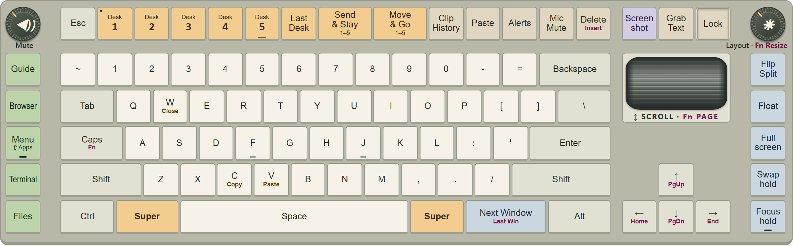

# Omar Keyboard

Historical draft. [Current revision](../../docs/design/keymap.md).

**Tap Desk 3 to go there. Tap Send & Stay, then Desk 3 to send a window there while you keep working. Hold Focus and press an arrow to choose a neighboring window.** Omar gives those everyday Omarchy actions physical labels while preserving US QWERTY, a full number row and Super under either thumb.

[Try the interactive layout or print the full-size fit template](../../docs/prototype/OMAR-KEYBOARD-PROTOTYPE.html)

## Where actions live

| Location | Controls and behavior |
| --- | --- |
| Left edge, top down | **Guide, Browser, Menu, Terminal, Files.** Menu sits at home-row height. Shift + Menu opens the app grid. |
| Across the top | **Esc, Desk 1–5, Last Desk, Send & Stay, Move & Go, Clip History, Paste, Alerts, Mic Mute, Delete, Screenshot, Grab Text, Lock.** Desk 5 has a tactile mark. Delete sits over Backspace. Lock has a recessed cap and a guarding rim. |
| Right edge, top down | **Flip Split, Float, Fullscreen, Swap, Focus.** Hold Swap or Focus while pressing an arrow. Releasing either key ends the gesture. Brushing either cap alone has no effect. |
| Bottom row | **Ctrl, Super, Space, Super, Next Window, Ctrl.** Next Window cycles on the current desk. Shift reverses the cycle. Fn + Next Window returns to the most recently focused other window on this desk with the optional host binding. |
| Top-left dial | Turn for speaker volume. Press to mute or unmute speakers. **Mic Mute** controls the input separately. |
| Top-right dial | Turn for screen brightness. Press for workspace layout. Hold Fn and turn to move the horizontal split boundary. External brightness uses Omarchy’s DDC path on compatible monitors. |
| Wide roller above the arrows | Pull toward you to scroll down, push away to scroll up. Hold Fn to send Page Down or Page Up to the keyboard-focused app. Ordinary rolling uses pointer-wheel routing. |

## When an application asks for F5 or Alt

**Tap Caps for Caps Lock. Hold Caps for Fn.** Pressing a second key while Caps is held selects Fn immediately. A solitary press shorter than 200 ms toggles Caps Lock. This timing is a prototype starting value.

| With Fn held | Output |
| --- | --- |
| Typing digits 1 through 0, then minus and equals | F1 through F12. For example, Fn + 2 gives F2 rename, Fn + 5 gives F5, and Fn + = gives F12. |
| Left / Right arrow | Home / End |
| Up / Down arrow | Page Up / Page Down |
| Delete | Insert |
| Left / Right Super | Actual left / right Alt. The active layout determines whether Right Alt acts as AltGr. |

For shell word movement, hold Caps, hold left Super, release Caps, then tap **B** or **F** while Super is still down. Releasing Caps first also makes ordinary arrows and digits available under Alt. Release the Super switch to release Alt. To record the screen, use that Alt with Screenshot. On an AltGr layout, use right Super the same way with a third-level character. Omarchy supports Alt + Space or held Right Alt when a dictation backend is installed. [Omarchy dictation bindings](https://github.com/omacom/omarchy/blob/v4.5.0/default/hypr/bindings/dictation.lua)

## Moving between windows and desks

A transfer accepts **one of the five labeled Desk keys within three seconds**. Esc or a second press of the same transfer cancels it. The other transfer replaces it and starts a fresh timer. A typing key cancels and types once. An arrow cancels and moves the caret. Last Desk cancels and visits the previous desk on this monitor. After expiry a Desk press simply visits. Destination lights follow the pending state.

Five desks are directly available per monitor. On stock Omarchy, Super + 6 through 0 stay available, Super + Tab visits the next workspace, and Super + Shift + Tab goes back. The optional five-desk setting confines keyboard workspace traversal and numbered transfers to the five labeled destinations. [Omarchy window and workspace bindings](https://github.com/omacom/omarchy/blob/v4.5.0/default/hypr/bindings/tiling.lua)

**A keyboard-only example.** With an editor and browser on Desk 1, tap Next Window to focus the browser. Press Send & Stay then Desk 3. The editor stays in view. Tap Desk 3, take a Screenshot, then tap Last Desk to return to the editor. To continue working in the browser as it moves, use Move & Go.

## Build status

The browser mockup exercises the gestures and prints a two-sheet fit template. A QMK pilot handles transfer timing and window gestures. Optional Omarchy bindings provide the Guide, last-focused window and a fallback microphone key. A separate bridge supplies host-confirmed desk and microphone state to a Raw HID receiver.

The design has **90 keys, two dial presses and three rotary encoders**. A lit build needs **27 GPIO** with the proposed wiring. The original Pico fits the unlit prototype. A bare RP2040 fits the lit board. Reach, roller mechanics, external brightness, USB startup and on-device feedback still need hands-on tests.

[Physical layout and stock shortcut map](OMAR-TKL-PERIMETER.md) · [UX review and acceptance tests](OMAR-UX-REVIEW.md) · [Pilot build and host setup](OMAR-BUILD-PILOT.md) · [Controller and pin budget](KEYBOARD-CONTROLLERS-AND-FIRMWARE.md)
