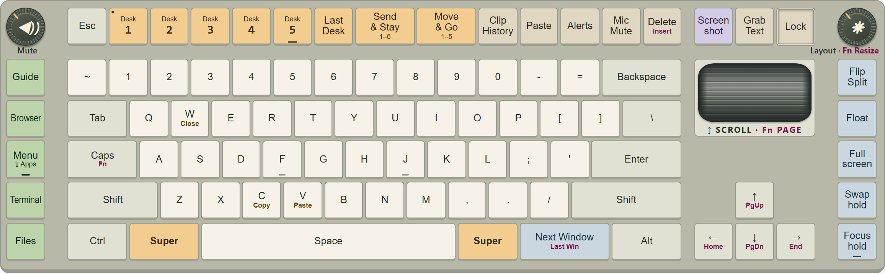

# Omar Keyboard layout and output map

Historical draft. [Current revision](../../docs/design/keymap.md).

The center keeps staggered US QWERTY, a complete number row and separate arrows. Launchers sit on the left, workspaces across the top and window controls on the right. The function row’s physical positions serve desktop actions. Caps/Fn restores all twelve function keys.

## Dimensions for the first fit test

| Feature | Prototype dimension or treatment |
| --- | --- |
| Key pitch and width | 19.05 mm per unit (u). The 21.25u control span is 404.81 mm before case borders, 3u or 57.15 mm wider than the 18.25u TKL reference. |
| Outer columns | One 1u column per side. A 0.5u gap, about 9.53 mm, separates each column from the nearest main cluster. Try a different cap texture on the rails. |
| Bottom row, left to right | Ctrl 1.5u · Super 1.75u · Space 6.25u · Super 1.5u · Next Window 2.25u · Ctrl 1.75u. Against the prior layout, the inner edge of Next Window moves 1u toward center and its center moves 0.625u, about 12 mm, relative to the typing block. |
| Top edge | Two pushable dials and 17 keys. Esc sits above the grave key. Desks align with digits 1–5. Last Desk borders Desk 5. Send & Stay and Move & Go each use a 1.5u cap. |
| Tactile landmarks | Bars on F/J, Menu, Focus and Desk 5. A recessed Lock and raised rim separate locking from capture and the right dial. Engrave dial press legends on the case. |
| Roller | 3u × 2u module envelope, 57.15 × 38.10 mm including end supports. Trial a 42–46 mm textured tread within it. Support the axle at both ends and couple it to an unloaded encoder. Start with light detents. Barrel diameter, cutout and bearings await fit and friction trials. |

Open the [prototype](../../docs/prototype/OMAR-KEYBOARD-PROTOTYPE.html), choose **Print full-size fit template**, print the two sheets in landscape at 100% and measure the 100 mm bars before joining them. The drawing locates the controls. A plate drawing needs the actual switch, encoder, barrel, bearing and stabilizer dimensions.

## What the board sends

Super is the everyday desktop modifier. Dedicated actions can send any modifier internally, including Alt. The target below is Omarchy **v4.5.0** with stock bindings enabled and an ANSI physical number row. Owners who have rebound a stock action can adapt the corresponding firmware output.

| Physical control | Host input |
| --- | --- |
| Desk 1–5, Last Desk | Super + matching physical digit, Super + Ctrl + Tab |
| Send & Stay → Desk n | Super + Shift + Alt + digit n. The window moves and the source workspace stays visible. |
| Move & Go → Desk n | Super + Shift + digit n. The window and view move together. |
| Next Window, Shift + Next Window | Alt + Tab, Alt + Shift + Tab. Each press cycles once on the current workspace. |
| Hold Focus / Swap + arrow | Super + arrow / Super + Shift + arrow. If both controls are held, Focus takes priority. |
| Flip Split, Float, Fullscreen, right dial press | Super + J, Super + T, Super + F, Super + L |
| Fn + right dial counterclockwise / clockwise | Super + physical minus / equals. Omarchy requests horizontal resize by −100 / +100. The visible result depends on the layout and neighboring tiles. |
| Browser, Menu, Terminal, Files | Super + Shift + B, Super + Space, Super + Return, Super + Shift + F |
| Shift + Menu | Super + Alt + Space, the app grid |
| Clip History, Paste, Alerts | Super + Ctrl + V, Super + V, Super + Shift + Alt + comma |
| Delete, Screenshot, Grab Text, Lock | Delete, Print Screen, Super + Ctrl + Print Screen, Super + Ctrl + L |
| Volume, speaker mute, brightness | Volume Down/Up, Audio Mute, Brightness Down/Up. Each detent sends one step. |
| Mic Mute | Native XF86AudioMicMute when the device exposes it. The QMK pilot uses F15 and the optional binding to the same Omarchy command. |
| Guide, Fn + Next Window | F13 opens the local key guide. F14 recalls the most recent other window on this desk. These use the optional host bindings. Super + K opens the stock shortcut list. |
| Roller down / up | USB wheel down / up. With Fn, Page Down / Page Up to the keyboard-focused application. |
| Super + W / C / V | Close window / universal copy / universal paste. Key fronts carry the respective legends. |

[Window and workspace commands](https://github.com/omacom/omarchy/blob/v4.5.0/default/hypr/bindings/tiling.lua) · [Launchers](https://github.com/omacom/omarchy/blob/v4.5.0/default/hypr/bindings/applications.lua) · [Menu, notifications, capture and lock](https://github.com/omacom/omarchy/blob/v4.5.0/default/hypr/bindings/utilities.lua) · [Universal clipboard](https://github.com/omacom/omarchy/blob/v4.5.0/default/hypr/bindings/clipboard.lua) · [Media bindings](https://github.com/omacom/omarchy/blob/v4.5.0/default/hypr/bindings/media.lua)

## Scroll routing and external displays

Omarchy v4.5.0 sets `input:follow_mouse` to 1 and `cursor:warp_on_change_workspace` to 1. Its shipped defaults, stock configuration and themes inspected for this review contain no explicit `cursor:no_warps` override. Hyprland’s documented default for that option is false. Workspace modes and personal settings can change effective behavior. Inspect the installed values with `hyprctl getoption input:follow_mouse`, `hyprctl getoption cursor:no_warps` and `hyprctl getoption cursor:warp_on_change_workspace`. A workspace-change warp alone does not establish which pane every application will scroll. [Omarchy input](https://github.com/omacom/omarchy/blob/v4.5.0/default/hypr/input.lua) · [Cursor configuration](https://github.com/omacom/omarchy/blob/v4.5.0/default/hypr/looknfeel.lua) · [Hyprland option definitions](https://wiki.hypr.land/configuring/core/config-options/)

Use ordinary rolling for continuous scrolling under the pointer. With the pointer over a terminal and a document focused, use Fn + roller for keyboard paging in the document. The application decides what Page Up/Down does. On an external monitor, check that DDC/CI is enabled and accessible and test which display changes on a multi-monitor setup. Omarchy already provides a DDC path. Fn + turn remains useful for tiled window resizing on displays with fixed brightness. [Brightness selection](https://github.com/omacom/omarchy/blob/v4.5.0/bin/omarchy-brightness-display) · [DDC implementation](https://github.com/omacom/omarchy/blob/v4.5.0/bin/omarchy-brightness-display-ddc)
