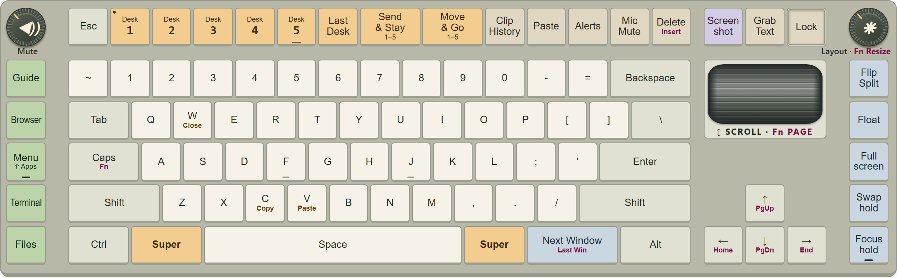

# Keymap and window controls

**Tap Desk 3 to go there. Tap Send & Stay, then Desk 3 to send a window there while you keep working. Hold Focus and press an arrow to choose a neighboring window.** Omar gives those everyday Omarchy actions physical labels while preserving US QWERTY, a full number row, Super under either thumb and a real Alt key.

[Try the interactive layout or print the full-size fit template](../prototype/OMAR-KEYBOARD-PROTOTYPE.html)

## Where actions live

| Location | Controls and behavior |
| --- | --- |
| Left edge, top down | **Guide, Browser, Menu, Terminal, Files.** Menu sits at home-row height. Shift + Menu opens the app grid. |
| Across the top | **Esc, Desk 1–5, Last Desk, Send & Stay, Move & Go, Clip History, Paste, Alerts, Mic Mute, Delete, Screenshot, Grab Text, Lock.** Desk 5 has a tactile mark. Delete sits over Backspace. Lock has a lower, recessed cap and a heavier 80 gf switch. |
| Right edge, top down | **Flip Split, Float, Fullscreen, Swap, Focus.** Hold Swap or Focus while pressing an arrow. Releasing either key ends the gesture. Brushing either cap alone has no effect. |
| Bottom row | **Ctrl, Super, Space, Super, Next Window, Alt.** Next Window cycles on the current desk. Shift reverses the cycle. Fn + Next Window returns to the most recently focused other window on this desk with the optional host binding. Alt sits left of the left arrow and sends Right Alt. Left Ctrl is the only Ctrl. |
| Top-left dial | Turn for speaker volume. Press to mute or unmute speakers. **Mic Mute** controls the input separately. |
| Top-right dial | Turn for screen brightness. Press for workspace layout. Hold Fn and turn to move the horizontal split boundary. External brightness uses Omarchy’s DDC path on compatible monitors. |
| Wide roller above the arrows | Pull toward you to scroll down, push away to scroll up. Hold Fn to send Page Down or Page Up to the keyboard-focused app. Ordinary rolling uses pointer-wheel routing. |

## Caps, Fn and Alt

**Tap Caps for Caps Lock. Hold Caps for Fn.** Pressing a second key while Caps is held selects Fn immediately. A solitary press shorter than 200 ms toggles Caps Lock. This timing is a prototype starting value. Fn does only what is printed on the keys, in one dedicated Fn legend colour. Every other key is unchanged while Fn is held.

| With Fn held | Output |
| --- | --- |
| Left / Right arrow | Home / End |
| Up / Down arrow | Page Up / Page Down |
| Delete | Insert |
| Next Window | Last Window |
| Right dial turn | Resize split |
| Roller | Page Up / Page Down to the focused app |

The Super legends (Close, Copy, Paste on W, C and V) use a second, amber legend colour so the two kinds of secondary legend are not confused.

**Omar deliberately has no function keys.** There are no F1–F12 legends and nothing on the Fn layer produces them. Digits, minus and equals type normally with Caps held. An application whose function-key shortcuts matter must be rebound inside that application. The board keeps three private input codes for Guide, Last Window and the microphone fallback. They are internal and are never labeled for the user.

**Alt.** The right-hand bottom key sends Right Alt and replaces the right Ctrl. With the right hand on the arrows, Alt gives Alt + Left/Right for browser history, Alt + B, F and period for shell word movement, and Alt + Screenshot for screen recording. Held Right Alt is Omarchy’s dictation push-to-talk when a backend is configured, and Alt + Space toggles dictation. On layouts that use it, Right Alt is AltGr. Fn does not change either Super key. [Omarchy dictation bindings](https://github.com/omacom/omarchy/blob/v4.5.0/default/hypr/bindings/dictation.lua)

## Moving between windows and desks

A transfer accepts **one of the five labeled Desk keys within three seconds**. Esc or a second press of the same transfer cancels it. The other transfer replaces it and starts a fresh timer. A typing key cancels and types once. An arrow cancels and moves the caret. Last Desk cancels and visits the previous desk on this monitor. Focus, Swap and the dial presses also cancel. Modifier presses, holding Caps and dial or roller turns do not cancel, so Shift then Desk 3 still completes and turning the volume keeps the transfer. After expiry a Desk press simply visits. Destination lights follow the pending state.

Five desks are directly available per monitor. On stock Omarchy, Super + 6 through 0 stay available, Super + Tab visits the next workspace, and Super + Shift + Tab goes back. The optional five-desk setting confines keyboard workspace traversal and numbered transfers to the five labeled destinations. [Omarchy window and workspace bindings](https://github.com/omacom/omarchy/blob/v4.5.0/default/hypr/bindings/tiling.lua)

**A keyboard-only example.** With an editor and browser on Desk 1, tap Next Window to focus the browser. Press Send & Stay then Desk 3. The editor stays in view. Tap Desk 3, take a Screenshot, then tap Last Desk to return to the editor. To continue working in the browser as it moves, use Move & Go.

## Finding the controls by touch

The two outer rails sit half a key unit away from their neighbors. The Next Window cap is 2.25u wide, bringing its center about 12 mm closer to the typing block than in the earlier layout. F, J, Menu, Focus and Desk 5 carry tactile bars. Lock sits about 2 mm lower than its neighbors and uses an 80 gf switch. The 404.81 mm switch field makes both thumb reach and the distance to a mouse worth checking on paper. Use **Print full-size fit template** in the prototype and measure both 100 mm scale bars.

## What the board sends

Super is the everyday desktop modifier. Dedicated actions can send any modifier internally, including Alt. The Alt key sends Right Alt (Alt + arrows, Alt + Screenshot for screen recording, held for dictation push-to-talk, AltGr where the layout uses it). The target below is Omarchy **v4.5.0** with stock bindings enabled and an ANSI physical number row. Owners who have rebound a stock action can adapt the corresponding firmware output.

| Physical control | Host input |
| --- | --- |
| Desk 1–5, Last Desk | Super + matching physical digit, Super + Ctrl + Tab |
| Send & Stay → Desk n | Super + Shift + Alt + digit n. The window moves and the source workspace stays visible. |
| Move & Go → Desk n | Super + Shift + digit n. The window and view move together. |
| Next Window, Shift + Next Window | Alt + Tab, Alt + Shift + Tab. Each press cycles once on the current workspace. |
| Hold Focus / Swap + arrow | Super + arrow / Super + Shift + arrow. If both controls are held, Focus takes priority. |
| Flip Split, Float, Fullscreen, right dial press | Super + J, Super + T, Super + F, Super + L |
| Fn + right dial counterclockwise / clockwise | Super + physical minus / equals. Omarchy requests horizontal resize by −100 / +100. The visible result depends on the layout and neighboring tiles. |
| Browser, Menu, Terminal, Files | Super + Shift + B, Super + Space, Super + Return, Super + Shift + F |
| Shift + Menu | Super + Alt + Space, the app grid |
| Clip History, Paste, Alerts | Super + Ctrl + V, Super + V, Super + Shift + Alt + comma |
| Delete, Screenshot, Grab Text, Lock | Delete, Print Screen, Super + Ctrl + Print Screen, Super + Ctrl + L |
| Volume, speaker mute, brightness | Volume Down/Up, Audio Mute, Brightness Down/Up. Each detent sends one step. |
| Mic Mute | Native XF86AudioMicMute when the device exposes it. The QMK pilot uses private code 15 (F15 to the host) and the optional binding to the same Omarchy command. |
| Guide, Fn + Next Window | Private code 13 (F13 to the host) opens the local key guide. Private code 14 (F14) recalls the most recent other window on this desk. These use the optional host bindings. Omar has no user-facing function keys. Super + K opens the stock shortcut list. |
| Roller down / up | USB wheel down / up. With Fn, Page Down / Page Up to the keyboard-focused application. |
| Super + W / C / V | Close window / universal copy / universal paste. Key fronts carry the respective legends. |

[Window and workspace commands](https://github.com/omacom/omarchy/blob/v4.5.0/default/hypr/bindings/tiling.lua) · [Launchers](https://github.com/omacom/omarchy/blob/v4.5.0/default/hypr/bindings/applications.lua) · [Menu, notifications, capture and lock](https://github.com/omacom/omarchy/blob/v4.5.0/default/hypr/bindings/utilities.lua) · [Universal clipboard](https://github.com/omacom/omarchy/blob/v4.5.0/default/hypr/bindings/clipboard.lua) · [Media bindings](https://github.com/omacom/omarchy/blob/v4.5.0/default/hypr/bindings/media.lua)

## Scroll routing and external displays

Omarchy v4.5.0 sets `input:follow_mouse` to 1 and `cursor:warp_on_change_workspace` to 1. Its shipped defaults, stock configuration and themes inspected for this review contain no explicit `cursor:no_warps` override. Hyprland’s documented default for that option is false. Workspace modes and personal settings can change effective behavior. Inspect the installed values with `hyprctl getoption input:follow_mouse`, `hyprctl getoption cursor:no_warps` and `hyprctl getoption cursor:warp_on_change_workspace`. A workspace-change warp alone does not establish which pane every application will scroll. [Omarchy input](https://github.com/omacom/omarchy/blob/v4.5.0/default/hypr/input.lua) · [Cursor configuration](https://github.com/omacom/omarchy/blob/v4.5.0/default/hypr/looknfeel.lua) · [Hyprland option definitions](https://wiki.hypr.land/configuring/core/config-options/)

Use ordinary rolling for continuous scrolling under the pointer. With the pointer over a terminal and a document focused, use Fn + roller for keyboard paging in the document. The application decides what Page Up/Down does. On an external monitor, check that DDC/CI is enabled and accessible and test which display changes on a multi-monitor setup. Omarchy already provides a DDC path. Fn + turn remains useful for tiled window resizing on displays with fixed brightness. [Brightness selection](https://github.com/omacom/omarchy/blob/v4.5.0/bin/omarchy-brightness-display) · [DDC implementation](https://github.com/omacom/omarchy/blob/v4.5.0/bin/omarchy-brightness-display-ddc)

The [hardware specification](../../hardware/specification.md) gives cap widths, reach distances and the roller geometry. The [validation plan](validation.md) covers fit and live desktop behavior.
