# Omar-Keyboard assembly design specification

**Revision 16 · B.2 motherboard, T3 roller and T4 assembly · Engineering prototype · 18 November 2026**

A wired US QWERTY keyboard for Omarchy. Five desk keys give windows a physical destination, the right rail puts tile controls beside the arrows, and a wide roller scrolls long pages. This specification describes how the controls fit, connect and come apart in the full-size custom PCB build.

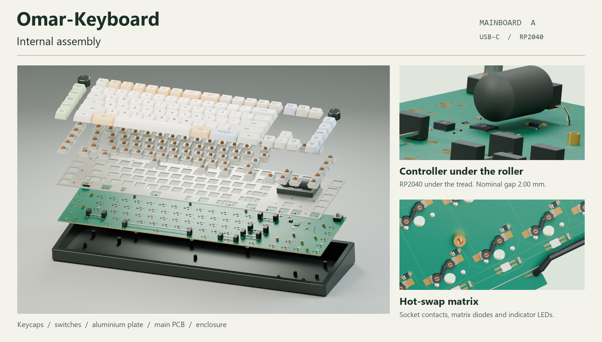

**Figure 1.** The exploded model separates the keycaps, switches, plate, populated motherboard and tray. The USB carrier sits behind Desk 3. Frame 1 of the Blender model closes the stack. Frame 61 opens it.

**Design status.** Dimensions marked **baseline** control the first sample. A **proposal** is a modeled placement or an integration choice that still needs a trial. An **open** item needs a part selection, drawing or measurement before fabrication. The full-size Rev A mainboard has a routed KiCad layout, drill files and a compiled QMK target. Its outline, holes, pads, tracks and component centers register the assembled Blender model. The routed T4 carrier is documented on sheet 20. Purchased-part tolerances and the first physical assembly still need validation. [Mainboard verification](mainboard/verification.md)

**Current electrical build.** Use the Rev B.2 mainboard, T3 encoder card and T4 USB-C carrier. B.2 adds R12/R13 and retains the B.1 switch, dial and 90-LED placements. The 403-placement quote pertains to B.1. See sheets 19–19B for B.2. [Rev B.2 project and fabrication files](mainboard-rev-b2/README.md) · [Encoder card](roller-encoder-card/README.md)

**Current mechanical build.** Use the T4 closed assembly and tray with the T3 plate and roller. Sheets 20–20C control the carrier, collars, cap rims, knob bores and clearances. [Full SolidWorks exchange assembly](mechanical-rfq/rev-b2-t4/Omar-Keyboard-full-T4.step)

**SolidWorks model.** [Datums and mates](#solidworks) · [Fitted parts](#cad-parts) · [Key stations](#cad-stations) · [Controller placements](#cad-logic) · [Verification](#cad-verification)

**At the bench.** [Fastener map](#bench-map) · [Build](#bench-build) · [Open the tray](#bench-open) · [Repair by part](#bench-repair) · [Proposed refinements](#bench-refinements)

**Current build register.** Sheets 21–21C list all nine assemblies. Sheets 22–22B give the revised fabrication inputs, software defaults and first-article acceptance tests. [Full T4 STEP](mechanical-rfq/rev-b2-t4/Omar-Keyboard-full-T4.step) · [Editable T4 assembly](mechanical-rfq/rev-b2-t4/Omar-Keyboard-full-T4.blend) · [T4 tray STL](mechanical-rfq/rev-b2-t4/T4-One-piece-tray.stl).

## 01 / Assembly map and design datums

The assembly identifiers below belong to this specification. Use them on sample measurements and fit photographs so a change to one part can be traced to its mating part.

| ID | Installed assembly | Interface to check first |
| --- | --- | --- |
| A1 | One-piece tray, feet and mounting hardware, with an optional split and joiner | Plate perimeter, support heights and rear port pocket |
| A2 | Switch plate | MX clips, stabilizer openings and roller brackets |
| A3 | Switches, stabilizers and keycaps | PCB pin alignment, wire sweep, cap travel and legends |
| A4 | Volume and brightness dials | PCB feet, plate openings, shaft height and cap clearance |
| A5 | Scroll barrel, bearing, encoder and bezel | Barrel runout, shaft engagement and moving clearances |
| A6 | Motherboard, scan matrix and service controls | Plate registration, underside sockets, clock and power |
| A7 | USB-C carrier, protection and four-wire harness | Rear plug fit, retention, data pair and protected VBUS |
| A8 | 90 per-key LEDs, including 15 status indicators, data buffer and switched LED rail | Switch windows, firmware index and 5 V budget |
| A9 | QMK firmware and Omarchy host integration | Physical input, host action and visible feedback |

**Plan datum.** Origin is the upper-left corner of the volume dial's 1u cell. Positive x runs right. Positive y runs toward the typist. All switch coordinates locate centers. The pitch is 19.05 mm. Heights use the plate top as z = 0, with positive z above the plate. Quoted z dimensions refer to the typing plane. Desk heights refer to the supporting surface.

| Plan feature | Baseline, mm unless shown |
| --- | --- |
| Switch field | 404.81 × 119.06 (21.25u × 6.25u) |
| Row top edges, back to front | 0, 1.25, 2.25, 3.25, 4.25, 5.25u |
| Typing block | x = 28.58 to 314.33 (15u) |
| Rail centers | x = 9.53 and 395.29. Each rail has a 9.53 gap from its neighbor |
| Arrow cluster | x = 319.09 to 376.24. The gap from the typing block is 4.76 |
| Plate and motherboard | 405.81 × 120.06, R1 corners |
| Outside of case | 422.8 × 137.1, R4 corners, nominal 6° typing angle |

Use the [switch register](layout/omar-switches.csv) for all 92 centers, widths, scan addresses and Rev A indicator indices. Use the sheet 07A register for Rev B.1 lighting. The [dimensioned top view](../docs/assets/omar-dimensions.svg) and [layout exchange file](layout/omar-kle.json) use the same origin.

## 01A / Exterior elevations

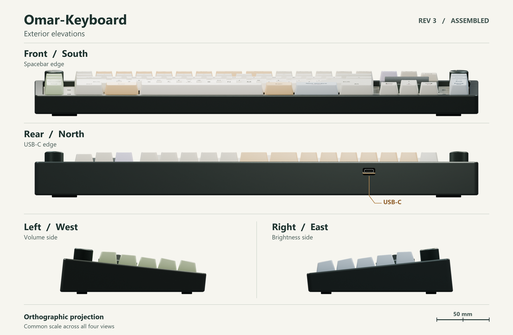

**Figure 1A.** All four cameras are level with the desk and use the same scale. With the typist seated at the spacebar, north is the rear USB-C edge, south is the front, west is the volume side and east is the brightness side.

The rear view locates the USB-C opening behind Desk 3. It appears to the viewer's right of center when looking at the back. The opposite side views show the 6° typing angle and how the tray meets the feet. The 50 mm bar applies to every view on the sheet.

**Full-resolution renders.** [Front](../docs/assets/omar-elevation-front.png) · [Rear](../docs/assets/omar-elevation-rear.png) · [Left](../docs/assets/omar-elevation-left.png) · [Right](../docs/assets/omar-elevation-right.png)

## 02 / A1 and A2 · Enclosure, plate and supports

**Tray.** Provide 8 mm nominal walls, 0.5 mm plate clearance per side and four 2 mm feet. The supplied tray STL is a one-piece shell in desk orientation, with the exterior floor at STL z = 0. The STL bounding box in print orientation is 422.80 × 139.43 × 32.04 mm (width × bed depth × height). The 137.10 mm case depth is measured in the tilted plate plane. A split near x = 200 and an internal joining bar are an optional redesign for smaller printers. Dry-fit on a flat surface and check the joint, rocking, and the center of the typing span under load. Keep the joiner, inserts and screw ends clear of solder joints and stabilizer wires. Joiner section, insert dimensions, screw lengths and tightening torque remain open.

| z from plate top | Layer or feature |
| --- | --- |
| +23 nominal / about +14 | Rev B.1 dial top / typical R3 cap top. Roller crown is +14 |
| +8 / +6 / +5 | Bezel top / roller axle / case lip |
| 0 to −1.5 | Finished 5052 aluminum plate. An FR4 pilot plate is 1.6 thick |
| −2 / −5 | Roller bottom / motherboard top. Nominal gap is 3 |
| −5 to −6.6 | 1.6 FR4 motherboard |
| −8.4 / −10.4 | Socket underside / target inner floor. Nominal clearance is 2 |
| −12.9 | Nominal outside of a 2.5 floor |

At 6° with feet fitted, the estimated front and back heights are 20 and 34 mm. The appearance model uses a desk-parallel floor. Check actual clearance across the whole cavity, especially at the front sockets, under the joiner and beside the rear carrier. The T4 underside screen gives 3.126 mm minimum vertical socket clearance at SW88. The 2 mm target applies to the first physical assembly, including solder and board deflection.

**Plate.** Cut 92 openings of 14.00 × 14.00 mm (+0.05/−0) for 90 MX housings and the two dial bodies. Add the twelve 6.6 × 12.2 stabilizer reliefs (two per stabilized key), the T3 44.40 × 13.50 R0.55 roller opening, four roller support fixings and the main mounting holes below. Match stabilizer openings to the selected housing. Test clips in the actual stock before cutting the full plate. A nominal 0.063-inch sheet is approximately 1.60 mm.

| Shared plate / PCB mounts | Centers (x, y), mm |
| --- | --- |
| Left and right rail gaps, 6 total | x = 23.81 or 381.00, each at y = 33.34, 71.44 and 109.54 |
| Top gap, 3 total | x = 85.73, 171.45 and 257.18, all at y = 21.43 |
| Arrow area, 3 total | (347.66, 71.44), (328.61, 90.49), (366.71, 90.49) |

**Mounting schedule.** H1–H3 follow the left rail from rear to front. H4–H6 follow the right rail. H7–H9 follow the top gap from left to right. H10–H12 follow the three arrow-area positions in table order. H13 (66.68, 42.86) and H14 (190.50, 61.91) support the PCB only. All 14 board holes are Ø2.20 mm. Only H1–H12 pass through the plate.

## 02A / A1 and A2 · Tray and fixing dimensions

| Mating features | Rev A nominal dimensions, mm |
| --- | --- |
| Tray to assembly | 422.8 × 137.1 outside, R4. Opening at plate sides 406.81 × 121.06, R1.5. Plate and PCB 405.81 × 120.06, R1. Lateral clearance 0.50 per side. Lip z = +5.00 |
| Floor and feet | One-piece desk-parallel floor, 2.50 thick. Floor bottom/top are 2.00/4.50 above desk. Four rounded 24 × 10 foot envelopes centered at desk x = ±183 and y = ±50 about case center. Visible foot height 2.00 |
| H1–H14 tray bosses | Ø6.30 at base, taper through Ø5.50 to Ø4.90. Top z = −9.82. Axial pilot Ø2.24. Base follows floor. Select insert or fastener and finish the pilot to its supplier drawing |
| Lower spacers | 14 × Ø4.30 outside, Ø2.20 bore, 3.20 tall, z = −9.80 to −6.60. The 0.02 modeled seating allowance closes in the hardware stack. Check all spacers support the board without bow |
| Upper spacers | H1–H12 only, Ø4.10 outside, Ø2.20 bore, 3.50 tall, z = −5.00 to −1.50. The two interior supports end at the PCB |
| Enter stabilizer | The tray leaves (278.60, 80.96) clear. The adjoining Ø3.70 HS6 through-bore is at (280.95, 79.695), just 2.67 center-to-center from the omitted post. Check screw head and wire sweep on assembly |
| USB carrier pocket | T4 relief X84.40–106.10, field Y−8.13 to +1.38, floor Z−10.35. Exterior port 12 × 7, R1.4. Carrier and saddle interfaces are on sheets 06A and 20A |
| Optional split | The printable mesh contains one connected shell, 14 motherboard bosses, two webbed USB carrier posts and three open cable saddles. Insert type/depth, tray screw lengths, split joint and tightening torque require a material sample |

[Current T4 tray STL](mechanical-rfq/rev-b2-t4/T4-One-piece-tray.stl) · [Closed T4 assembly](mechanical-rfq/rev-b2-t4/Omar-Keyboard-full-T4.step).

## 03 / A3 · Switches, stabilizers and cap set

Install **89 Gateron G Pro 3.0 Brown five-pin switches** and **one CHERRY MX Linear Grey (MX1A-21NW) for Lock** in the first sample. Orient all 90 switches north over the underside hot-swap sockets. The two dial presses are separate encoder contacts. Sheet 03A gives the switch dimensions, force ratings and fit checks.

| Cap width | Installed | Special positions to check |
| --- | --- | --- |
| 1u | 75 | Includes DSA Lock and all four arrows |
| 1.5u | 6 | Two R1 transfers, Tab, backslash, Ctrl and right Super |
| 1.75u | 3 | Caps, left Super and R4 right Ctrl |
| 2u | 1 | Backspace |
| 2.25u | 3 | Enter, left Shift and R4 Next Window |
| 2.75u / 6.25u | 1 each | Right Shift / Space |

The set totals **107u**, including the separate 1u Lock. Use nominal 1.5 mm PBT with shine-through primary legends as specified on sheet 07A. Top and number rows use Cherry R1, QWERTY uses R2, home uses R3, and Shift, bottom and arrows use R4. Rails follow the row they occupy. Lock uses a DSA cap with a target top about 2 mm below adjacent caps. Confirm both the recess and switch force with a finger moving from the right dial.

| Stabilized key | Center (x, y), mm | Wire spacing, mm |
| --- | --- | --- |
| Backspace / Enter | (295.28, 33.34) / (292.89, 71.44) | 23.88 each |
| Left Shift / right Shift | (50.01, 90.49) / (288.13, 90.49) | 23.88 each |
| Next Window / Space | (259.56, 109.54) / (150.02, 109.54) | 23.88 / 100.0 |

Use six PCB screw-in stabilizer pairs on the custom board. Backspace, Enter, both Shifts and Next Window require five short wires. Fit Space and Next Window with the modeled inward orientation for the first trial. Check wire sweep, screw heads, socket pads and interior standoffs with each key fully depressed. Each wide cap must return freely after a press at either end.

**Legends and touch.** Homing bars go on F, J, Menu, Focus and Desk 5. Use 4 mm primary glyphs, 2.8 mm words on up to two lines, and 1.9 mm secondary legends. Fn uses plum (#7a1346). Super uses dark amber (#6b3d00) for Close, Copy and Paste on W, C and V. Proof vendor colors, unusual cap widths and tactile bars against the [legend and color schedule](specification.md#keycaps).

## 03A / A3 · Switch selection and dimensions

**Typing and Omarchy controls.** Fit Gateron G Pro 3.0 Brown, five-pin PCB mount, on all 89 keys except Lock. The tactile bump gives Focus, the five desk keys and the typing block consistent feedback. Gateron specifies 55 ±15 gf operating force, 2.0 ±0.6 mm pretravel and 4.0 mm maximum travel. The housing supports SMD indicators. The five-pin ordering code is **KS-9E10B055NW-Y51**. [Gateron specifications](https://www.gateron.com/products/gateron-g-pro-30-switch-set) · [Five-pin supplier listing](https://mechanicalkeyboards.com/products/gateron-g-pro-30-brown-55g-tactile-pcb-mount)

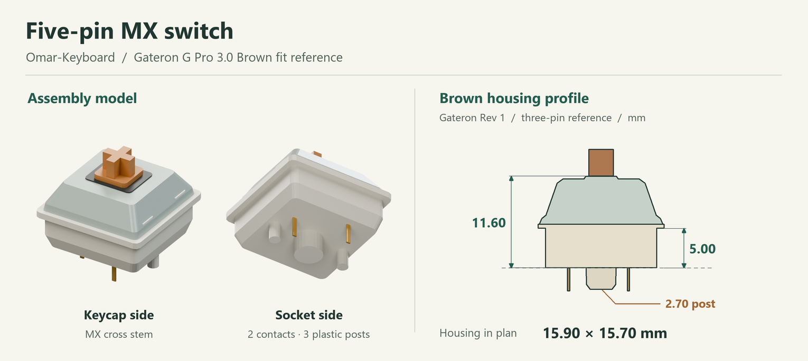

**Figure 1B.** The two renders show the nominal project model. The side profile and the Gateron dimensions below use the published Brown drawing, KS-9E10B055NN-Y51, Rev 1. This is the three-pin variant. Use its dimensions for housing clearance and confirm the ordered five-pin part on a coupon before releasing the footprint. [Gateron Brown drawing, page 1](https://cdn.shopify.com/s/files/1/0565/8070/2297/files/SPEC-KS-9E10B055NN-Y51__Rev-1_KS-9_G_Brown_Pro_3.0_Switch.pdf?v=1683623523)

| Feature | Dimension and datum |
| --- | --- |
| Brown housing | 15.90 × 15.70 mm in plan. Lower body 14.00 ±0.05 mm in both axes. The clips extend beyond the lower body |
| Brown side profile | 11.60 mm from base seating plane to upper shoulder. The free stem rises above it. The underside of the flange sits 5.00 mm above the seating plane. The center post extends 2.70 mm below it |
| Lock housing | CHERRY's MX series outline is 15.6 × 15.6 mm. Housing shoulder is 11.6 mm above the seating plane, with 3.6 mm of free stem above the shoulder |
| Keyboard interface | 19.05 mm pitch. Project plate opening 14.00 × 14.00 mm (+0.05/−0), plate thickness 1.50 mm, plate top to PCB top 5.00 mm |

**Lock.** Specify the higher-force linear MX1A-21NW with the recessed DSA cap. CHERRY rates this variant at 2.8 ozf actuation (about 79 gf). Holding the heavy feel to one key makes Lock harder to hit while reaching for brightness. Use actuation force when comparing substitutes. [CHERRY MX catalog, pp. 10-2 and 10-5](https://media.digikey.com/pdf/Data%20Sheets/Cherry%20PDFs/MX%20Series.pdf)

**First fit.** With the PCB supported, seat a five-pin Brown in the actual socket and plate coupon. Check that both locating pegs and both contacts enter freely, the clips latch and the housing sits flat. Press a north-facing home-row key with the intended Cherry-profile cap through its full travel and check LED visibility. Test the Lock cap's full return and resistance to a brush from the right dial.

## 04 / A4 and A5 · Dials and wide scroll roller

| Component | Placement and interface |
| --- | --- |
| Two push dials | Volume (9.53, 9.53), brightness (395.29, 9.53). Bourns PEC11R-4220F-S0024 (C143797), 24 detents / 24 pulses, Ø6 D shaft, nominal 20 mm shaft from mounting face |
| Knobs | Two knurled Ø18 × 12 knobs with set screws. Target top +23 mm with the uncut shaft and ≥1 mm to neighboring caps. Allow 10.5 mm shaft insertion and verify the set screw lands on the flat. Verify at full push and full rotation |
| Rev B.1 encoder mounting | Shaft-centered 12.5 × 13.4 mm body in the 14 mm plate opening. A 6.5 mm body plus a 20 mm shaft puts its tip at +21.5 mm with the PCB at −5. Check full 0.5 mm push travel. [Bourns drawing](https://www.bourns.com/docs/Product-Datasheets/PEC11R.pdf) |
| Dial labels | Mute on the left, Layout · Fn Resize on the right. Use 2.4 mm lettering in the 4.76 mm band below each dial |
| Roller envelope | T3 tread Ø16 × 42, X321.49–363.49, axis Y42.86 / Z+6.00 |
| Left bearing | MR63ZZ, Ø3 bore × Ø6 OD × 2.5 wide. Ø3 journal carried by R04, with the foot centred at T3 field X319.465. |
| Right drive | Alps EC11E15204A3, supported at the bushing and housing by R03/R05. Solder its metal lugs and terminals to a mounting card. See sheets 19–19B. |
| Bezel and harness | T3 hood, four underside M2 fixings shared with the supports. The card and dressed leads clear the hood and shaped P01 opening on sheets 19–19B. |

Use the T2 turned core with a silicone sleeve giving Ø16 finished tread. The selected non-push Alps has 30 detents and 15 pulses per turn. One detent should scroll one step, about 1.68 mm of tread. Pulling the upper surface toward the user scrolls down.

**Axial stack.** T3 uses a 42.00 mm tread, 12.00 mm of shaft engagement, a 2.00 mm shaft-tip allowance and a 1.00 mm nominal bushing-to-core gap. Sheet 19 locates both ends and defines sample limits.

Check that the roller encoder cannot rotate in its bracket when the user reverses direction. Confirm that repeated end loading cannot walk the barrel off the bearing or loosen the drive set screw. The four module holes use the coordinates on sheet 04B. Final bearing-seat tolerance, end float and shaft engagement depend on the purchased parts. The following section shows where to measure moving clearance.

## 04A / Roller section and fit trial

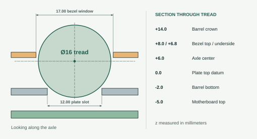

**Figure 2.** Mid-tread section from the concept model. The table gives horizontal clearance at selected heights. The T3 solid minima are 0.760 mm at the hood and 1.031 mm at the plate. Use sheet 19B for acceptance.

| Section plane | Barrel width at plane | Nominal opening | Clearance per side |
| --- | --- | --- | --- |
| Plate top, z = 0 | 10.58 | 12.00 | 0.71 |
| Bezel top, z = +8.0 | 15.49 | 17.00 | 0.75 |
| Bezel underside, z = +6.8 | 15.92 | 17.00 | **0.54** |

The values assume a concentric Ø16 barrel, square aperture edges and axle at z = +6. At any height z the barrel width is twice the square root of 8² − (z − 6)². Halving the difference between the opening and that width gives the static side clearance. The nominal crown stands 6 mm above the bezel. These values exclude shaft play, sleeve variation, print error and axle skew.

The earlier 16.00-wide opening left just 0.04 per side at the underside. The 17.00-wide revision provides another 0.50 per side while keeping the same axle and crown height.

**Fit trial.** Use the intended bearing, bracket and finished tread. Measure the barrel at the center and both ends. With the bezel installed, turn through a full revolution, first unloaded, then pressing near each end. Inspect the lower inside edge for rubbing and measure displacement. Trial an underside relief or revised aperture if needed. Recheck finger access and exposure after any shim or bezel change. Record the successful geometry before ordering a finished bezel.

## 04B / A5 and A6 · Controller beneath the tread

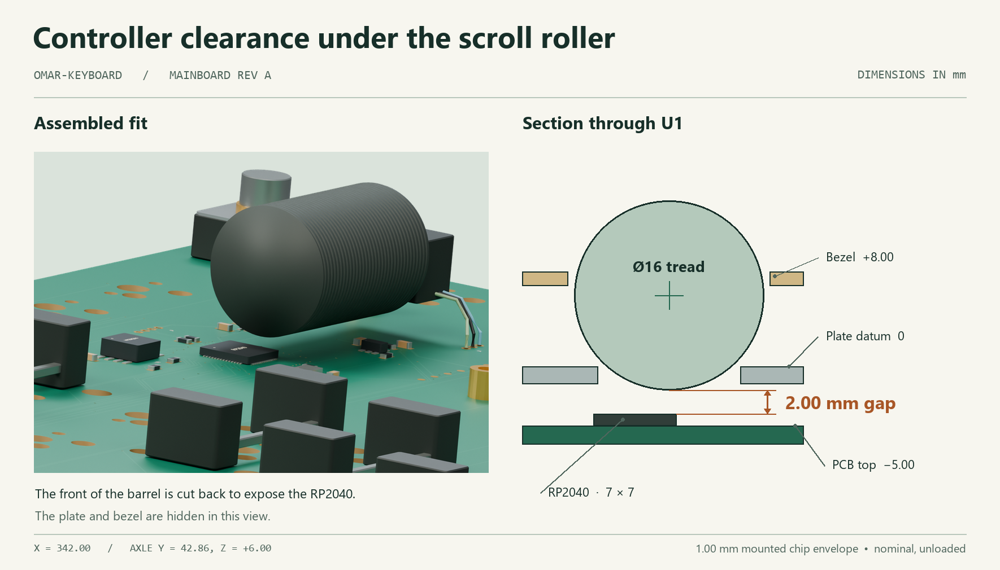

**Figure 2B.** The section cuts through U1 at x = 342.00. Its 7 × 7 body spans x = 338.50–345.50 and y = 36.50–43.50. The roller axle at y = 42.86 crosses the package. At that point the concentric Ø16 sweep reaches z = −2.00. The PCB top is −5.00. The fitted 1.00-high package reaches −4.00, leaving **2.00 mm** to the tread. The height budget uses the 0.90 maximum package height plus a conservative 0.10 assembly allowance. [RP2040 package drawing, Fig. 166](https://datasheets.raspberrypi.com/rp2040/rp2040-datasheet.pdf#page=608)

| Moving or clamped interface | Modeled dimensions, mm |
| --- | --- |
| Barrel and flash | U2 center (330, 32), body 5.30 × 5.30, mounted height 2.15. Its nearest y edge is 34.65, outside the tread projection starting at 34.86. Flash top −2.85 clears the plate underside −1.50 by 1.35 |
| T3 module fixing pattern | Four Ø2.20 through-holes in P01. Centre X319.465 or X369.665 crossed with Y27.26 or Y58.46. Pitch 50.20 × 31.20. The board has no module screw holes. |
| Bracket and bezel · concept section | Two 4.40 × 35.20 × 1.50 bracket feet. Four Ø4.60 posts span z = +1.50 to +6.80, with Ø1.60 modeled tapping pilot. M2 × 8 from plate underside gives 5.00 nominal engagement and 0.30 tip clearance below the bezel skin. Head envelope Ø3.80 × 1.10 reaches z = −2.60 |
| T3 encoder opening | Use the shaped passage in P01 T3. Its nearest webs to H4 and M4 are 3.391 and 2.133. |

**First article.** Measure installed U1 height, assembled axle height at both ends, maximum tread diameter and runout. Rotate through 360° while loading the center and both ends. Check for witness marks on the chip, plate and bezel and measure the smallest gap under load. The digital measurements describe the unloaded assembly.

## 05 / A6 · Rev A motherboard and switch matrix

The Rev A mainboard is a 405.81 × 120.06 × 1.60 mm two-layer FR4 board with R1 corners, nominal 1 oz copper and ENIG baseline finish. The native outline runs from (−0.50, −0.50) to (405.31, 119.56). It carries 2,277 routed segments, 180 through vias and two filled ground zones. The archived KiCad check reports zero rule violations and zero outstanding connections. The model takes X/Y geometry from the board export. See the [routed board](mainboard/omar-mainboard.kicad_pcb), [fabricator package](mainboard/Omar-Keyboard-Rev-A-quote.zip) and [verification record](mainboard/verification.md).

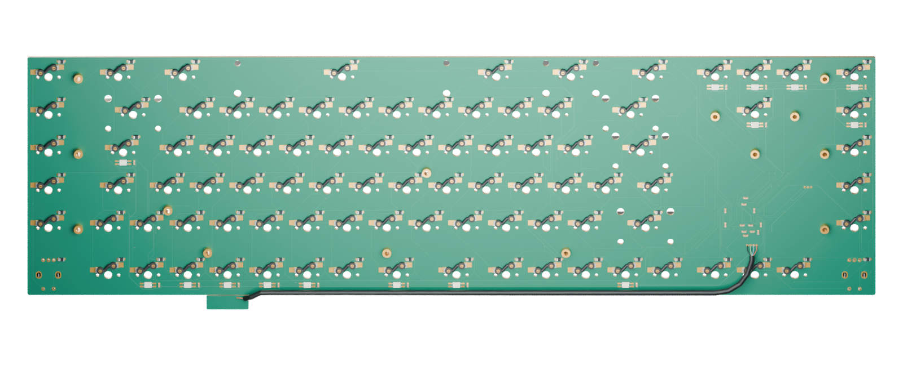

**Figure 3.** Socket side of the Rev A motherboard. There are 90 socket bodies, 92 switch diodes and 15 indicator positions. Dial push contacts have diodes and soldered encoder pins.

| Function | Baseline implementation |
| --- | --- |
| Controller and memory | RP2040 in 7 × 7 QFN-56, external 3.3 V W25Q16JV 2 MB QSPI flash, 12 MHz crystal. Match boot2 to the selected flash and crystal loading to the selected crystal and layout |
| Scan rows / columns | GP0–GP7 = R0–R7. GP8–GP19 = C0–C11. COL2ROW, one 1N4148W SOD-123 per contact, banded cathode toward row |
| Contacts | 90 socketed keys plus two dial pushes = 92 of 96 addresses. Unused R5C11, R6C10, R6C11, R7C11 |
| Encoder inputs | Volume GP20/21, brightness GP22/23, roller GP24/25. Each pair is A/B. Dial pushes are R0C0 and R6C6 |
| Lighting and spare | GP26 drives the indicator buffer. GP27, GP28 and GP29 remain available |
| Recovery and debug | BOOTSEL and RUN buttons. Provide access to GND, 3V3, SWCLK and SWDIO with the plate removed. Confirm service access before final assembly |

Set the Kailh CPG151101S11-family socket on the underside. Verify pad orientation from the physical socket and prove insertion using a supported PCB. Build a coupon containing a socket, diode, LED window and representative cap. A bent switch pin or lifted pad should be diagnosable without opening traces under an installed support. See the [scan schedule](specification.md#switch-matrix) and [individual contact register](layout/omar-switches.csv).

## 05A / A6 and A8 · Rev A populated motherboard dimensions

The table uses the board's plan datum and the top of the plate for z. Package sizes here describe the modeled body. Consult the BOM footprint and supplier drawing for pad geometry and production tolerances. Through-hole contact and support locations come directly from KiCad.

| Ref and center (x, y), mm | Body or board feature, mm |
| --- | --- |
| U1 (342, 40) | QFN-56, 7 × 7, 0.40 lead pitch, 3.20 × 3.20 exposed pad. Fitted envelope 1.00, top −4.00 |
| U2 (330, 32) | SOIC-8W flash, 5.30 × 5.30, 1.27 lead pitch. Fitted 2.15, top −2.85 |
| U3 (358, 32) / U4 (360, 48) | Regulator / LED buffer. SOT-23-5 bodies modeled 1.65 × 2.90, fitted 1.18. Tops −3.82 |
| Y1 (340, 51) | 12 MHz crystal, 3.20 × 2.50, fitted 0.85, top −4.15 |
| SW93 (311, 21.2) / SW94 (324, 21.2) | BOOTSEL / RUN. Selected PTS810 body footprint 4.20 × 3.20, nominal height including actuator 2.50. Top −2.50 leaves 1.00 below the plate underside. The Rev 4 Blender proxy shows 1.30 height. Use the supplier dimension for fit checks. Access with plate removed |
| Sockets and stabilizers | 90 bottom sockets. Each switch has one Ø4.00 center, two Ø1.70 pegs and two Ø3.00 contact openings. Socket underside z = −8.43. Six stabilizer pairs use 24 PCB bores, Ø3.0 and Ø3.7 |
| ENC1 / ENC2 | Each TT footprint has five Ø1.10 terminal holes and two 1.80 × 2.60 tab slots at x ±4.65 about its center. A/C/B sit 7.50 forward. S1/S2 sit 7.00 rearward. Outer terminal spacing 5.00 |
| Indicators / passives | 15 LED cutouts 3.50 × 3.05. LED body envelope 3.18 × 2.80 × 1.68. 92 rear SOD-123 diode bodies 2.75 × 1.55 × 0.95. 34 capacitors and eight resistors use 1.60 × 0.80 body class. Actual side and orientation follow BOM |
| Service points | Seven Ø1.00 front pads. TP1–TP6 at y = 61.00, x = 350 through 365 on 3.00 pitch. TP7 LED_OUT at (380, 98). See sheet 06A for J1 and J2 |

[Per-pad dimensions, drills, rotations and positions](model/internals/board-geometry.json) · [Electrical BOM](mainboard/bom.csv) · [Schematic](mainboard/schematic.pdf)

## 05B / A6 and A8 · Rev A mainboard purchasing list

**One Rev A board takes 248 soldered components across 18 manufacturer part numbers.** Each reference was matched to the routed KiCad board, schematic and fitted BOM. This sheet covers 206 components. The 42 resistors and capacitors are on sheet 05C. The counts are installed quantities for one board, before spares or assembler overage.

| PCB refs | Fit | Manufacturer and orderable part | Purpose and ordering detail |
| --- | ---: | --- | --- |
| U1 | 1 | Raspberry Pi · [SC0914(13)](https://datasheets.raspberrypi.com/rp2040/rp2040-datasheet.pdf) | Controller. RP2040, QFN-56 with exposed pad, 7 × 7 mm, 0.40 mm pitch. |
| U2 | 1 | Winbond · [W25Q16JVSSIQ](https://www.winbond.com/export/sites/winbond/product-selection-guide/file/2025-Product-Selection-Guide-Winbond-Code-Storage-Flash-Memory.pdf) | QSPI flash. 16 Mbit / 2 MB, 2.7–3.6 V, 208-mil SOIC-8W. |
| U3 | 1 | Diodes Incorporated · [AP2112K-3.3TRG1](https://www.diodes.com/datasheet/download/AP2112.pdf) | 3.3 V regulator. 600 mA rated LDO, SOT-25. Regulates protected VBUS. |
| U4 | 1 | Texas Instruments · [SN74AHCT1G125DBVR](https://www.ti.com/product/SN74AHCT1G125/part-details/SN74AHCT1G125DBVR) | LED data buffer. 5 V AHCT noninverting buffer, SOT-23-5 (DBV). |
| Y1 | 1 | Abracon · [ABM8-272-T3](https://abracon.com/datasheets/ABM8-272-T3.pdf) | Clock crystal. 12 MHz fundamental, 10 pF load, 3.2 × 2.5 mm, four pads. |
| SW93–SW94 | 2 | C&K / Littelfuse · [PTS810SJM250SMTRLFS](https://www.ckswitches.com/media/1476/pts810.pdf) | BOOTSEL / RUN buttons. Momentary SPST-NO, 160 gf nominal, J-lead SMT, 2.50 mm installed nominal. |
| SW2–SW18, SW20–SW92 | 90 | Kailh · [CPG151101S11-16](https://datasheet.lcsc.com/lcsc/2208291600_Kailh-CPG151101S11-16_C5156480.pdf) | MX hot-swap sockets. Bottom-mount MX sockets. The two gaps in the SW sequence are the dial pushes. |
| ENC1–ENC2 | 2 | TT Electronics / BI Technologies · [EN11-HSM1BF20](https://www.ttelectronics.com/TTElectronics/media/ProductFiles/Datasheet/EN11.pdf) | Corner push encoders. 20 detents and 20 pulses per turn. Both push contacts are integral. |
| D1–D92 | 92 | Diodes Incorporated · [1N4148W-7-F](https://www.diodes.com/part/view/1N4148W) | Matrix diodes. SOD-123. Cathode band faces the row. D75 uses the same diode on a different land pattern. |
| LED1–LED15 | 15 | OPSCO · [SK6812MINI-E](https://cdn-shop.adafruit.com/product-files/4960/4960_SK6812MINI-E_REV02_EN.pdf) | Addressable indicators. 5 V reverse-mount RGB, Rev 02 pin assignment. Hardware LED1 is firmware index 0. |

**Board order.** Add one bare, two-layer Rev A PCB to the component order. The underside takes the 90 sockets, 92 diodes, 15 LEDs and 27 capacitors. The other 24 parts go on the front. J1, J2 and TP1–TP7 are included copper features. H1–H14 and HS1–HS24 are mechanical bores. No connector bodies, pin headers or test pins are required at those positions. [Bare PCB fabrication package](mainboard/Omar-Keyboard-Rev-A-quote.zip)

**Socket count.** SW2–SW18 and SW20–SW92 are the 90 sockets. ENC1 and ENC2 include the other two matrix contacts. The 89 Brown and one Grey switches plug into the sockets after assembly. See sheet 06B for these and the rear inlet.

## 05C / A6 and A8 · Rev A resistors and capacitors

Fit **34 capacitors and eight resistors** on the mainboard. All use 0603 imperial (1608 metric) land patterns. The two USB-C configuration resistors belong to the separate rear carrier on sheet 06B.

| PCB refs | Fit | Manufacturer part number | Electrical specification and use |
| --- | ---: | --- | --- |
| C1–C4, C17 | 5 | [GRM188R71C105KA12D](https://ds.murata.com/simsurfing/mlcc.html?oripartnumbers=%5B%22GRM188R71C105KA12D%22%5D&partnumbers=%5B%22GRM188R71C105KA12%22%5D) | 1 µF, ±10%, 16 V, X7R, 0603.. Supply capacitors. |
| C5–C13, C16, C18–C19, C101–C115 | 27 | [C0603C104K4RECTU](https://search.kemet.com/download/specsheet/C0603C104K4RECTU) | 100 nF, ±10%, 16 V, X7R, 0603. Decoupling capacitors. |
| C14–C15 | 2 | [C0603C150J5GACTU](https://search.kemet.com/component-documentation/download/specsheet/C0603C150J5GACTU) | 15 pF, ±5%, 50 V, C0G, 0603. Crystal load capacitors. |
| R1–R2 | 2 | [RC0603FR-0727RL](https://www.yageogroup.com/component-documentation/download/specsheet/RC0603FR-0727RL) | 27 Ω, ±1%, 0.10 W, thick film, 0603.. USB data series. |
| R3, R5 | 2 | [RC0603FR-071KL](https://www.yageogroup.com/component-documentation/download/specsheet/RC0603FR-071KL) | 1 kΩ, ±1%, 0.10 W, thick film, 0603.. BOOT and crystal series. |
| R4, R6 | 2 | [RC0603FR-0710KL](https://www.yageogroup.com/component-documentation/download/specsheet/RC0603FR-0710KL) | 10 kΩ, ±1%, 0.10 W, thick film, 0603.. Flash CS and RUN pull-ups. |
| R7 | 1 | [RC0603FR-07330RL](https://www.yageogroup.com/component-documentation/download/specsheet/RC0603FR-07330RL) | 330 Ω, ±1%, 0.10 W, thick film, 0603.. LED data series. |
| R8 | 1 | [RC0603FR-07100KL](https://www.yageogroup.com/component-documentation/download/specsheet/RC0603FR-07100KL) | 100 kΩ, ±1%, 0.10 W, thick film, 0603.. LED input pull-down. |

**Assembly side.** C1, C2, C13–C17 and all eight resistors go on the front. C3–C12, C18, C19 and C101–C115 go on the back. C14 and C15 are the crystal load capacitors. Keep their C0G dielectric. Their 15 pF values implement the Rev A circuit for the crystal’s 10 pF specified load, including board and pin capacitance. Verify startup on the assembled board.

**Ordering files.** The purchasing CSV lists one row per mainboard part number with quantity, references, side, manufacturer and drawing. It also lists the daughterboard, wiring and plug-in parts with their build status. The KiCad BOM preserves the individual footprint variants, including D75. [Purchasing CSV](mainboard/purchasing-bom.csv) · [KiCad fitted BOM](mainboard/bom.csv)

## 06 / A7 · USB-C inlet, protection and power

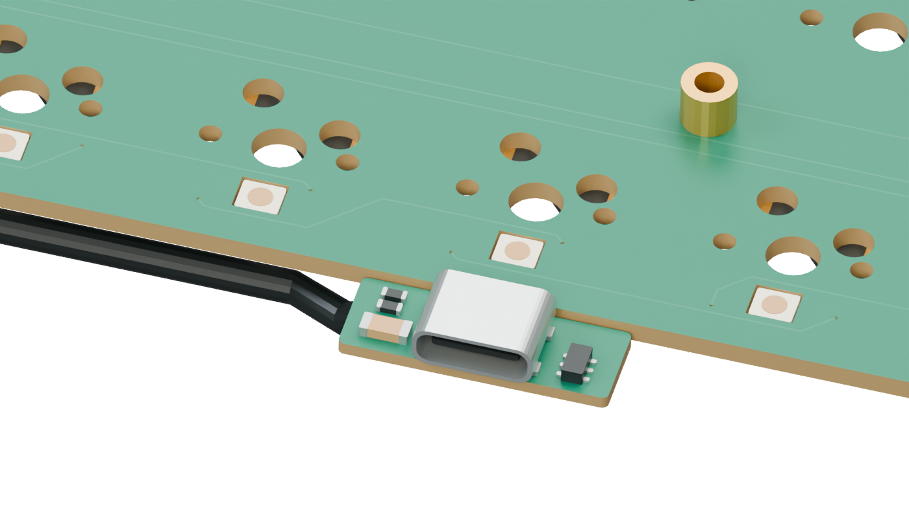

**Figure 4.** The small board at the rear carries the USB-C inlet and protection. The harness follows the rear edge to J1. The regulator, processor, flash and clock sit in the roller bay, about 247 mm across the case from the port.

| Interface | Requirement or sample proposal |
| --- | --- |
| Case to carrier | Port centered at x = 95.25 behind Desk 3. Rear opening 12 × 7. The T4 20 × 7 × 1 carrier seats on two screw posts. See sheet 20A. Verify plug overmold, complete seating and extraction load |
| USB-C receptacle | GCT USB4105-GF-A candidate, 8.94 mm wide. Use USB 2.0 full-speed data and bus power. Validate shell tabs, connector-to-board datum and access with both plug orientations |
| Port protection | Separate 5.1 kΩ pull-downs from CC1 and CC2 to ground. Fit USBLC6-2SC6 beside the inlet and a 500 mA hold PTC in the VBUS path |
| Four-wire link | Protected VBUS, D−, D+ and ground. J1 pins 1–4 take these nets in this order. Solder the link on the underside. Start with an untrimmed donor. Use 260–300 mm only as a rough trial range and measure the service loop per sheet 22A. Confirm actual cable OD, conductor gauge, termination and strain relief on the first sample. |
| Mainboard distribution | Protected 5 V feeds LEDs, the AHCT buffer and the LDO input. AP2112K-3.3 candidate supplies the 3.3 V domain, including MCU I/O and QSPI flash. Rev A includes the RP2040 core supply and local bypassing. Check all three rails on the assembled sample. |
| Data and service | Place a 27 Ω series resistor on each data line near the RP2040. Keep the pair together across both boards and the harness. Check shield termination, return path and data continuity in the electrical design |

For B.2 the configured USB budget is 500 mA and the steady-state acceptance target is ≤450 mA at capped white (16/255). Measure total draw at the host. Sheet 07B gives pre-configuration and suspend limits. Check startup, configured operation, and suspend behavior against the implemented USB descriptor and power states. Size the supply path using measured peak draw and check the selected PTC's trip curve.

Before connecting the host, verify CC terminations, VBUS polarity, continuity of both data conductors, and absence of a supply short. Bring up the rails on a current-limited source, then test enumeration and recovery on a data-capable cable. Reinsert the plug with the case closed and check carrier movement and harness pinch.

## 06A / A1 and A7 · Harness and service interfaces

| Assembly or interface | Dimensions and routing, mm |
| --- | --- |
| USB carrier | 20.00 × 7.00 × 1.00, four 0.50 corner chamfers, center (95.25, −4.35), z = −6.55 to −5.55. At y = −0.85 its front edge clears the mainboard rear edge by 0.35. Connector shell body 8.94 wide × 3.26 high |
| T4 carrier retention | Two Ø3.80 webbed posts, Ø1.60 blind pilots and M2 × 4 screws. Post centers and trial fit are on sheet 20A. |
| USB cable | Jacket Ø2.50, modeled centerline 255.38 from the carrier breakout to the J1 breakout. Main span y = 2.00, z = −11.00, jacket top/bottom −9.75/−12.25. Use a USB-rated twisted data pair. Confirm bend radius and strain relief for the purchased cable |
| Three floor saddles | Centers (134, 2), (218, 2), (309, 2). Each is 4.00 wide along the cable, pedestal 5.80 across, clear channel 2.80. Saddle floor z = −12.35. Lift the cable vertically to release it during service |
| J1 wire pads | Pin 1 at (348.50, 24.50), then x = 347.00, 345.50, 344.00 at the same y. Pitch 1.50, Ø0.65 plated holes. Pin order is protected VBUS, D−, D+, GND. Dress breakouts below the PCB |
| J2 roller leads | Three Ø0.65 plated holes at Y53.90 on 1.50 pitch. From X371.50, pins are A/GP24, GND and B/GP25. Route from the encoder card with strain relief. Sheet 19A locates R12 and R13. |
| Service and production | Route the main cable outside the roller sweep and support the first short deck lift and release each saddle as it becomes accessible. The trial uses a soldered link. Desolder one end for complete separation. Qualify the carrier, retention, slack, strain relief and USB enumeration in both plug orientations |

## 06B / A3, A5 and A7 · Off-board electronics

The rear carrier uses its own 20 × 7 × 1 mm custom PCB and **five electronic components**. Sheet 20 identifies its routed source, fabrication archive and two-sided assembly data. It joins the routed mainboard at J1. The scroll encoder connects at J2. Neither connection requires a separate header.

| Location | Fit | Manufacturer and orderable part | Assembly detail |
| --- | ---: | --- | --- |
| Rear carrier | 1 | GCT · [USB4105-GF-A](https://gct.co/connector/usb4105) | 16-contact receptacle. Check the shell stakes and plug position in the rear pocket. |
| Rear carrier | 1 | STMicroelectronics · [USBLC6-2SC6](https://www.st.com/resource/en/datasheet/usblc6-2.pdf) | SOT-23-6. Place at the USB data entry. |
| Rear carrier | 1 | Littelfuse · [1206L050YR](https://www.littelfuse.com/assetdocs/resettable-ptcs-1206l-datasheet?assetguid=2b6a1515-d4ee-4c83-8bd4-152b4901b8f5) | 1206 PPTC, 500 mA hold. Check peak-load drop and temperature derating. |
| Rear carrier | 2 | YAGEO · [RC0603FR-075K1L](https://www.yageogroup.com/component-documentation/download/specsheet/RC0603FR-075K1L) | 5.1 kΩ each, ±1%, 0603. Fit one from CC1 to ground and one from CC2 to ground. |
| J1 harness | 1 | Sanwa Supply · [KU20-SL05WK](https://www.sanwa.co.jp/product/syohin?code=KU20-SL05WK) | One 0.50 m USB 2.0 donor, approx. Ø2.5 mm, with twisted data pair. Establish the cut length by trial in both closed and supported service positions (sheet 22A). Verify all four conductors and VBUS drop under load. |
| Roller / J2 | 1 | Alps Alpine · [EC11E15204A3](https://tech.alpsalpine.com/e/products/detail/EC11E15204A3/) | Selected for T3. Solder the seven terminals and lugs to the mounting card, then wire the card to J2. Sheet 19A gives the footprint and pull-ups. |
| Key field | 89 | Gateron · [KS-9E10B055NW-Y51](https://www.gateron.com/products/gateron-g-pro-30-switch-set) | Five-pin G Pro 3.0 Brown for typing and controls. Fit after soldering the sockets. |
| Lock | 1 | CHERRY · [MX1A-21NW](https://media.digikey.com/pdf/Data%20Sheets/Cherry%20PDFs/MX%20Series.pdf) | PCB-mount MX Linear Grey for the recessed Lock key. |
| Host | 1 | Adafruit · [4474](https://www.adafruit.com/product/4474) | One data-capable cable from the host to the rear USB-C inlet. An existing compatible cable can be used. |

**What remains open.** Build and qualify the B.2 board and T3 mounting card on sheets 19–19B. For the rear carrier, prove the receptacle mounting and pinout, CC pull-downs, ESD return, fuse path and harness continuity before releasing its PCB. Sheet 06A gives the solder-pad order and cable saddle dimensions.

## 07 / A8 and A9 · Rev A indicators, firmware and host

Fit 15 reverse-mount SK6812MINI-E emitters with light centers 5.08 mm toward the rear from their switch centers. GP26 feeds a 5 V SN74AHCT1G125 buffer, then the first LED. Fit sixteen 100 nF bypass capacitors, one per emitter and one at the buffer. Verify chain direction, emitter-to-window alignment and visibility with finished caps in place. Program the 80/255 maximum brightness before the full-white current test.

| Chain index | Visible feedback |
| --- | --- |
| 0 | Caps Lock state |
| 1–5 | Desk 1 through Desk 5. Amber during a pending transfer. Otherwise dim white on the host-reported active desk |
| 6, 7 | Send & Stay, Move & Go. Amber on the armed action |
| 8 | Mic Mute. Red only while a fresh host report says muted |
| 9, 10 | Swap, Focus. Blue while the corresponding control is held |
| 11, 12, 13, 14 | Right, Down, Left, Up. Blue while Focus or Swap is held |

**Firmware.** Target QMK on RP2040 with an 8 × 12 matrix, 5 ms per-key deferred debounce, 200 ms Caps tap-hold, hold-on-other-key-press and zero quick-tap term. Enable encoder maps, extra keys, mouse wheel, NKRO, raw HID and RGB matrix via the PIO driver. Initial quadrature resolutions are 4 for the corner dials and 2 for the roller. Target 1000 Hz polling. Check each purchased encoder against a host event log at slow, fast and reversed turns. The [Rev A QMK target](../firmware/qmk/omar_keyboard/rev_a/) builds on QMK 0.31.0. The [compiled UF2](../firmware/builds/omar_keyboard_rev_a_default.uf2) uses prototype VID/PID 1209:0001. Leave the pilot's optional discrete armed-LED pin undefined on this board. Its GP25 example would conflict with roller channel B. Drive the transfer indicators through the GP26 chain.

**Host.** Stock actions target Omarchy v4.5.0. The optional user-session integration adds the local Guide (F13), last distinct window on this desk (F14) and the pilot microphone fallback (F15). Set hidraw access for the chosen VID/PID and logged-in user. Select an assigned release USB ID before distribution.

**Status message.** The optional bridge sends a 32-byte raw HID payload. Byte 0 is 0x4F, byte 1 is version 1, byte 2 holds flags and byte 3 the desk number. Flag bits 0, 1 and 2 mean desk valid, microphone state known and microphone muted respectively. Only desks 1–5 can light. Reject a wrong size, tag or version. Clear host-derived states after 3 seconds without a valid report. Local gesture feedback takes priority. Exercise a desk or mute change from another device and unplug the bridge while a transfer is armed.

[QMK controls](../firmware/qmk/omar-controls.h) · [Indicator receiver](../firmware/qmk/omar-indicators.h) · [Host bridge](../host/omarchy/omar-indicators.py) · [Omarchy bindings](../host/omarchy/omar-bindings.lua)

## 07A / A3 and A8 · White backlight at every key

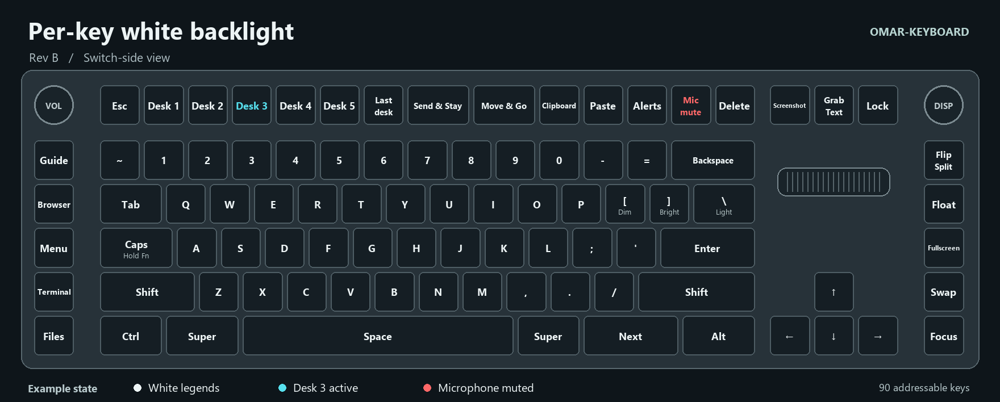

Each of the 90 MX keys gets one independently addressable OPSCO SK6812MINI-E. Equal red, green and blue values produce white. Fifteen emitters also show keyboard or host state. The two rotary knobs and the scroll roller have no LEDs. The normal dial action continues to adjust the display.

| At the keyboard | What you see |
| --- | --- |
| Hold Caps/Fn and press the left bracket or right bracket | Dim or brighten the keyboard in four-count steps. The initial setting is 8 of 255. The firmware ceiling is 16. |
| Hold Caps/Fn and press backslash | Toggle all key lighting, including the indicators. The brightness setting is retained. |
| Select a desk or arm a window transfer | The active desk turns cyan. An armed transfer shows amber on the five destinations and the chosen transfer key. Cancel or complete it to return to desk feedback. |
| Mute the microphone, engage Caps Lock, or hold Focus/Swap | A fresh host mute report lights the mic red. Caps Lock lights green. A held window control and its arrows light blue. Expired host feedback returns to the underlying white. |

**Keycaps and switches.** Backlight all 90 positions. Place shine-through primary legends toward the rear light window and retain the blank Space artwork specified on sheet 12H. Use a translucent legend insert or laser-ablated coating over a translucent blank for short-run custom caps. Opaque dye-sub legends show a halo around the keys. Sample a letter, a two-word command, the spacebar and the recessed Lock with its heavy switch. Verify the Lock housing passes enough light or qualify a light guide or heavy clear-top equivalent. Preserve the guard and actuation force. Review actual brightness and color at the intended desk illumination.

## 07B / A6 and A8 · Per-key lighting circuit and parts

| Assembly item | Rev B specification |
| --- | --- |
| Emitters and apertures | LED1–LED90, all on the rear. Retain the 15 Rev A designators and add LED16–LED90. Each optical center is 5.08 mm behind its switch stem. Use a 3.50 × 3.05 mm through-window in the 1.60 mm PCB. The package is nominally 3.2 × 2.8 × 1.78 mm. OPSCO Rev 02 pins 1, 2, 3 and 4 are VDD, DOUT, GND and DIN. |
| Data path | GP26 → U4 SN74AHCT1G125DBVR → R7 330 Ω → Esc. Chain all 90 pixels in alternating row directions, ending at Files and TP7. Use 800 kbit/s GRB, 24 bits per pixel and a 100 µs low reset interval. The map gives each key, designator, address, DIN, DOUT and aperture center in millimeters. |
| Switched 5 V | J1 fused VBUS → U5 TPS22919DCKR → VLED. Pin 1 IN, pin 2 GND, pin 3 ON from GP27, pin 4 NC, pins 5 QOD and 6 OUT tied to VLED. SC70-6 body class 2.1 × 2.0 mm. Use R11 100 kΩ to hold ON low at reset. U5 sits in the roller controller bay. |
| Bypass and isolation | Add C116–C190, 75 × 100 nF. C101–C190 each serve one emitter. Add C20 1 µF at U5 IN and use C17 1 µF at OUT. U4 and C16 stay on fused 5 V. GP28 drives U4 active-low OE. R9 10 kΩ pulls OE to 3.3 V. R10 100 kΩ holds the first DIN at ground while U4 is disabled. |
| Purchasing change | Per mainboard, add 75 LEDs, 75 bypass capacitors, U5, C20 and R9–R11. This brings the fitted count from 248 to 403. The three resistors and both capacitor values reuse existing 0603 parts. The 90 LED apertures and 90 LED bypasses are individually registered in the PCB design. |

**USB budget.** OPSCO specifies 12 mA per channel for this version and 1 mA typical static current per pixel. Estimate the whole-keyboard current as 100 mA reserved for logic and margin, plus 90 × (1 + 36 × brightness / 255) mA. That gives about 292 mA at startup white and 393 mA at the 16/255 ceiling. Full-scale white would draw over 3 A from the LEDs alone. Colored overlays obey the same per-channel ceiling. The switch's 1.5 A rating describes its capacity. The keyboard advertises 500 mA after USB configuration. These estimates require measurement on the purchased LED lot.

**Sequencing and first article.** Hold GP28 high and GP27 low at reset, before USB configuration, during suspend and when lighting is off. Wait at least 5 ms after enabling U5 before driving data. Verify inrush on attach and wake, VLED discharge, supply at the farthest pixel and total current during worst-case white. Target ≤100 mA before configuration, ≤450 mA steady at the ceiling and ≤2.5 mA total during USB suspend. Check the readings with all 90 switches and caps installed. Sweep all pixels individually, verify each status and check for resets while typing and turning all three encoders.

[OPSCO emitter drawing and electrical data](https://cdn-shop.adafruit.com/product-files/4960/4960_SK6812MINI-E_REV02_EN.pdf) · [TI load-switch data](https://www.ti.com/lit/ds/symlink/tps22919.pdf) · [TI buffer data](https://www.ti.com/lit/ds/symlink/sn74ahct1g125.pdf) · [QMK RGB Matrix](https://docs.qmk.fm/features/rgb_matrix)

## 07C / A4 and A6 · Rev B.1 corner encoder assembly

| Item | Rev B.1 fabrication or assembly detail |
| --- | --- |
| Fit on the top side | ENC1 (volume) at (9.53, 9.53) and ENC2 (brightness) at (395.29, 9.53), both at 0°. The assembler solders both Bourns PEC11R-4220F-S0024 encoders before plate installation. Orient the A/C/B row toward the keys and the push pair toward the rear. |
| Contact holes | Five Ø1.05 mm plated holes. Viewed from the shaft side, A/C/B lie at x = −2.50, 0, +2.50 and y = +7.50 mm. Push 1/2 lie at x = −2.50, +2.50 and y = −7.00 mm. |
| Grounded body tabs | Two vertical plated slots on 11.40 mm centers. Finished slot 2.00 × 4.40 mm, pad 3.00 × 5.40 mm. The supplier’s 13.20 mm spans the outside edges of its nominal 1.80 mm holes. Verify retention on a populated sample. |
| Electronics | The two quadrature pairs and both matrix pushes retain their assignments. Keep QMK resolution 4 on the dials and 2 on the separate roller. Test slow clockwise/counterclockwise turns for 24 events per revolution and verify each push. |
| Form and feel | The stock shaft puts the Rev B.1 knob about 7 mm above the original +16 mm target depicted in the earlier renders. Verify knob engagement, grip and cap clearance on the first physical assembly. |
| Quoted assembly | 403 placements per board, including two Bourns encoders, 90 reverse-mount LEDs and 90 HanElectricity sockets. The assembly BOM also specifies the stocked Walsin 1 µF, Yageo 100 nF, Samsung 15 pF and C&K 2.6 N service switches. |

JLCPCB quoted five double-sided mainboards for **$277.81 before shipping and tax**. All 403 placements were selected. Switches, knobs, keycaps, roller, USB-C daughterboard and case are separate assemblies. [Quote and manufacturing configuration](mainboard-rev-b/quotes/2026-11-18-bourns/Omar-Keyboard-Rev-B.1-JLCPCB-quote.md)

## 08 / A9 · Physical controls and interaction contract

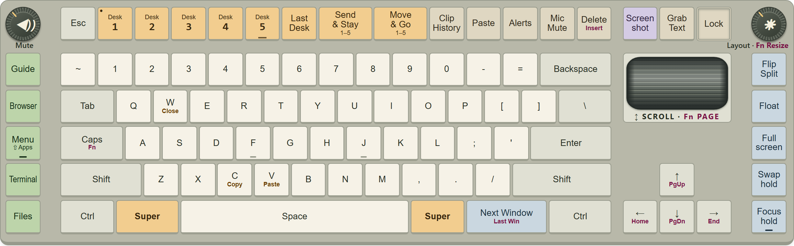

**Figure 5.** Read the five desk targets from left to right above the number row. Focus sits beside the arrows. The left dial controls the speakers, while Mic Mute controls the input.

| Zone | Required behavior |
| --- | --- |
| Left rail | Guide, Browser, Menu, Terminal, Files. Menu on the home row launches the menu. Shift + Menu opens the app grid |
| Top row | Esc, Desk 1–5, Last Desk, Send & Stay, Move & Go, Clip History, Paste, Alerts, Mic Mute, Delete, Screenshot, Grab Text, Lock |
| Right rail | Flip Split, Float, Fullscreen, Swap, Focus. Hold Focus + arrow to select a neighbor or Swap + arrow to exchange tiles. Focus wins if both are held |
| Bottom row | Left Ctrl, left Super, Space, right Super, Next Window, Right Ctrl. Tap Next Window to cycle, add Shift to reverse or Fn to recall via the host helper |
| Caps and Fn | Tap Caps for Caps Lock. Hold for Fn. Arrows become Home, End, Page Up and Page Down by direction. Fn + Delete gives Insert. Digits and both Super keys retain their base functions. F1–F12 have no user mapping |
| Three rotary controls | Left dial adjusts volume and pushes for speaker mute. Right dial adjusts brightness and pushes for Layout. Fn + right dial resizes a split. The wide roller scrolls under normal host pointer routing. Fn + roller sends Page Up/Down to the focused application |

**Moving a window.** Send & Stay keeps the source desk visible. Move & Go follows the window. Arm one command, then tap Desk 1–5 within 3 seconds. Esc or the same command cancels. The other command replaces it and restarts the timer. A normal key cancels and acts once. A direction, Focus, Swap or dial push cancels. Last Desk cancels and visits history. Modifier presses, holding Caps and rotary turns preserve the arm. After expiry a desk press only visits. Five desk keys address the current monitor. The installed Omar host profile defaults to slots 1–5 per monitor. Super+Tab and Super+wheel wrap. Sheet 22 gives the explicit stock-profile opt-out. [Complete physical-to-host mapping](../docs/design/keymap.md)

## 09 / A1–A7 · Fastener and access map

Use this sequence for the B.2 mainboard, T3 roller and T4 tray/carrier. The **deck** is the plate, switches and mainboard lifted together. The roller stays on the plate and the two Bourns encoders stay soldered to the mainboard.

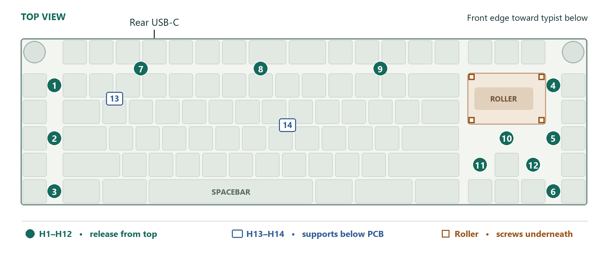

**Figure 6.** Numbers match the H designators in KiCad. The USB-C port is at the rear, behind Desk 3. The drawing shows the roller screw locations through the plate for orientation. Their heads face the PCB.

| Hardware or tool | Bench instruction |
| --- | --- |
| H1–H12 · deck to tray | Twelve top-entry M2 positions. H1–H6 are in the side gaps, H7–H9 in the top gap and H10–H12 around the arrows. Use the driver that fits the installed heads. Lift an adjacent cap if it obstructs a straight approach. Tray screw length, insert and torque await a material trial. |
| Spacers · two heights | Fourteen 3.20 mm lower spacers support the PCB. Twelve 3.50 mm upper spacers set the plate height at H1–H12. At H13 and H14, fit the lower spacer only. Keep the two heights in separate cups. Leave the Enter stabilizer sweep clear on sheet 02A. |
| Roller · separate hardware | Four M2 × 8 screws enter from the underside of the free plate. Keep these together with the two bracket feet. Keep left and right shims in their installed order. The roller drive uses an M3 set screw. |
| Bench kit | Wire keycap puller, MX switch puller, drivers for the installed heads and knob set screws, nonconductive deck supports, labeled parts cups and a continuity meter. Full module separation on the soldered harness also needs soldering and desoldering tools. |

## 09A / A1–A8 · Assemble the B.2 / T3 / T4 keyboard

Start with the 405-placement B.2 mainboard, populated T4 carrier, soldered T3 encoder card and Rev B firmware. Photograph both sides, record revisions and verify the 100 mm print scale. Trial a switch, stabilizer, dial and roller before loading the field. Qualify the tray retention and service loop on sheet 22A before final closure.

| Step | Assembly sequence |
| --- | --- |
| 1 · Verify the open board | Inspect the 90 sockets, 90 rear-mounted LEDs and both soldered Bourns encoders. With power off, label and meter the USB harness end to end. J1 pins 1–4 are protected VBUS, D−, D+, GND. Rehearse the service loop unpowered (sheet 22A). With the boards out of the tray, solder both ends, inspect and meter the harness. Follow sheet 06 for current-limited bring-up, then test USB enumeration, BOOTSEL and RUN while the buttons are exposed. Disconnect power. |
| 2 · Build the PCB side | Fit six screw-in stabilizer pairs to the populated PCB, with five short wires and the long Space wire. Retain the wire orientations on sheet 03. Inspect the screws and Enter sweep from underneath. Cycle each stabilizer before the plate hides its housings. |
| 3 · Build the plate side | For the fit sample, seat the bearing and the soldered encoder/card. Clock the bare core screw onto the flat before adding the sleeve. Trial the dressed leads and fit R03 with the four underside screws. Measure free rotation and end float. See sheets 19–19B. |
| 4 · Join the deck | Set the twelve upper spacers at H1–H12. Guide the plate squarely over both bare encoder shafts and the stabilizer housings. Solder the three leads from the mounting card at J2 with access to the pads, in pin order A, GND, B. Connect power only for bench tests. Seat a few well-separated switches with straight pins, backing each socket from below. Check the 5.00 mm plate-top to PCB-top spacing, then seat the remaining switches with the same support. |
| 5 · Test before closure | Exercise all 90 key switches, both dial pushes and all three rotary controls. Walk the 90 LEDs individually. Spin the roller under light center and end loads and check for rub above U1. Trial both knobs at +23 mm nominal, turn and fully depress them. Test each stabilized cap at both ends. Keep caps over the twelve fasteners off until closure. Disconnect USB. |
| 6 · Seat and close | Place all fourteen lower spacers, secure the T4 carrier to its two posts and lay the USB jacket in all three open saddles. Keep the USB pair together and the roller leads clear. Before inserting screws, rehearse step 2 on sheet 09B. Adjust the cable routing or trial length until the supported lift gives access to the saddles without loading J1. Lower the deck level, start all twelve screws by hand and tighten evenly in alternating areas. Stop if a corner lifts or the plate bows. Fit the remaining caps and complete sheet 10. |

## 09B / A1–A7 · Open the tray and separate the deck

**For a tray inspection, stop after step 3.** The deck can remain assembled for access to the board underside and cable routing. Full plate removal is needed for the roller fixing heads, screw-in stabilizer housings and BOOTSEL/RUN.

| Step | Removal sequence |
| --- | --- |
| 1 · Expose the screws | Unplug external USB. Photograph key positions and knob height. Place the keyboard face up. Use the map on sheet 09 and pull only the caps that block the driver. Loosen the twelve deck screws progressively and collect them. H13 and H14 are PCB supports. The four roller screws stay in place. |
| 2 · Open to the harness | Lift both ends of the deck together just enough to see the wiring. Prop the edges on nonconductive blocks while another hand guides the leads. Stop at the first sign of cable tension. Ease the USB jacket vertically out of the three open saddles as they become accessible. Support the carrier while removing its two M2 screws, then ease the connector inward and lift. Keep the cable, carrier and deck together for a solder-free tray inspection. |
| 3 · Support the open deck | Capture any loose lower spacers, including H13 and H14. Rest the deck on its edges with the underside accessible and the carrier supported beside it. Keep the knobs, roller, sockets and LEDs clear of the bench. Inspect J1, J2 and any affected socket joints. |
| 4 · Separate the plate if needed | Label the roller leads and photograph J2 before desoldering one end of the three-wire harness. Free the leads to pass back through the plate. Loosen both knob set screws and lift the knobs straight off. Remove any shaft hardware that captures the plate. Remove the remaining caps and all 90 plug-in switches, releasing each pair of plate clips and pulling straight. The Bourns bodies remain on the PCB. |
| 5 · Expose the buried hardware | Support plate and PCB separately and lift the plate over the shafts and stabilizers. Collect the twelve upper spacers. The four roller fixing heads are accessible. Follow sheet 19B for R03 and R04 removal. For full mainboard separation label J1 and desolder one end of the USB harness. |

**Close after service.** Restore each shim and spacer to its recorded location. For any soldered lead that was disturbed, check its pin-to-pin continuity and adjacent pads for bridges before applying power. Repeat the affected open-deck tests, then close using step 6 on sheet 09A. With the case closed, check USB in both plug orientations and exercise the serviced controls again.

## 09C / A3–A8 · Choose the shortest repair

| Service job | Access, repair and return check |
| --- | --- |
| Cap or dial knob | Work from above with USB disconnected. Pull a stabilized cap evenly from both ends. For a knob, loosen the set screw, lift axially and refit with the screw on the D-flat. Check +23 mm nominal height, ≥1 mm to adjacent caps and free return through the full 0.5 mm dial push. |
| One MX switch | Expose the cap and release the switch clips with the puller. Inspect both electrical pins. Open the tray for underside support when seating the replacement. Press against the socket body from below while inserting straight from above. Stop if a pin folds or the socket moves. Test that key and its light. Lock uses the heavy CHERRY switch. |
| Socket or per-key LED | The socket and reverse-mount LED are soldered to the underside. Remove the affected switch before socket rework. Use the Rev B light register to identify the emitter. For one dead key, check the socket joints and diode. For a dark run, check VLED, ground and DIN/DOUT at the first dark pixel and its predecessor. Verify key release and walk the light chain after repair. |
| USB-C inlet or harness | Open the tray and free the jacket from the saddles. For a carrier swap, desolder the marked carrier end and retain the J1 joint where practical. Check VBUS polarity, D−/D+ continuity and shorts before power. Confirm enumeration, suspend/wake and retention with the case closed. |
| Roller, stabilizer or corner encoder | Split the deck using sheet 09B. For a roller repair, follow the carrier and rotor removal trial on sheet 19B. For a stabilizer, preserve wire direction, then test the wide cap at both ends. For a Bourns body, clear five electrical pins and both plated anchor slots before lifting the part. Check 24 events per turn in each direction and one clean push. |

**Hand-wired pilot variant.** An Olimex RP2040-PICO30 (51 × 21 mm) provides the controller, regulator and USB-C inlet. Direct-wire the 92 contacts with axial 1N4148 diodes and use plate-mount stabilizers with matching cutouts. Mount the controller separately and check its own cable path. Its port mount, wiring and stabilizers need their own fit trial. The full-size hot-swap assembly above uses an onboard RP2040 and the rear USB carrier. [Pilot and setup instructions](../docs/build/pilot.md)

## 09D / A1, A2 and A7 · Serviceability refinements to prototype

These changes are proposed for the next mechanical and harness samples. The current $277.81 quote covers five Rev B.1 mainboards with solder pads at J1 and J2. A case, harness or bracket change needs its own fit trial.

| Change to prototype | How to accept it |
| --- | --- |
| Make the spacers stay put | Locate or capture the fourteen lower spacers in the tray and the twelve upper spacers on the plate side. Keep their 3.20 and 3.50 mm bearing heights. Mark H1–H12 at the accessible screw positions and identify H13/H14 as supports. Lift and reseat the deck with the tray at its typing angle. All spacers must stay located and the PCB must sit flat. |
| Make both tethers detachable | Trial different, keyed inline plugs with four circuits for J1 and three for J2. Label both ends. Place the USB joint where the first supported lift exposes its latch. Place the roller joint where it can be released before splitting the deck. Preserve the twisted USB data pair, provide strain relief on both sides and verify the 500 mA supply path and USB operation. |
| Give the deck a place to grip | Trial opposed finger reliefs in the tray lip. Keep each clear of sockets, switch clips and copper. Size the openings and service loops together on the tray sample. A builder should be able to support the deck, reach each latch and free the carrier without levering against the PCB or pulling a wire. Record the measured lift and required free lead length. |
| Keep the roller serviceable | Trial a top-access bezel fixing with captive threads on the module. Keep the four existing plate-hole centers. Verify driver access, screw-tip clearance, 360° free travel, bezel clearance under load and the 2.00 mm nominal tread-to-U1 gap. Adopt it only if the module can be removed with the plate and PCB still mated and J2 accessible. |

**Run the service trial.** Give a second builder the map, labeled parts cups and one sample. Have them open the tray, service the USB carrier, reassemble it and repeat for three opening cycles. Record elapsed time, obstructed heads, solder operations, dropped spacers and any cable or pad strain. For the detachable sample, require both modules to separate without soldering. Repeat the USB, light-chain and input checks after the last closure.

## 10 / First-article acceptance and release decisions

Record the sample identity, actual part numbers, firmware revision, test setup, measurements and disposition for each check. The digital model and interaction tests provide a reference for comparison. Physical fit, electrical operation and usability remain to be demonstrated on hardware.

| Check | Pass condition or decision |
| --- | --- |
| Mechanical datum and closure | Verify plate and PCB outline, 5 mm plate-to-PCB datum, mount registration and no bow. Measure worst clearance under sockets against 2 mm nominal, and the roller-to-PCB gap against 3 mm nominal and roller-to-U1 gap against 2.00 mm nominal. Record tray angle, front/back heights and four-foot contact |
| Typing and stabilized keys | Scan all 90 MX keys and both dial pushes at their registered addresses. Four unused cells stay silent. Test simultaneous keys, every wide cap at both ends and triggers while holding modifiers. No stuck release, ghost event or double input |
| Dials and Lock | Check each dial returns after a push, clears caps by ≥1 mm and delivers one step per detent. Check the Rev B.1 +23 mm nominal knob top and measure Lock recess against its ≈2 mm target. Record unintended Lock presses in a brisk right-dial trial |
| Roller | Check slow and fast rotation, reversals, center and edge loads, full rotation and both sides of the barrel. Confirm free motion, no contact, one host step per detent and pull-to-scroll-down. Measure any radial play or deflection before choosing the final window |
| USB, power and recovery | Verify data in both plug orientations, reset, bootloader recovery, reconnect and suspend/wake. Record 5 V and 3.3 V rails. Check ≤100 mA before configuration, ≤450 mA steady at capped white (16/255) and ≤2.5 mA total during USB suspend. Verify enclosure holds the port under ordinary insertion/removal |
| Indicators and actions | Walk all 90 LEDs and verify the 15 status positions using the Rev B light register. Change desk or microphone externally. Stop bridge reports and confirm host-derived lights clear within 3 s. Verify transfer completion, replacement, timeout and cancellation. Check hold-only Focus/Swap and plain arrow recovery |
| On-desk use | Run stock Omarchy v4.5.0 cold boot/unlock, GUI and terminal paste, capture, monitor-local desks, and focused paging with pointer elsewhere. Add helpers and check Guide, last window, mic feedback and external brightness on a compatible display. Log reach errors for a newcomer and a tiling user |

**Service trial.** Record one complete opening and closure with the production-intent plate and caps. Account for all 12 deck screws, 14 lower and 12 upper spacers. Record the service opening that the harness permits, any cap obstructing the driver, and USB, lighting and input results after closure. Sheet 09D covers the proposed removable harness.

**Production release.** The B.2, T3 and T4 fabrication inputs are available. Obtain supplier confirmation for carrier fill/cap and panelization, price the B.2 placement list, then complete the mechanical, electrical and live-desktop tests on sheets 22A–22B. Record qualified seat, fastener and harness measurements against the sample. [Fit and live-desktop test procedure](../docs/design/validation.md)

## 11 / Contact schedule and reference files

Use this schedule at the bench to identify the row and column for any key. The two tables are halves of the same 8 × 12 matrix. An empty address is marked “unused”. The CSV calls the Clip History key “Clipboard” and the backtick/tilde position “~”.

| Row | C0 | C1 | C2 | C3 | C4 | C5 |
| --- | --- | --- | --- | --- | --- | --- |
| R0 | Volume push | Esc | Desk 1 | Desk 2 | Desk 3 | Desk 4 |
| R1 | Guide | ~ | 1 | 2 | 3 | 4 |
| R2 | Browser | Tab | Q | W | E | R |
| R3 | Menu | Caps | A | S | D | F |
| R4 | Terminal | Left Shift | Z | X | C | V |
| R5 | Files | Ctrl | Left Super | Space | Right Super | Next Window |
| R6 | Alerts | Mic Mute | Delete | Screenshot | Grab Text | Lock |
| R7 | Minus | Equals | Backspace | Flip Split | [ | ] |

| Row | C6 | C7 | C8 | C9 | C10 | C11 |
| --- | --- | --- | --- | --- | --- | --- |
| R0 | Desk 5 | Last Desk | Send & Stay | Move & Go | Clipboard | Paste |
| R1 | 5 | 6 | 7 | 8 | 9 | 0 |
| R2 | T | Y | U | I | O | P |
| R3 | G | H | J | K | L | Semicolon |
| R4 | B | N | M | Comma | Period | Slash |
| R5 | Right Ctrl | Left arrow | Down arrow | Right arrow | Focus | unused |
| R6 | Brightness push | Right Shift | Up arrow | Swap | unused | unused |
| R7 | Backslash | Float | Apostrophe | Enter | Fullscreen | unused |

**Reference files in the project.** The following paths start at the repository root.

| File | Use |
| --- | --- |
| [hardware/layout/omar-switches.csv](layout/omar-switches.csv) | Per-contact coordinates, width, stabilizer, electrical address, profile and legends. Use sheets 14A–14F for the Rev B.1 LED chain. |
| [hardware/specification.md](specification.md) and [hardware/parts-plan.md](parts-plan.md) | Baseline dimensions and candidates, quantities, cost and vendor drawings |
| [hardware/model/internals/README.md](model/internals/README.md) | Editable Blender source, animated GLB, offline viewer, model limits and checks |
| [docs/design/keymap.md](../docs/design/keymap.md) and [docs/design/validation.md](../docs/design/validation.md) | Stock OS outputs, optional behaviors, physical and live-desktop trials |

## 12 / SolidWorks · Start the B.2 / T3 / T4 assembly

Build the assembly in millimetres. Fix one master layout part at the top level. Give every manufactured part the same plate-plane origin. Rebuild the plate and enclosure from the dimensions below. Use the Rev B.2 KiCad PCB as the authority for board geometry, populated face, pin orientation and footprint origins. The enclosed drawings, coordinates and checks describe a prototype awaiting its first physical fit.

| Reference | How to set it in the assembly |
| --- | --- |
| Plate plane and origin | Plate top is z = 0. Plan (0, 0) is the rear-left corner of the volume dial's 1u cell. In this document x grows toward Brightness, y toward the spacebar, z upward. Create a right-handed sketch frame with CAD +X right, +Y rear, +Z above. Enter every plan point as (x, −y, z). Use that conversion once. |
| Board anchor check | The actual outer profile extends from (−0.50, −0.50) to (405.31, 119.56), with four R1.00 corners. ENC1 is (9.53, 9.53), ENC2 (395.29, 9.53), H12 (366.71, 90.49). Verify all three after import, viewed from the switch side. They identify the correct face, orientation and origin. |
| Desk and typing angle | Model the plate, PCB, shafts and bosses square to the deck. At top assembly level, tilt them 6° around the left–right axis, rear high. Keep the desk, foot contacts and tray floor horizontal. At field center (202.40625, 59.53125), the plate top is 21.99476 above the desk in the current case model. |
| Desk-height equation | For any field point (x, y, z), height above desk = 21.99476 + (59.53125 − y) sin 6° + z cos 6°. Use this to cut the floor and determine individual boss lengths. The tray STL uses the exterior floor as its zero, 2.00 mm above the desk in the assembled model. |
| Global dimensions | Pitch 19.05. Field 21.25u × 6.25u. Plate 405.81 × 120.06 × 1.50. PCB same outline × 1.60. PCB top −5.00, underside −6.60. Tray 422.80 × 137.10 in the typing plane. The 139.43 mm bed depth on sheet 02 is the projected STL envelope. |
| Evidence in the tree | Mark measured or released PCB features **B.2 ECAD**, model-derived solids **nominal envelope**, and unbuilt alternatives **proposal**. Store part number, quantity, revision, units, reference origin and evidence in the model properties. Board DRC verifies the PCB. Record actual moving and assembly clearances separately. |

**Read the registers.** Sheet 13 identifies all 19 fitted part numbers. Sheets 14A–14F give the 92 keyboard stations and their local electronics. Sheets 15A–15B give the other board placements. Dimensions use finished part geometry unless a drawing or coupon still needs a value.

**Bring the board into SolidWorks.** The [populated B.2 mainboard](mainboard-rev-b2/omar-mainboard-populated.step) has 405 fitted positions and resolves all package files locally. The STEP datum is the field origin in plan and the underside of the PCB in Z. For the keyboard mate its underside to Z−6.60. Check orientation at ENC1, ENC2 and H12. The complete T4 STEP already registers both boards, the roller and the case.

## 12A / SolidWorks · Part tree and mates

| Assembly | Components, quantities and mating intent |
| --- | --- |
| A1 · Tray and feet | One tray, four feet, fourteen lower supports. Seat the feet on the desk plane. Model integral bosses, two webbed USB screw posts and three open cable saddles as tray features. Keep removable spacers as separate bodies. The 12 shared screw positions clamp the deck. H13/H14 support the PCB only. |
| A2 · Switch plate | One 1.50 mm 5052 plate and twelve upper spacers. Locate the plate by the master outline or by one hole and a second direction datum. Constrain the plate and PCB to parallel planes 5.00 apart. Pattern the other holes from the layout to avoid redundant concentric mates. See sheets 02 and 12C. |
| A3 · Key field | Pattern 89 Gateron Browns, one CHERRY Linear Grey at Lock and 90 removable caps. Locate each switch by its stem center, north-facing orientation and flange on plate top. Seat cap sockets on stems. Make six wide-key stabilizer subassemblies, each with two housings, a wire and two screw locations. Drive key travel along the switch normal. |
| A4 · Volume and brightness | Two Bourns bodies belong to the PCBA. Align each D-shaft with its encoder body and give the shaft rotation plus a 0.50 mm axial push. Mate each separate knob to the shaft flat and one axial height. The installed knob, shaft and moving switch element travel together. |
| A5 · Roller module | Locate R03/R04/R05 to the plate and align the bearing, core and selected Alps on the X axis. Set the shaft engagement and tap-to-flat mate on sheets 19–19B. Model the screw, card, solder, lead bends and harness before interference and extraction checks. |
| A6 and A8 · PCBA | One B.2 FR4 board with 405 soldered parts, including R12 and R13. LEDs, bypasses, load switch, both Bourns bodies and the 90 sockets are included in this number. Use a lightweight board solid for case design and an unsuppressed population for interference checks. The 90 insertable MX switches are separate. |
| A7 · USB carrier and leads | One carrier PCB with receptacle, ESD array, fuse and two CC resistors. Mate the carrier underside to the two post tops and register the mounting bores concentrically. Locate the receptacle mouth to the rear opening. Route one four-conductor J1 harness and one three-conductor roller lead set. Keep each end accessible in the service configuration. |
| A9 · Controls and labels | Use the 92-station register for legends, matrix address and cap configuration. A9 has no additional mechanical solid. Apply legends and homing features to the correct cap or plate face. Use sheets 07A–07C and 08 to associate the light and control functions. |

## 12B / A1 · Tray sections and reference planes

Use the field center on sheet 12 for every rounded rectangle. The rings below reproduce the one-piece tray's nominal loft, walking around the outer surface, over the lip and down the inside. Width and depth are measured in the deck sketch. At a desk-height station, intersect the loop's deck-normal projection with the indicated horizontal plane. That keeps the footprint and front/rear wall heights consistent.

| Loft station | Width × depth / corner radius, mm | Plane or elevation, mm |
| --- | --- | --- |
| Exterior floor edge | 420.00 × 134.30 / R3.00 | Desk height 2.00 |
| Outer lower bevel | 422.20 × 136.50 / R3.80 | Desk height 2.70 |
| Full outside wall | 422.80 × 137.10 / R4.00 | Desk height 3.50 |
| Upper outside wall | 422.80 × 137.10 / R4.00 | Deck z +3.70 |
| Upper bevel | 422.20 × 136.50 / R3.70 | Deck z +4.45 |
| Lip, outside then inside | 421.10 × 135.40 / R3.20 then 407.65 × 121.91 / R1.80 | Both at deck z +5.00 |
| Inside wall at seat | 406.81 × 121.06 / R1.50 | Deck z +4.55 to −7.50 |
| Inside floor edge | 406.81 × 121.06 / R1.50 | Desk height 4.50, giving a 2.50 thick horizontal floor |

**Fastener stack.** From each shared H1–H12 boss upwards, use the 3.20 lower spacer, 1.60 PCB, 3.50 upper spacer and 1.50 plate. The grip from boss seating surface to plate top is nominally 9.80 before thread engagement. The model puts the boss top at −9.82, leaving a 0.02 allowance. Choose screw length for measured grip, head seat and usable insert depth. Record bottoming clearance and material-specific torque after the insert trial.

**Boss and feet detail.** Model each boss base on the plane at desk height 3.95, Ø6.30 at the base, then Ø5.50 at 0.45 above it along the deck normal, tapering to Ø4.90 at z −9.82. The modeled pilot is Ø2.24. The modeled foot envelopes are 24 × 10, R4, at desk-frame offsets (±183, ±50). The foot blank is 2.30 high with 2.00 visible. Establish foot seat and retention from the chosen material. Keep Enter's omitted boss position empty.

## 12C / A2 and A6 · Plate features and board registration

| Feature | Sketch or import instruction |
| --- | --- |
| Outer profile and shared fasteners | Use the Rev B.1 finished perimeter on sheet 12. Add twelve Ø2.20 plate holes at H1–H12 on sheet 02. The PCB additionally contains H13/H14 and 24 stabilizer bores. Sheet 12D lists all 24. |
| Key and dial openings | Cut one 14.00 square per station on sheets 14A–14F. The 92 squares include both encoders. The nominal model uses R0.18 internal corners. The plate opening tolerance is +0.05/−0. Validate the selected process radius, switch clips and Bourns tabs on a coupon. |
| Stabilizer reliefs | Two 6.60 × 12.20 plate windows per stabilized key, modeled R0.25. Center each on the key's y and on the two wire-receiver x positions in sheet 12D. Account for overlap with the main MX cut as a single cut profile where applicable. |
| Roller and pigtail | Through-slot 44.40 × 13.50 R0.55 centered (342.49, 42.86). Four Ø2.20 fixing holes at 50.20 × 31.20 pitch about (344.565, 42.86). Use the shaped T3 passage on sheet 19. |
| Socket holes · board top view | About each MX stem, center Ø4.00 at (0, 0), two Ø1.70 pegs at (±5.08, 0) and Ø3.00 contact bores at (−3.81, +2.54) and (+2.54, +5.08). Bottom copper land centers are (−7.36, +2.54) and (+6.09, +5.08), each 2.55 × 2.50. Use the assembled board face orientation. |
| LED windows · board only | Cut 90 through-windows, each 3.50 X × 3.05 Y. Their centers are 5.08 mm rearward of their respective MX stems. LED pin 1 is rear-left in the switch-side plan for this placement. Retain the optical path through the switch to the rear-facing legend. |
| Connector pads and service points | J1 and J2 are direct wire pads with Ø0.65 plated holes. Sheet 06A gives each pin center. TP1–TP7 are Ø1.00 top copper targets. Include probe approach with the plate removed. Use the fab drills and Edge.Cuts for ECAD detail, including vias and slots. |

**Pickup origin check.** All 90 sockets use a JLCPCB pickup point offset (−0.635, +3.810) from the stem in top-view plan. For Esc the stem is (38.100, 9.530), the socket pickup (37.465, 13.340) and the LED center (38.100, 4.450). The JLCPCB placement CSV writes the pickup Y as −13.340. In the station tables the socket reference is located at the stem, suitable for a switch-centered SolidWorks part.

## 12D / A2 and A3 · Stabilizer drilling schedule

These are absolute, top-view Rev B.1 PCB coordinates in mm. Each row describes four NPTH bores. For each listed x, use the y from each diameter column. The reference pairs follow ascending x. Use separate plate reliefs and PCB bores.

| Key | Bores | Left / right x | Ø3.00 y | Ø3.70 y |
| --- | --- | --- | --- | --- |
| Backspace | HS1–HS4 | 283.34 / 307.22 | 26.355 | 41.595 |
| Enter | HS5–HS8 | 280.95 / 304.83 | 64.455 | 79.695 |
| Left Shift | HS9–HS12 | 38.07 / 61.95 | 83.505 | 98.745 |
| Right Shift | HS13–HS16 | 276.19 / 300.07 | 83.505 | 98.745 |
| Space | HS17–HS20 | 100.02 / 200.02 | 116.525 | 101.285 |
| Next Window | HS21–HS24 | 247.62 / 271.5 | 116.525 | 101.285 |

The reversed y order on Space and Next Window identifies the inward-facing pair. Keep the Enter sweep around HS6 at (280.95, 79.695) clear. The 6.25u Space uses the 100.00 mm wire spacing. All five short wires use 23.88 mm.

| Mount | Center x, y | Mount | Center x, y |
| --- | --- | --- | --- |
| H1 | 23.81, 33.34 | H2 | 23.81, 71.44 |
| H3 | 23.81, 109.54 | H4 | 381, 33.34 |
| H5 | 381, 71.44 | H6 | 381, 109.54 |
| H7 | 85.73, 21.43 | H8 | 171.45, 21.43 |
| H9 | 257.18, 21.43 | H10 | 347.66, 71.44 |
| H11 | 328.61, 90.49 | H12 | 366.71, 90.49 |
| H13 | 66.68, 42.86 | H14 | 190.5, 61.91 |

All fourteen board bores are Ø2.20. H1–H12 are shared. H13 and H14 are PCB-only supports. Four roller-module holes are in the plate only.

## 12E / A3 and A4 · Cap surfaces and corner dials

| Feature | Construction detail |
| --- | --- |
| Cap skirt and top | For cap width k in units, skirt width = 19.05k − 1.05, skirt depth = 18.00. Nominal loft lower perimeter is (width − 0.55) × 17.45, R1.05 at z +4.40. Full skirt is width × 18.00, R1.20 at +4.77. Crown plan is (width − 4.05) × 13.40, R1.50. The resulting nominal same-row gap is 1.05. |
| Row profiles | In the appearance model the nominal crown references are R1 +15.60, R2 +14.60, R3 +13.80, R4 +14.40 and DSA +13.60. With local v toward the rear, the regular R1–R4 profiles add slopes −0.060, −0.021, +0.045 and +0.105 mm/mm respectively. The dish center sits 0.50 below the reference on standard keys. Space has a convex fore/aft crown. These are reference surfaces for sculpting and clearance. Qualify the actual profile and Lock recess against purchased caps. |
| Receivers and optics | One central MX cross receiver per cap. Add receivers at x ±11.94 on the five short-wire caps, ±50.00 on Space. The model uses a Ø5.66 external receiver envelope and a 4.26 × 1.34 cruciform opening in each direction between z +4.42 and +10.64. Prototype the stem fit and the nominal 1.5 mm cap wall. Use a translucent legend window for the requested illuminated primary legend. |
| Finish and touch | Body colors in the reference are ivory #F6F2E7, modifier grey #E0E0D3, desk/Super gold #F2CD8F, left rail sage #BDD4AA, right rail blue-grey #CAD7E0, utility #DFD7C2 and Screenshot violet #D4CBE4. The five homing bars on sheet 03 are modeled 3.40 × 0.67 × 0.32 with R0.29, placed 4.80 forward of cap center. |
| Encoder and knob | PEC11R-4220F-S0024 uses a nominal Ø6 D-shaft, M7 × 0.75 bushing, 20 mm shaft length, 7 mm bushing and 10 mm flat length. The stock shaft tip is +21.50. The Ø18 × 12 knob targets +23.00, putting its bottom at +11.00 and requiring 10.50 shaft engagement. Specify axial seating and screw contact on the flat from the measured knob bore, leaving roof thickness and full 0.50 push travel. [Bourns shaft drawing](https://www.bourns.com/docs/Product-Datasheets/PEC11R.pdf) |
| Encoder-to-plate fit | The nominal 12.50 × 13.40 body in a centered 14.00 square leaves 0.75 and 0.30 per side before tolerances. Include both metal tabs, the full body contour and any washer/nut actually fitted when checking insertion. Both Bourns footprints and their four plated mounting slots are specified on sheet 07C. |

## 12F / A5 and A7 · Roller detail and cable paths

| Feature | Geometry and service motion |
| --- | --- |
| Bezel and aperture · earlier Blender model | Outer skin 56.20 × 37.20, R2.20, centered (347.665, 42.86), from z +6.80 to +8.00. The 46.00 × 17.00 window, R0.85, is centered on the tread at x 345.59. Its offset from the bezel center is −2.075 X. Skirt outer 56.15 × 37.15 R2.17, inner 53.50 × 34.50 R1.55, z +0.05 to +6.80. |
| Tread and supports · earlier Blender model | X-axis at y 42.86, z +6.00. Tread Ø16 × 42.00. Left block 4.00 × 9.00, z 0 to +7.75 centers at x 322.09. Right sensor envelope 7.50 × 12.60, z +0.10 to +7.75 centers at x 370.84. Four bezel posts Ø4.60 and the two plate feet are dimensioned on sheet 04B. Use sheet 18 for the T2 axial stack. |
| Axle details · earlier Blender model | In the fit model, the Ø3 stub runs x 320.40–325.50, the Ø6 bearing OD spans x 320.80–323.30, and the Ø6 drive shaft spans x 364.80–370.00. The Ø16 tread includes its sleeve. Trial bearing retention, drive flat, M3 screw access and end float with the actual parts. |
| USB inlet and carrier posts | Rear wall opening 12 × 7 R1.40 centered at field X95.25, deck Z−4.60. The receptacle faces rearward. Sheet 20A locates the two post tops, rear webs and cable exit. Verify the overmold approach and engagement with both plug orientations. |
| Carrier population | T4 uses top-side J1 and bottom-side F1, U1, R1 and R2. Mount coordinates and two-sided orientation are on sheet 20. |
| USB jacket sweep | Sweep Ø2.50 through these field (x, y, z) points in order. (103.5, −2, −7.8), (106.5, −0.4, −10.6), (111, 2, −11), (329, 2, −11), (335, 3, −11), (340.5, 6.5, −11), (344, 11.5, −11), (346.2, 18, −10.7), (346.2, 20, −9.6). The polyline is 255.38 long before breakouts. Dress the actual cable with its qualified bend radius and enough slack for sheet 09B. |
| Roller pigtail | Route from a lug-soldered card on the back of the encoder to J2. Model insulation, solder and strain relief in installed and service configurations. Sheet 19A gives fixed endpoints and measured constraints. The lead route and length require a trial. |

## 12G / SolidWorks · Clearance and release checks

| Configuration or section | What to measure or record |
| --- | --- |
| Closed · underside and fasteners | Check board registration at ENC1, ENC2 and H12. Section all fourteen supports, Enter/HS6 and the socket nearest each boss. Measure the smallest gap from any actual socket, solder tail, LED or component to the floor and saddle. The design targets 2.00 mm under sockets. The 3.22 mm Rev A vertex result describes the earlier proxy. |
| Roller · center and end load | Sweep 360°. The concentric static model gives 2.00 mm to the U1 package, 3.00 mm to bare PCB and 0.54 mm lateral clearance at the mid-tread section. T3 solid minima are 0.760 at the hood and 1.031 at the plate. Include U5 at (366.50, 40.00) under the drive end and the nearby passives. Its DCK package maximum height is 1.10 above seating plane. For a conservative first screen, allow 0.10 extra installed height, giving 1.80 clearance to the lowest tread plane anywhere its projection overlaps. Measure local clearance with the curved surface and loaded bracket. [TI package outline](https://www.ti.com/lit/ds/symlink/tps22919.pdf) |
| Keys and dial push | Test full key travel, the stabilized key ends, Lock recess and full 0.50 axial dial push at representative shaft angles. Check knob-to-cap clearance ≥1.00, positive axial seating, screw approach to the flat, and stem/cap return. Check light-window alignment on Lock, Space and a two-line legend. |
| Carrier and service lift | Check the 0.35 nominal carrier-to-mainboard plan gap, plug insertion, screw access, strain relief and cable position when closed and at the first supported lift. Measure plug engagement and carrier screw torque on the printed tray. Record actual service opening, cable bend radius and slack. |
| Configurations to save | Save closed, keys/dials pressed, bare PCB, deck supported for tray inspection and plate-separated configurations. Prepare an exploded view following sheet 09B. Retained spacers, inline plugs, finger reliefs and the top-release roller each belong to a separate proposal configuration until the sample passes sheet 09D. |
| Drawing release | Record supplier part/drawing revision, manufactured tolerance and measured minimum for each critical interface. Open decisions include the roller mounting card, bias resistors and support fits, shaft retention, knob bore/set-screw geometry, carrier PCB and retention, screw length/inserts/torque, tray process, cable strain relief and service slack. Keep these values marked open in the model. |

Run Interference Detection in the assembled and pressed configurations. Section the optical windows and roller pocket as well. Coincident mounting faces, stem engagement and screw threads are intentional contacts. Log every other overlap and dimension the near misses. Check motion and flexible parts on the first article. [SOLIDWORKS interference detection](https://help.solidworks.com/2025/english/SolidWorks/Sldworks/t_detecting_interferences.htm)

## 12H / A3 · Sculpted cap surfaces and legend artwork

The following dimensions reproduce the nominal exterior model for comparison with a purchased keyset. In a local cap sketch, u grows to the right, v grows to the rear, and z is measured above the plate. W is the skirt width on sheet 12E. Set a = (W − 4.05)/2, b = 6.70 and T to the crown reference for the chosen row. The slope s is listed on sheet 12E.

| Surface | Section or loft equation in mm |
| --- | --- |
| Standard Cherry rows | z = T − 0.50 + 0.55(u/a)² + s·v |
| DSA Lock | z = T − 0.55 + 0.31(u/a)² + 0.24(v/b)² |
| Convex Space | z = T + 0.40 − 0.70(v/b)² + 0.035v |
| Sidewall to crown | Above the full skirt on sheet 12E add (W − 0.10) × 17.90 R1.25 at z +5.45. Approach the crown with two sections, first (2a + 0.85) × 14.25 R1.82 at local surface z − 0.73, then (2a + 0.36) × 13.76 R1.68 at local surface z − 0.18. Finish on the crown profile at local surface z. |

**Artwork.** Use the position names on sheets 14A–14F with these legend conventions. Print “Clip History” at Clipboard, “Shift” on both shifts and “Super” on both Super caps. Leave Space blank. The two knob presses are Mute and Layout. Use the primary and secondary sizes, homing positions and inks on sheet 03. Check every primary text window against its rear LED opening.

| Secondary legend group | Key and secondary text |
| --- | --- |
| Fn, plum | Caps → Fn, Delete → Insert, Next Window → Last Win. Left → Home, Right → End, Up → PgUp and Down → PgDn. |
| Super, dark amber | W → Close, C → Copy and V → Paste. |

**Bottom-row assignment.** R5/C6 (SW88) is Right Ctrl. Fit a 1.75u R4 cap with the Ctrl legend, left of the arrow cluster. Its width, center, socket and indicator are listed on sheet 14F.

## 13 / A6 and A8 · Fitted board components

Quantities are fitted to one mainboard. The board has 21 manufacturing BOM rows covering 20 order codes. D75 has the same diode as the other matrix positions with a different footprint. Use the supplier body, seating plane and pin-1 datum when available. Footprint names specify land patterns.

| Component | Manufacturer part / JLCPCB code | Top | Bottom |
| --- | --- | --- | --- |
| Controller | SC0914(13) · C2040 | 1 | 0 |
| QSPI flash | W25Q16JVSSIQ · C131025 | 1 | 0 |
| 3.3 V regulator | AP2112K-3.3TRG1 · C51118 | 1 | 0 |
| LED data buffer | SN74AHCT1G125DBVR · C7484 | 1 | 0 |
| Clock crystal | ABM8-272-T3 · C20625731 | 1 | 0 |
| BOOTSEL / RUN buttons | PTS810SJK250SMTRLFS · C221896 | 2 | 0 |
| MX hot-swap sockets | CPG151101S11-16 · C41430893 | 0 | 90 |
| Corner push encoders | PEC11R-4220F-S0024 · C143797 | 2 | 0 |
| Matrix diodes | 1N4148W-7-F · C83528 | 0 | 92 |
| Per-key backlight and indicators | SK6812MINI-E · C5149201 | 0 | 90 |
| Supply capacitors | 0603B105K160CT · C108463 | 4 | 2 |
| Decoupling capacitors | CC0603KRX7R9BB104 · C14663 | 2 | 100 |
| Crystal load capacitors | CL10C150JB8NNNC · C1644 | 2 | 0 |
| USB data series | RC0603FR-0727RL · C137753 | 2 | 0 |
| BOOT and crystal series | RC0603FR-071KL · C22548 | 2 | 0 |
| Flash, reset and buffer-enable pull-ups | RC0603FR-0710KL · C98220 | 3 | 0 |
| LED data series | RC0603FR-07330RL · C105881 | 1 | 0 |
| Lighting pull-down resistors | RC0603FR-07100KL · C14675 | 3 | 0 |
| LED rail load switch | TPS22919DCKR · C2149796 | 1 | 0 |
| Roller input pull-ups R12/R13 | 0603WAF2701T5E · C13167 | 1 | 1 |

Installed total 405. J1/J2, the seven test pads and the mounting bores are PCB features. The plug-in MX switches, USB carrier and roller sensor belong to other assemblies.

## 14A / A3, A4 and A8 · Top controls

All x, y pairs are absolute mm in switch-side plan. SW origins are stems. ENC origins are shafts. Diodes, LEDs and bypasses mount on the bottom. Sockets, diodes, LEDs and encoders have native rotation 0°. Each bypass shows its own KiCad angle. The light index i runs from 0 at Esc to 89 at Files.

| Key · size/profile | Station / x, y | Diode / x, y | LED · index / x, y | Bypass / x, y / θ |
| --- | --- | --- | --- | --- |
| Volume / Mute · dial | ENC1 / 9.53, 9.53 | D1 / 15.63, 17.53 | — | — |
| Esc · 1u R1 | SW2 / 38.1, 9.53 | D2 / 44.2, 17.53 | LED16 · i0 / 38.1, 4.45 | C116 / 43.4, 4.45 / 90° |
| Desk 1 · 1u R1 | SW3 / 57.15, 9.53 | D3 / 63.25, 17.53 | LED2 · i1 / 57.15, 4.45 | C102 / 62.45, 4.45 / 90° |
| Desk 2 · 1u R1 | SW4 / 76.2, 9.53 | D4 / 82.3, 17.53 | LED3 · i2 / 76.2, 4.45 | C103 / 81.5, 4.45 / 90° |
| Desk 3 · 1u R1 | SW5 / 95.25, 9.53 | D5 / 101.35, 17.53 | LED4 · i3 / 95.25, 4.45 | C104 / 100.55, 4.45 / 90° |
| Desk 4 · 1u R1 | SW6 / 114.3, 9.53 | D6 / 120.4, 17.53 | LED5 · i4 / 114.3, 4.45 | C105 / 119.6, 4.45 / 90° |
| Desk 5 · 1u R1 | SW7 / 133.35, 9.53 | D7 / 139.45, 17.53 | LED6 · i5 / 133.35, 4.45 | C106 / 138.65, 4.45 / 90° |
| Last Desk · 1u R1 | SW8 / 152.4, 9.53 | D8 / 158.5, 17.53 | LED17 · i6 / 152.4, 4.45 | C117 / 157.7, 4.45 / 90° |
| Send & Stay · 1.5u R1 | SW9 / 176.21, 9.53 | D9 / 182.31, 17.53 | LED7 · i7 / 176.21, 4.45 | C107 / 181.51, 4.45 / 90° |
| Move & Go · 1.5u R1 | SW10 / 204.79, 9.53 | D10 / 210.89, 17.53 | LED8 · i8 / 204.79, 4.45 | C108 / 210.09, 4.45 / 90° |
| Clipboard · 1u R1 | SW11 / 228.6, 9.53 | D11 / 234.7, 17.53 | LED18 · i9 / 228.6, 4.45 | C118 / 233.9, 4.45 / 90° |
| Paste · 1u R1 | SW12 / 247.65, 9.53 | D12 / 253.75, 17.53 | LED19 · i10 / 247.65, 4.45 | C119 / 252.95, 4.45 / 90° |
| Alerts · 1u R1 | SW13 / 266.7, 9.53 | D13 / 272.8, 17.53 | LED20 · i11 / 266.7, 4.45 | C120 / 272, 4.45 / 90° |
| Mic Mute · 1u R1 | SW14 / 285.75, 9.53 | D14 / 291.85, 17.53 | LED9 · i12 / 285.75, 4.45 | C109 / 291.05, 4.45 / 90° |
| Delete · 1u R1 | SW15 / 304.8, 9.53 | D15 / 310.9, 17.53 | LED21 · i13 / 304.8, 4.45 | C121 / 310.1, 4.45 / 90° |
| Screenshot · 1u R1 | SW16 / 328.61, 9.53 | D16 / 334.71, 17.53 | LED22 · i14 / 328.61, 4.45 | C122 / 333.91, 4.45 / 90° |
| Grab Text · 1u R1 | SW17 / 347.66, 9.53 | D17 / 353.76, 17.53 | LED23 · i15 / 347.66, 4.45 | C123 / 352.96, 4.45 / 90° |
| Lock · 1u DSA | SW18 / 366.71, 9.53 | D18 / 372.81, 17.53 | LED24 · i16 / 366.71, 4.45 | C124 / 372.01, 4.45 / 90° |
| Brightness / Layout · dial | ENC2 / 395.29, 9.53 | D19 / 401.39, 17.53 | — | — |

## 14B / A3, A4 and A8 · Number row

All x, y pairs are absolute mm in switch-side plan. SW origins are stems. ENC origins are shafts. Diodes, LEDs and bypasses mount on the bottom. Sockets, diodes, LEDs and encoders have native rotation 0°. Each bypass shows its own KiCad angle. The light index i runs from 0 at Esc to 89 at Files.

| Key · size/profile | Station / x, y | Diode / x, y | LED · index / x, y | Bypass / x, y / θ |
| --- | --- | --- | --- | --- |
| Guide · 1u R1 | SW20 / 9.53, 33.34 | D20 / 15.63, 41.34 | LED25 · i32 / 9.53, 28.26 | C125 / 14.83, 28.26 / 90° |
| Grave / tilde · 1u R1 | SW21 / 38.1, 33.34 | D21 / 44.2, 41.34 | LED26 · i31 / 38.1, 28.26 | C126 / 43.4, 28.26 / 90° |
| 1 · 1u R1 | SW22 / 57.15, 33.34 | D22 / 63.25, 41.34 | LED27 · i30 / 57.15, 28.26 | C127 / 62.45, 28.26 / 90° |
| 2 · 1u R1 | SW23 / 76.2, 33.34 | D23 / 82.3, 41.34 | LED28 · i29 / 76.2, 28.26 | C128 / 81.5, 28.26 / 90° |
| 3 · 1u R1 | SW24 / 95.25, 33.34 | D24 / 101.35, 41.34 | LED29 · i28 / 95.25, 28.26 | C129 / 100.55, 28.26 / 90° |
| 4 · 1u R1 | SW25 / 114.3, 33.34 | D25 / 120.4, 41.34 | LED30 · i27 / 114.3, 28.26 | C130 / 119.6, 28.26 / 90° |
| 5 · 1u R1 | SW26 / 133.35, 33.34 | D26 / 139.45, 41.34 | LED31 · i26 / 133.35, 28.26 | C131 / 138.65, 28.26 / 90° |
| 6 · 1u R1 | SW27 / 152.4, 33.34 | D27 / 158.5, 41.34 | LED32 · i25 / 152.4, 28.26 | C132 / 157.7, 28.26 / 90° |
| 7 · 1u R1 | SW28 / 171.45, 33.34 | D28 / 177.55, 41.34 | LED33 · i24 / 171.45, 28.26 | C133 / 176.75, 28.26 / 90° |
| 8 · 1u R1 | SW29 / 190.5, 33.34 | D29 / 196.6, 41.34 | LED34 · i23 / 190.5, 28.26 | C134 / 195.8, 28.26 / 90° |
| 9 · 1u R1 | SW30 / 209.55, 33.34 | D30 / 215.65, 41.34 | LED35 · i22 / 209.55, 28.26 | C135 / 214.85, 28.26 / 90° |
| 0 · 1u R1 | SW31 / 228.6, 33.34 | D31 / 234.7, 41.34 | LED36 · i21 / 228.6, 28.26 | C136 / 233.9, 28.26 / 90° |
| - · 1u R1 | SW32 / 247.65, 33.34 | D32 / 253.75, 41.34 | LED37 · i20 / 247.65, 28.26 | C137 / 252.95, 28.26 / 90° |
| = · 1u R1 | SW33 / 266.7, 33.34 | D33 / 272.8, 41.34 | LED38 · i19 / 266.7, 28.26 | C138 / 272, 28.26 / 90° |
| Backspace · 2u R1 | SW34 / 295.28, 33.34 | D34 / 301.38, 41.34 | LED39 · i18 / 295.28, 28.26 | C139 / 300.58, 28.26 / 90° |
| Flip Split · 1u R1 | SW35 / 395.29, 33.34 | D35 / 401.39, 41.34 | LED40 · i17 / 395.29, 28.26 | C140 / 400.59, 28.26 / 90° |

## 14C / A3, A4 and A8 · QWERTY row

All x, y pairs are absolute mm in switch-side plan. SW origins are stems. ENC origins are shafts. Diodes, LEDs and bypasses mount on the bottom. Sockets, diodes, LEDs and encoders have native rotation 0°. Each bypass shows its own KiCad angle. The light index i runs from 0 at Esc to 89 at Files.

| Key · size/profile | Station / x, y | Diode / x, y | LED · index / x, y | Bypass / x, y / θ |
| --- | --- | --- | --- | --- |
| Browser · 1u R2 | SW36 / 9.53, 52.39 | D36 / 15.63, 60.39 | LED41 · i33 / 9.53, 47.31 | C141 / 14.83, 47.31 / 90° |
| Tab · 1.5u R2 | SW37 / 42.86, 52.39 | D37 / 48.96, 60.39 | LED42 · i34 / 42.86, 47.31 | C142 / 48.16, 47.31 / 90° |
| Q · 1u R2 | SW38 / 66.68, 52.39 | D38 / 72.78, 60.39 | LED43 · i35 / 66.68, 47.31 | C143 / 71.98, 47.31 / 90° |
| W · 1u R2 | SW39 / 85.73, 52.39 | D39 / 91.83, 60.39 | LED44 · i36 / 85.73, 47.31 | C144 / 91.03, 47.31 / 90° |
| E · 1u R2 | SW40 / 104.78, 52.39 | D40 / 110.88, 60.39 | LED45 · i37 / 104.78, 47.31 | C145 / 110.08, 47.31 / 90° |
| R · 1u R2 | SW41 / 123.83, 52.39 | D41 / 129.93, 60.39 | LED46 · i38 / 123.83, 47.31 | C146 / 129.13, 47.31 / 90° |
| T · 1u R2 | SW42 / 142.88, 52.39 | D42 / 148.98, 60.39 | LED47 · i39 / 142.88, 47.31 | C147 / 148.18, 47.31 / 90° |
| Y · 1u R2 | SW43 / 161.93, 52.39 | D43 / 168.03, 60.39 | LED48 · i40 / 161.93, 47.31 | C148 / 167.23, 47.31 / 90° |
| U · 1u R2 | SW44 / 180.98, 52.39 | D44 / 187.08, 60.39 | LED49 · i41 / 180.98, 47.31 | C149 / 186.28, 47.31 / 90° |
| I · 1u R2 | SW45 / 200.03, 52.39 | D45 / 206.13, 60.39 | LED50 · i42 / 200.03, 47.31 | C150 / 205.33, 47.31 / 90° |
| O · 1u R2 | SW46 / 219.08, 52.39 | D46 / 225.18, 60.39 | LED51 · i43 / 219.08, 47.31 | C151 / 224.38, 47.31 / 90° |
| P · 1u R2 | SW47 / 238.13, 52.39 | D47 / 244.23, 60.39 | LED52 · i44 / 238.13, 47.31 | C152 / 243.43, 47.31 / 90° |
| Left bracket · 1u R2 | SW48 / 257.18, 52.39 | D48 / 263.28, 60.39 | LED53 · i45 / 257.18, 47.31 | C153 / 262.48, 47.31 / 90° |
| Right bracket · 1u R2 | SW49 / 276.23, 52.39 | D49 / 282.33, 60.39 | LED54 · i46 / 276.23, 47.31 | C154 / 281.53, 47.31 / 90° |
| Backslash · 1.5u R2 | SW50 / 300.04, 52.39 | D50 / 306.14, 60.39 | LED55 · i47 / 300.04, 47.31 | C155 / 305.34, 47.31 / 90° |
| Float · 1u R2 | SW51 / 395.29, 52.39 | D51 / 401.39, 60.39 | LED56 · i48 / 395.29, 47.31 | C156 / 400.59, 47.31 / 90° |

## 14D / A3, A4 and A8 · Home row

All x, y pairs are absolute mm in switch-side plan. SW origins are stems. ENC origins are shafts. Diodes, LEDs and bypasses mount on the bottom. Sockets, diodes, LEDs and encoders have native rotation 0°. Each bypass shows its own KiCad angle. The light index i runs from 0 at Esc to 89 at Files.

| Key · size/profile | Station / x, y | Diode / x, y | LED · index / x, y | Bypass / x, y / θ |
| --- | --- | --- | --- | --- |
| Menu · 1u R3 | SW52 / 9.53, 71.44 | D52 / 15.63, 79.44 | LED57 · i63 / 9.53, 66.36 | C157 / 14.83, 66.36 / 90° |
| Caps · 1.75u R3 | SW53 / 45.24, 71.44 | D53 / 51.34, 79.44 | LED1 · i62 / 45.24, 66.36 | C101 / 50.54, 66.36 / 90° |
| A · 1u R3 | SW54 / 71.44, 71.44 | D54 / 77.54, 79.44 | LED58 · i61 / 71.44, 66.36 | C158 / 76.74, 66.36 / 90° |
| S · 1u R3 | SW55 / 90.49, 71.44 | D55 / 96.59, 79.44 | LED59 · i60 / 90.49, 66.36 | C159 / 95.79, 66.36 / 90° |
| D · 1u R3 | SW56 / 109.54, 71.44 | D56 / 115.64, 79.44 | LED60 · i59 / 109.54, 66.36 | C160 / 114.84, 66.36 / 90° |
| F · 1u R3 | SW57 / 128.59, 71.44 | D57 / 134.69, 79.44 | LED61 · i58 / 128.59, 66.36 | C161 / 133.89, 66.36 / 90° |
| G · 1u R3 | SW58 / 147.64, 71.44 | D58 / 153.74, 79.44 | LED62 · i57 / 147.64, 66.36 | C162 / 152.94, 66.36 / 90° |
| H · 1u R3 | SW59 / 166.69, 71.44 | D59 / 172.79, 79.44 | LED63 · i56 / 166.69, 66.36 | C163 / 171.99, 66.36 / 90° |
| J · 1u R3 | SW60 / 185.74, 71.44 | D60 / 191.84, 79.44 | LED64 · i55 / 185.74, 66.36 | C164 / 191.04, 66.36 / 90° |
| K · 1u R3 | SW61 / 204.79, 71.44 | D61 / 210.89, 79.44 | LED65 · i54 / 204.79, 66.36 | C165 / 210.09, 66.36 / 90° |
| L · 1u R3 | SW62 / 223.84, 71.44 | D62 / 229.94, 79.44 | LED66 · i53 / 223.84, 66.36 | C166 / 229.14, 66.36 / 90° |
| ; · 1u R3 | SW63 / 242.89, 71.44 | D63 / 248.99, 79.44 | LED67 · i52 / 242.89, 66.36 | C167 / 248.19, 66.36 / 90° |
| ' · 1u R3 | SW64 / 261.94, 71.44 | D64 / 268.04, 79.44 | LED68 · i51 / 261.94, 66.36 | C168 / 267.24, 66.36 / 90° |
| Enter · 2.25u R3 | SW65 / 292.89, 71.44 | D65 / 298.99, 79.44 | LED69 · i50 / 292.89, 66.36 | C169 / 298.19, 66.36 / 90° |
| Fullscreen · 1u R3 | SW66 / 395.29, 71.44 | D66 / 401.39, 79.44 | LED70 · i49 / 395.29, 66.36 | C170 / 400.59, 66.36 / 90° |

## 14E / A3, A4 and A8 · Shift row

All x, y pairs are absolute mm in switch-side plan. SW origins are stems. ENC origins are shafts. Diodes, LEDs and bypasses mount on the bottom. Sockets, diodes, LEDs and encoders have native rotation 0°. Each bypass shows its own KiCad angle. The light index i runs from 0 at Esc to 89 at Files.

| Key · size/profile | Station / x, y | Diode / x, y | LED · index / x, y | Bypass / x, y / θ |
| --- | --- | --- | --- | --- |
| Terminal · 1u R4 | SW67 / 9.53, 90.49 | D67 / 15.63, 98.49 | LED71 · i64 / 9.53, 85.41 | C171 / 14.83, 85.41 / 90° |
| Left Shift · 2.25u R4 | SW68 / 50.01, 90.49 | D68 / 56.11, 98.49 | LED72 · i65 / 50.01, 85.41 | C172 / 55.31, 85.41 / 90° |
| Z · 1u R4 | SW69 / 80.96, 90.49 | D69 / 87.06, 98.49 | LED73 · i66 / 80.96, 85.41 | C173 / 86.26, 85.41 / 90° |
| X · 1u R4 | SW70 / 100.01, 90.49 | D70 / 106.11, 98.49 | LED74 · i67 / 100.01, 85.41 | C174 / 105.31, 85.41 / 90° |
| C · 1u R4 | SW71 / 119.06, 90.49 | D71 / 125.16, 98.49 | LED75 · i68 / 119.06, 85.41 | C175 / 124.36, 85.41 / 90° |
| V · 1u R4 | SW72 / 138.11, 90.49 | D72 / 144.21, 98.49 | LED76 · i69 / 138.11, 85.41 | C176 / 143.41, 85.41 / 90° |
| B · 1u R4 | SW73 / 157.16, 90.49 | D73 / 163.26, 98.49 | LED77 · i70 / 157.16, 85.41 | C177 / 162.46, 85.41 / 90° |
| N · 1u R4 | SW74 / 176.21, 90.49 | D74 / 182.31, 98.49 | LED78 · i71 / 176.21, 85.41 | C178 / 181.51, 85.41 / 90° |
| M · 1u R4 | SW75 / 195.26, 90.49 | D75 / 201.36, 98.49 | LED79 · i72 / 195.26, 85.41 | C179 / 200.56, 85.41 / 90° |
| , · 1u R4 | SW76 / 214.31, 90.49 | D76 / 220.41, 98.49 | LED80 · i73 / 214.31, 85.41 | C180 / 219.61, 85.41 / 90° |
| . · 1u R4 | SW77 / 233.36, 90.49 | D77 / 239.46, 98.49 | LED81 · i74 / 233.36, 85.41 | C181 / 238.66, 85.41 / 90° |
| / · 1u R4 | SW78 / 252.41, 90.49 | D78 / 258.51, 98.49 | LED82 · i75 / 252.41, 85.41 | C182 / 257.71, 85.41 / 90° |
| Right Shift · 2.75u R4 | SW79 / 288.13, 90.49 | D79 / 294.23, 98.49 | LED83 · i76 / 288.13, 85.41 | C183 / 293.43, 85.41 / 90° |
| ↑ · 1u R4 | SW80 / 347.66, 90.49 | D80 / 353.76, 98.49 | LED15 · i77 / 347.66, 85.41 | C115 / 352.96, 85.41 / 90° |
| Swap · 1u R4 | SW81 / 395.29, 90.49 | D81 / 401.39, 98.49 | LED10 · i78 / 395.29, 85.41 | C110 / 400.59, 85.41 / 90° |

## 14F / A3, A4 and A8 · Thumbs and arrows

All x, y pairs are absolute mm in switch-side plan. SW origins are stems. ENC origins are shafts. Diodes, LEDs and bypasses mount on the bottom. Sockets, diodes, LEDs and encoders have native rotation 0°. Each bypass shows its own KiCad angle. The light index i runs from 0 at Esc to 89 at Files.

| Key · size/profile | Station / x, y | Diode / x, y | LED · index / x, y | Bypass / x, y / θ |
| --- | --- | --- | --- | --- |
| Files · 1u R4 | SW82 / 9.53, 109.54 | D82 / 15.63, 117.54 | LED84 · i89 / 9.53, 104.46 | C184 / 14.83, 104.46 / 90° |
| Ctrl · 1.5u R4 | SW83 / 42.86, 109.54 | D83 / 48.96, 117.54 | LED85 · i88 / 42.86, 104.46 | C185 / 48.16, 104.46 / 90° |
| Left Super · 1.75u R4 | SW84 / 73.82, 109.54 | D84 / 79.92, 117.54 | LED86 · i87 / 73.82, 104.46 | C186 / 79.12, 104.46 / 90° |
| Space · 6.25u R4 | SW85 / 150.02, 109.54 | D85 / 156.12, 117.54 | LED87 · i86 / 150.02, 104.46 | C187 / 155.32, 104.46 / 90° |
| Right Super · 1.5u R4 | SW86 / 223.84, 109.54 | D86 / 229.94, 117.54 | LED88 · i85 / 223.84, 104.46 | C188 / 229.14, 104.46 / 90° |
| Next Window · 2.25u R4 | SW87 / 259.56, 109.54 | D87 / 265.66, 117.54 | LED89 · i84 / 259.56, 104.46 | C189 / 264.86, 104.46 / 90° |
| Right Ctrl · 1.75u R4 | SW88 / 297.66, 109.54 | D88 / 303.76, 117.54 | LED90 · i83 / 297.66, 104.46 | C190 / 302.96, 104.46 / 90° |
| ← · 1u R4 | SW89 / 328.61, 109.54 | D89 / 334.71, 117.54 | LED14 · i82 / 328.61, 104.46 | C114 / 333.91, 104.46 / 90° |
| ↓ · 1u R4 | SW90 / 347.66, 109.54 | D90 / 353.76, 117.54 | LED13 · i81 / 347.66, 104.46 | C113 / 352.96, 104.46 / 90° |
| → · 1u R4 | SW91 / 366.71, 109.54 | D91 / 372.81, 117.54 | LED12 · i80 / 366.71, 104.46 | C112 / 372.01, 104.46 / 90° |
| Focus · 1u R4 | SW92 / 395.29, 109.54 | D92 / 401.39, 117.54 | LED11 · i79 / 395.29, 104.46 | C111 / 400.59, 104.46 / 90° |

## 15A / A6 · Remaining board placements 1

Use the footprint origin in switch-side x, y millimetres and the native KiCad angle in degrees. The face identifies the board seating plane. For bottom parts register their actual pin-1 pad after turning the body over. The angle remains the native board convention.

| PCB ref | Fitted part | Origin x, y | Face | θ |
| --- | --- | --- | --- | --- |
| C1 | 0603B105K160CT | 354.8, 30 | Top | 90° |
| C2 | 0603B105K160CT | 360, 28.8 | Top | 0° |
| C3 | 0603B105K160CT | 346.4, 31.5 | Bottom | 0° |
| C4 | 0603B105K160CT | 345.6, 34.7 | Bottom | 0° |
| C5 | CC0603KRX7R9BB104 | 333.5, 34.8 | Bottom | 90° |
| C6 | CC0603KRX7R9BB104 | 333.5, 42 | Bottom | 90° |
| C7 | CC0603KRX7R9BB104 | 342.4, 45.3 | Bottom | 0° |
| C8 | CC0603KRX7R9BB104 | 347.3, 42 | Bottom | 90° |
| C9 | CC0603KRX7R9BB104 | 350.5, 34.8 | Bottom | 90° |
| C10 | CC0603KRX7R9BB104 | 342.4, 31.5 | Bottom | 0° |
| C11 | CC0603KRX7R9BB104 | 343.2, 48.5 | Bottom | 0° |
| C12 | CC0603KRX7R9BB104 | 341.6, 34.7 | Bottom | 0° |
| C13 | CC0603KRX7R9BB104 | 324, 30 | Top | 90° |
| C14 | CL10C150JB8NNNC | 336.6, 50 | Top | 90° |
| C15 | CL10C150JB8NNNC | 341.2, 53.9 | Top | 0° |
| C16 | CC0603KRX7R9BB104 | 362, 44.7 | Top | 0° |
| C17 | 0603B105K160CT | 368.9, 40 | Top | 90° |
| C18 | CC0603KRX7R9BB104 | 349.2, 31.1 | Bottom | 90° |
| C19 | CC0603KRX7R9BB104 | 343.2, 29.5 | Bottom | 0° |
| C20 | 0603B105K160CT | 362.6, 39.8 | Top | 0° |

## 15B / A6 · Remaining board placements 2

Use the footprint origin in switch-side x, y millimetres and the native KiCad angle in degrees. The face identifies the board seating plane. For bottom parts register their actual pin-1 pad after turning the body over. The angle remains the native board convention.

| PCB ref | Fitted part | Origin x, y | Face | θ |
| --- | --- | --- | --- | --- |
| R1 | RC0603FR-0727RL | 345.4, 31.2 | Top | 270° |
| R2 | RC0603FR-0727RL | 343.6, 31.2 | Top | 270° |
| R3 | RC0603FR-071KL | 326, 38 | Top | 0° |
| R4 | RC0603FR-0710KL | 332, 37 | Top | 0° |
| R5 | RC0603FR-071KL | 343.3, 49.3 | Top | 90° |
| R6 | RC0603FR-0710KL | 321, 25 | Top | 0° |
| R7 | RC0603FR-07330RL | 363.2, 48 | Top | 90° |
| R8 | RC0603FR-07100KL | 358, 51 | Top | 0° |
| R9 | RC0603FR-0710KL | 361.5, 51.2 | Top | 0° |
| R10 | RC0603FR-07100KL | 367.6, 45.5 | Top | 0° |
| R11 | RC0603FR-07100KL | 366.7, 42.6 | Top | 0° |
| SW93 | PTS810SJK250SMTRLFS | 311, 21.2 | Top | 0° |
| SW94 | PTS810SJK250SMTRLFS | 324, 21.2 | Top | 0° |
| U1 | SC0914(13) | 342, 40 | Top | 0° |
| U2 | W25Q16JVSSIQ | 330, 32 | Top | 0° |
| U3 | AP2112K-3.3TRG1 | 358, 32 | Top | 0° |
| U4 | SN74AHCT1G125DBVR | 360, 48 | Top | 0° |
| U5 | TPS22919DCKR | 366.5, 40 | Top | 0° |
| Y1 | ABM8-272-T3 | 340, 51 | Top | 0° |

**Bare-board features in the controller bay.** J1 pin 1 protected VBUS is at (348.50, 24.50). Its three other pins step to the left by 1.50. J2 pin 1 A is at (371.50, 53.90). Its next pins step to the right by 1.50. Test pads on the top side are listed below.

| Test pad | Net | Plan center x, y |
| --- | --- | --- |
| TP1 | GND | 350, 61 |
| TP2 | +3V3 | 353, 61 |
| TP3 | SWCLK | 356, 61 |
| TP4 | SWDIO | 359, 61 |
| TP5 | +5V | 362, 61 |
| TP6 | +1V1 | 365, 61 |
| TP7 | LED_OUT | 380, 98 |

## 16 / CAD verification · Geometry and evidence record

The design data above was checked against the quoted Rev B.1 fabrication package. The native PCB, light register, purchasing BOM, assembly BOM and CPL in the archive match the Desktop project sources byte for byte at this revision. The embedded schedule covers 403 unique BOM and placement designators. The switch-station entries were also cross-checked against their matrix diode nets and the 90 aperture designators in the Edge.Cuts Gerber.

| Design check | Verified value |
| --- | --- |
| Keyboard stations | 92 unique positions, 90 MX stems and two corner encoder shafts |
| Soldered parts | 364 local station parts plus 39 other placements = 403. Front 29, back 374. |
| Case and plate registration | 14 PCB mounts, 12 shared with plate, 24 stabilizer bores, four separate plate-only roller fasteners. |
| Board inputs | 9 Gerber layers plus separate plated and non-plated drill files in the Rev B.1 upload. Use the archived board and holes for shape import. |
| Board SHA-256 | 8b91aeeeb6ac684d279ce3ad438e9aae4385c2ce32e981bffce62bada3aad777 |
| Layout CSV SHA-256 | 210fcc1777d5d53951762cac712f1b0c75abbbadf47153cb71e0a83b846cd641 |

**Before drawing release.** Compare the native reconstruction with the supplied tray STL by registering the desk/plate frames, port and at least two mount centers. Check the board perimeter, hole schedule, moving stack, all cable transitions and each supplier model’s pin-1 orientation. Keep the physical sample results with the drawing revision. The current checks establish registration and parts coverage. No native SolidWorks assembly or measured fit report has been produced by this document revision.

## 17 / A2 and A5 · T1 mechanical quotation and trial geometry

Use the existing one-piece tray STL for the JLC3DP quote. The T1 models and quotes on this sheet are historical. Use sheet 19 for current P01 and A5. The dimensions in sheets 04 and 12 describe the earlier roller envelope. The following changes apply to the T1 fit sample. [Quotation package, STEP files, drawings and captured prices](mechanical-rfq/rev-b1-t1/README.md)

| Item | Prototype geometry and release check |
| --- | --- |
| P01 and P02 · plate | P01 retains the 405.81 × 120.06 × 1.50 envelope and all 122 through-cut features. P02 trials an MX switch, a Bourns encoder and one stabilized position in the same 5052 stock. Confirm all 92 finished windows at 14.00–14.05 and nominal R0.18 corners. The lead passage leaves a 0.388 mm web to the nearest roller fixing. Request shop review before cutting the plate. |
| R01 and R02 · rotor | Quote a turned bare 6061-T6 core, Ø14 × 42 body and integral Ø3 journal projecting 4.19. Add nominal Ø14 ID × Ø16 OD × 42 silicone tread. Proposed drive is a Ø6.05 × 6 full-depth bore with one M3 × 0.5 radial screw 3.00 from the end. It requires at least 4.50 of shaft engagement. The earlier shaft envelope supplies 1.79. Confirm the selected encoder, retention and sleeve grip before release. |
| R03 · bezel | The original nominal shell overlaps the bearing and supports. T1 keeps the 56.20 × 37.20 footprint and top window but raises the end hoods to z +10.60. Reliefs clear the feet, bearing and sensor. The underside aperture is widened to 17.40 up to z +7.75. Recheck near caps and under end loading. |
| R04 and R05 · supports | R04 combines the left foot and block, with an open-top Ø6.04 × 3.21 bearing pocket and Ø3.50 journal clearance. R05 is the right clamping foot. The encoder-specific adapter needs the production sensor drawing. Validate the foot seating, axial retention and tapped bezel pilots in the actual material. |
| Verification and quote status | Seven STEP files reimported as valid individual solids. The T1 bezel clears the nominal roller, bearing, both feet and sensor envelope in unloaded CAD. The portal priced one white SLS tray at $110.79 plus $18.12 estimated freight, and one machined core at $40.84 standard before freight. P01 needs a manual quote. |

## 18 / A2 and A5 · T2 plate and roller drive (historical)

This sheet records the superseded T2 geometry. Use T3 on sheet 19 for new parts. The positioned assembly omits the mounting card and set screw and needs the rotational mate on sheet 18B. Sheet 17 records the earlier T1 trial and quotations. [T2 CAD, drawings and quotation record](mechanical-rfq/rev-b1-t2/README.md)

| Interface | T2 dimensions and assembly controls in mm |
| --- | --- |
| P01 · plate | 405.81 × 120.06 × 1.50 bare 5052, deburred both sides. Cut one 9.50 × 17.50 R0.75 through-opening centered at field X379.040, Y46.110 for encoder tabs and leads. Bounds X374.29–383.79, Y37.36–54.86. The former 0.388 web grows to 3.059 at M4. H4 is closest at 2.920. Retain 121 other openings. Inspect all 92 switch and dial windows at 14.00–14.05 in both axes. |
| R01 and encoder | Use Alps Alpine EC11E15204A3, 30 detents, 15 pulses, without push. Rotate its mounting plane perpendicular to X. Set shaft axis Y42.86, Z+6.00 facing left. Set housing front X374.59 and rear X379.09. A 20.00 stock Ø6 D shaft enters the roller 12.00 past its drive face at X366.59. Bore Ø6.05 +0.03/−0.00 × 14.00 full-diameter depth. Blind drill tip may extend farther. Tip X354.59 leaves 2.00 to the full-bore bottom. |
| Retention | Set screw center X363.59, 3.00 from the core face and 9.00 from the shaft tip. Align the flat to the screw. Trial M3 × 0.5 × 5 flat point. Confirm its head stays below core OD. Shaft engagement acceptance target 11.70–12.30, bottom clearance ≥1.50, running clearance to bushing ≥0.50. The nominal bushing gap is 1.00. Inspect runout, axial retention and grip under hand load. |
| R03 and R05 | Split Ø7.10 seat spans X370.79–373.74. Front shoulder X374.49, rear stops X379.24, nominal axial clearances 0.10 front and 0.15 rear. Side cheeks Y±6.20 from the axis restrain housing rotation. Hood roof Z13.10–14.30, outermost X384.70. The right-rail cap skirt starts at X386.29, leaving 1.59. H4 driver relief Ø5.40. Drawing sheets 2–4 give the T2 geometry and the required fit checks. |
| Harness and service | Use the three-wire mounting-card interface on sheet 18A and trial removal with R04 and the rotor lifting together on sheet 18B. The fixed-carrier vertical extraction path interferes with the bearing and journal. |
| Verification | 92 plate windows and 12 shared holes register to KiCad within 0.001 mm. All 90 emitter centers register 5.08 mm rearward of their switch centers. Confirm light transmission on a populated sample. The bare encoder tab reaches Z−0.55, 4.45 above bare PCB. [Manufacturer dimensions and STEP](https://tech.alpsalpine.com/e/products/detail/EC11E15204A3/) |

## 18A / A5 and A6 · T2 review requirements (historical)

**Mounting card.** Use one daughterboard perpendicular to the roller axis. Use the Alps mounting-hole pattern viewed from the mounting side. Solder every metal mounting lug to the substrate and solder A, common and B to the card. Secure the insulated three-wire pigtail to the stationary assembly. Define card thickness, outline, hole plating, pad sizes, tail projection and strain relief from the manufacturer drawing and measured samples. The T2 hood and plate opening were checked against the bare encoder only. T3 checks the soldered card and three-wire harness on sheet 19B. [Alps ratings and mounting instructions](https://tech.alpsalpine.com/e/products/detail/EC11E15204A3/)

| Interface | Requirement for the revised assembly |
| --- | --- |
| Terminal and hood | At field X381.50 the upper terminal spans Z8.05–8.95. The notch ends at Z7.00 and only 0.375 mm is available outboard at terminal height. The earlier wire model alone was Ø0.44. Build the card, tab ends, solder fillets, insulation, bends and strain relief into the SolidWorks assembly. |
| Rear wall and deck | The encoder housing ends at X379.09 and the rear stops begin at X379.24. Include the installed and removal positions of the card, pigtail, caps, H4 driver, four module screws and populated PCB. Record minimum separations and the cable’s qualified bend radius in both positions. Resize the relief or supports where needed. |
| J2 connection | Three pads at field Y53.90. Pin 1 at X371.50 carries A to GP24. Pin 2 at X373.00 is common/GND. Pin 3 at X374.50 carries B to GP25. The harness has no supply conductor. |
| Input bias | Rev B.1 connects each signal only to J2 and U1. Internal 50–80 kΩ pull-ups supply about 41–66 µA at 3.3 V. Alps specifies 1–10 mA resistive current. On the next mainboard add two 2.7 kΩ ±1% 0603 resistors, one from ROLL_A and one from ROLL_B to 3V3. Each supplies 1.22 mA nominal through its closed contact. [RP2040 electrical data](https://datasheets.raspberrypi.com/rp2040/rp2040-datasheet.pdf#page=617) |
| Electrical acceptance | With external pull-ups alone, use minimum 3V3 / 2.727 kΩ and maximum 3V3 / 2.673 kΩ for the current bounds. Include enabled internal pull-ups and contact resistance. Verify 1–10 mA on each closed channel. Measure both contact currents and verify open/closed logic on a powered prototype. Check 30 host scroll events per turn in each direction at slow and fast speeds, including reversals. |

**Procurement status.** The encoder card and two pull-ups are prospective parts with cost pending. The Rev B.1 quote and placement files cover 403 installed parts. Release revised schematic, PCB, Gerbers, BOM and placement data after implementing the change.

## 18B / A5 · T2 service findings (historical)

| Operation | How to perform and verify it on the fit sample |
| --- | --- |
| 1 · Free the module | Unplug USB. Support and split the deck following sheet 09B. Label the three leads and free the J2 end. Support the card, harness and rotor. Remove the four underside M2 screws, then lift the R03 hood. |
| 2 · Remove the bearing carrier | Lift R04 together with the coupled rotor, bearing and encoder/card clear of R05. Keep the harness slack. The rigid Ø6.04 seat has a 4.923 mm mouth around a Ø6.00 MR63ZZ. A 0.50 mm vertical lift with R04 fixed gave 0.854 mm³ bearing and 0.214 mm³ journal interference. |
| 3 · Separate on the bench | Once clear of the deck, withdraw R04 and the bearing axially from the journal. Support the inner race when applying load to the journal. Slide off the sleeve, loosen the M3 screw, then withdraw the encoder shaft. On refit, the fixed shoulder may touch only the outer race. Demonstrate extraction and refit with the purchased bearing and a soldered card. If the sequence binds, revise the carrier before release. |
| 4 · Set the drive flat | In the delivered STEP the tap faces +Z and the shaft flat +Y. In the shown shaft pose rotate the core about X until the tap faces +Y. Model the M3 × 0.5 × 5 flat-point screw in place. Nominally the outer end of the screw sits 0.50 below core OD on the flat and 1.00 proud on the round. Confirm recess before fitting the sleeve. |
| 5 · Prove running fits | Exact nominal minima are 0.433 mm tread to hood, 0.485 tread to plate, 0.050 encoder to hood and to cradle, and 0.253 encoder to plate. The Ø6.04 pocket leaves only 0.020 radial bearing allowance. Use 0.60 mm as the SLS moving-clearance design target. Published 1172 Pro tolerance is ±0.30 mm at these sizes. Size fixed seats to measured parts and trial coupons. [SLS guidance](https://jlc3dp.com/3d-printing/selective-laser-sintering) · [Nylon tolerance](https://jlc3dp.com/help/article/precimid-1172-pro) |
| 6 · Release P01 and A5 | Obtain written acceptance of the 14.00–14.05 finished windows. Check a same-stock coupon with actual switches, dial and stabilizer. Measure end float, shaft engagement and loaded runout. Turn the tread 360° under center and end load and demonstrate free travel, sleeve grip, cap and PCB clearance, screw access and repeatable service. Record results against the CAD revisions tested. |

## 19 / A2 and A5 · T3 plate and roller assembly

Use this sheet for new roller parts and SolidWorks mates. T3 moves the module 3.10 mm left of T2 to preserve H4 driver access. Field X grows right and Y toward the spacebar. STEP uses (X, −Y, Z) with the plate top at Z0. [SolidWorks-ready assembly and individual STEP files](mechanical-rfq/rev-b2-t3/README.md)

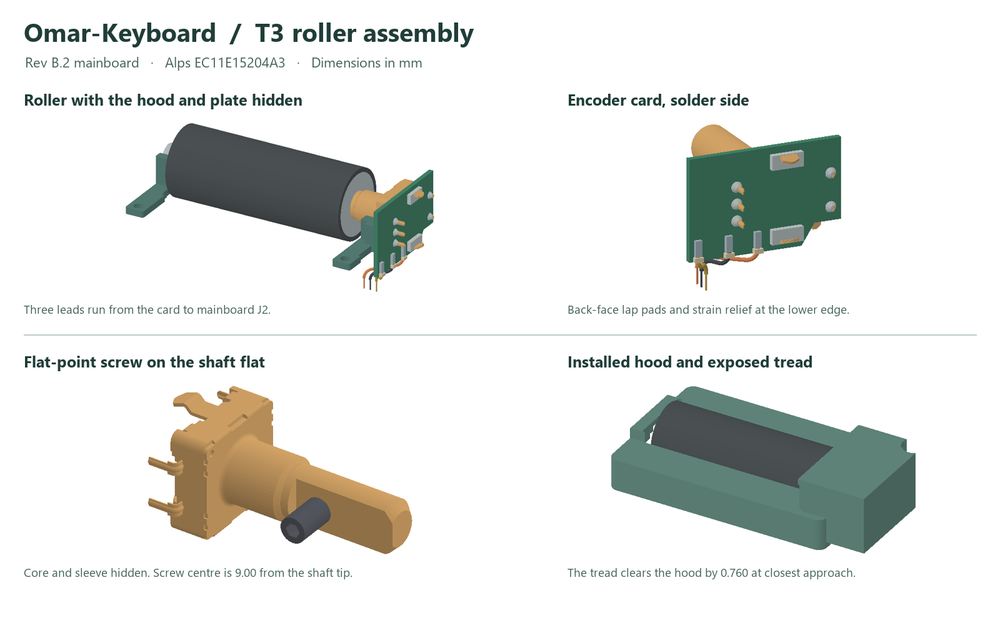

| Part | Geometry and mate in mm |
| --- | --- |
| P01 | 405.81 × 120.06 × 1.50. Tread opening 44.40 × 13.50 R0.55 about (342.49, 42.86). The shaped cable passage is defined in the STEP and gives 3.391 web to H4 and 2.133 to M4. The 92 station openings and 12 shared holes retain their positions. |
| R01/R02 and encoder | Align to X at Y42.86, Z+6.00. Tread X321.49–363.49. Encoder front X371.49, back X375.99. The uncut shaft tip at X351.49 seats 12.00 into the 14.00 full bore. Bushing gap 1.00, tip allowance 2.00. |
| Drive retention | At X360.49 mate the M3 × 0.5 × 5 flat point with the shaft flat facing +Y in STEP. Its centre is recessed 0.50 and its outer rim clears the sleeve by 0.329. Install the sleeve after checking the screw. The assembly suppresses mating threads. Machine the bare core to the R01 tapping drawing. |
| R03/R04/R05 | T3 hood top Z16.12, Ø6.80 H4 relief, card stop 0.370 behind the card. T3 R04 has an outer-race shoulder with Ø5.26 relief. Use the T2 R05 cradle at the new location. Four underside M2 positions at X319.465/369.665 and Y27.26/58.46. |
| Clearance to nearby parts | Tread to hood 0.760, plate 1.031 and left carrier 0.750. Hood to nearby cap travel boxes 2.660. Encoder to plate 0.763. The fixed bushing keeper has 0.050 nominal clearance. Finish its seat to the purchased bushing. |

## 19A / A5 and A6 · B.2 roller electronics and mounting card

| Item | Build and inspect |
| --- | --- |
| R12 and R13 | Two UNI-ROYAL 0603WAF2701T5E, 2.7 kΩ ±1%, 0603 (JLCPCB C13167). R12 front at X366.90 Y52.80 ties +3V3 to ROLL_A. R13 back at X352.50 Y44.10 ties +3V3 to ROLL_B. The resistor alone supplies 1.22 mA nominal through a closed contact. |
| J2 | At Y53.90, pin 1 X371.50 = A/GP24, pin 2 X373.00 = GND, pin 3 X374.50 = B/GP25. Both new resistors appear in the 405-placement BOM and CPL. The earlier B.1 quote covers 403 placements. |
| Daughterboard | Two layers, 15.20 × 23.40 × 1.00 FR4 with relieved corner. Mount the encoder on the front face at X375.99. Rear solder face X376.99. Local u points +Z in assembly and v points toward the spacebar. |
| Encoder lands | A/C/B at u −2.50/0/+2.50, v+7.50. D/E at u ±2.50, v−7.00. Finished Ø1.08 holes. Two soldered lugs at u ±5.50, v0 in 1.60 × 4.20 plated routed slots. Both lugs and dummy lands are isolated. Trim only D/E to 0.96 maximum beyond the back pad. |
| Harness | Three rear lap pads 2.40 × 1.05 at u−5.60, v4.40/8.85/13.60 in A/GND/B order. Use ≤Ø0.60 jacket and ≤Ø0.30 stranded bundle. The model includes 1.80 centreline bend radii, terminations and strain relief. Trial actual bend radius, strain relief and insulation. |
| Native verification | Both boards passed KiCad DRC with zero unconnected pads and footprint errors. Netlist and layout agree on 1,082 connected mainboard pad assignments and six daughterboard endpoints. [Mainboard and fabrication files](mainboard-rev-b2/README.md) · [Daughterboard and slot details](roller-encoder-card/README.md) |

## 19B / A5 · T3 fit and service checks

| Inspection | Result and first-article action |
| --- | --- |
| Installed card and wiring | CAD minimum card to hood/plate 0.370/1.100 mm. Harness including soldered wire ends and strain relief to hood/plate 1.501/1.256. Encoder solder envelopes to hood/plate 0.990/2.350. Harness to the four fixing screws 3.088 and to nearby electronic component envelopes 3.564. |
| Hood and tool access | The Ø5.40 H4 driver gauge clears the hood by 0.700 and the clipped encoder by 1.117. An 18 mm vertical hood lift clears the card by 0.370 and the conservative solder/attachment sweeps by 0.680. |
| Service procedure | Unplug USB, support and split the deck, desolder and straighten the J2 leads. Undo all four underside screws and lift R03. Withdraw R04 together with the bearing, coupled rotor and encoder/card. Separate the carrier axially. Slide off the sleeve, loosen the screw and withdraw the encoder shaft. Straightened leads clear P01 by 1.873. |
| Physical acceptance | Record finished card thickness and lug fit. Check outer-race contact, end float, sleeve grip, full rotation and clearance under centre and end loads. Demonstrate service with the dressed harness. Measure 1–10 mA per closed channel, then check 30 scroll events per revolution in both directions at slow and fast speeds, including reversals. |

## 20 / A7 · USB-C carrier T4

The rear carrier is a separate four-layer PCB. Five components mount across both faces. Route, BOM and placement data belong to this carrier. The keyboard motherboard is B.2 and the roller card is T3. [Native carrier and fabrication files](usb-c-carrier/README.md)

| Interface | Controlled definition, mm |
| --- | --- |
| Board and mates | 20.00 × 7.00 × 1.00 FR-4 with four 0.50 × 45° corner chamfers. Field center (95.25, −4.35). PCB bottom −6.55, top −5.55. KiCad J1 origin (100,100) maps to field (95.25, −5.65). |
| Connector | J1 GCT USB4105-GF-A on top, KiCad 180°. Fit its locating pegs, signal contacts and four grounded shell stakes. The mouth overhangs the board’s rear edge. Rear opening 12 × 7. D− is A7/B7, D+ A6/B6. A8/B8 are free. |
| Bottom components | U1 USBLC6-2SC6 at field (95.25, −4.15), rotation 90° in the placement file. F1 1206L050YR at (87.75, −2.45). R1/R2 RC0603FR-075K1L at (92.86, −7.05) and (97.77, −7.05). F1/R1/R2 rotation 0°. |
| USB and power | Separate 5.1 kΩ to ground on CC1 and CC2. U1 pins 1/6 protect D+, 3/4 protect D−, 2 ground, 5 raw VBUS. F1 connects raw VBUS to the cable, 500 mA hold nominal. The two 27 Ω series resistors are on the mainboard. |
| Harness | Backside J2 lands 0.90 × 1.75 on 1.24 pitch. At field Y −2.83, the four X centers are 100.85, 102.09, 103.33 and 104.57. Order is fused VBUS, D−, D+, GND. Terminate at same-numbered mainboard J1. Tin the wire lightly and dress the pair together. |
| Stack and fabrication | 35 µm outer and 17.5 µm inner copper. Nominal dielectric 0.160 / 0.555 / 0.160. Board has 153 routed segments and 11 through vias. Minimum trace 0.18, clearance 0.15, copper to edge and hole clearance 0.20. Confirm stack and panelization with the fabricator. |
| Assembly treatment | Specify planar filled and plated-over via-in-pad at J1 A6 and B6, finished Ø0.20 in Ø0.40 lands, CAD X100.25 and X99.25, Y104.25. Four ground contact designators use shortened 0.60 × 1.11 solder lands for locator clearance. Request footprint and stencil review for the first panel. |
| Electrical acceptance | Native DRC reports zero violations, open pads and footprint errors. The schematic matches all 31 connected pin assignments. Check continuity and both CC pull-downs unpowered. Test USB enumeration in both orientations and at the maximum permitted LED load. Signal integrity, ESD transients and thermal performance require bench tests. |

## 20A / A1 and A7 · Rear pocket and installation

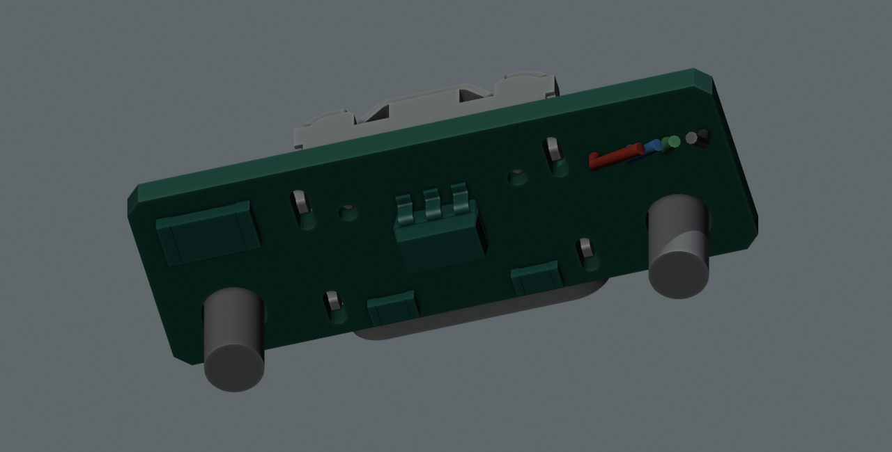

| Feature | Build and inspection |
| --- | --- |
| Pocket | Field X84.40–106.10, Y−8.13 to +1.38. Relief floor Z−10.35. A Ø3.36 cable relief follows the jacket as it leaves the carrier. Use the T4 tray STL in the original desk orientation. |
| Retention | Two Ø2.20 carrier bores at field (87.65, −6.13) and (102.85, −6.13). Ø3.80 posts land at Z−6.55. Each has a 1.20-wide rear web and a blind Ø1.60 pilot 3.50 deep. Sample two M2 × 4 thread-forming screws with head Ø3.80 maximum, 1.55 maximum head height. Nominal screw engagement 3.00. Qualify the pilot and installation torque for the chosen tray material. |
| Installation | Solder and inspect the four underside leads before installation. Lower the carrier onto the two posts, keeping the receptacle centered in the rear wall. Fit both top-access screws, guide the cable into the relief and press it into the three saddles. |
| Service | Unplug USB, loosen the deck, prop it at the qualified service lift, release the saddles, support the carrier and remove its two screws. Ease the mouth inward from the exterior aperture, lift the carrier and desolder one end of the harness for complete separation. Prove this sequence with a terminated cable. |
| Nominal clearances | PCB-to-PCB gap 0.35. The installed shell is approximately 1.12 from the tray and 1.23 from either screw head. Sampled component-to-tray distances are F1 0.99, R1/R2 1.25 and U1 2.20. The carrier underside seats against the two post tops. Solder fillets and external plug overmolds need a physical check. |

## 20B / A1–A8 · Full assembly and fit results

Use the full T4 assembly for the closed keyboard. Electronics and T3 roller geometry retain native CAD faces. Enclosure and key parts use faceted reference surfaces. Dimensions below are nominal. [Complete assembly, models and inspection files](mechanical-rfq/rev-b2-t4/README.md)

| Area | Finding and disposition |
| --- | --- |
| Mainboard | 405 fitted positions. The board has models for 90 CPG151101S11-16 sockets, 90 SK6812MINI-E Rev 02 LEDs and two PEC11R-4220F-S0024 encoders. The body, solder tails, reverse optical position and D-shafts are represented. Active contacts and thread forms are simplified. The B.2 copper fabrication archive is byte-identical to the previous package. |
| Underside supports | H13 and H14 lower collars are Ø4.30 OD, Ø2.20 bore, Z−9.80 to −6.60. Add a flat facing D22 or D44. In STEP XY the outward normal is 142° from +X on both. Center-to-flat dimensions are 1.621 and 1.614 respectively. This gives 0.32 nominal clearance to each diode and leaves over 0.51 wall at the bore. Orient the flats when seating the collars. |
| Corner knobs | Ø18 × 12, bottom +11.00, top +23.00. Bore Ø6.10 to Z+22.20. Horizontal M3 × 6 flat-point screw at Z+18.50 bears on the +Y shaft flat in the STEP pose. The nominal shaft tip is +21.55 in the populated STEP. Check the purchased hub’s socket access, engagement and 0.50 mm push travel. |
| Switches and stabilizers | Cap lower rim +4.75 above the plate at rest. The original +4.40 rim contacted the housing flange at 4.00 travel. Keep the cap roof and stem seat datums when making the rim. Six Ø1.20 stabilizer-wire routing envelopes use a crossbar 8.85 from the stem row at Z−2.40. Check the actual wire bend, pivots and switch clearances against the purchased set. |
| Static screen | 783 physical objects, 306,153 unordered pairs. The report records intersecting mesh surfaces and possible containment. Plate-to-roller fastener/seat contacts have zero common mesh volume. The carrier-to-post result is below 0.00001 mm³ of mesh noise. Remaining flagged pairs are installation, retention, switch or solder interfaces. |
| Actuation | Sampled each of the 90 cap shells at 0.25 mm intervals through 4.00 mm and each dial shell through 0.50 mm. No shell crossed screened stationary geometry in the revised model. The check moves the plunger with its cap. First articles must establish internal switch operation, dynamic wire flex and production tolerances. |
| First assembly | Try the two fitted collars, seated switches, caps and stabilizers on the actual plate and PCB. Verify free return, full dial rotation and push, roller action, port alignment, lead slack and strain relief. Perform both-orientation USB and backlight load tests before releasing a production order. |

## 20C / A1–A8 · Populated-board clearance register

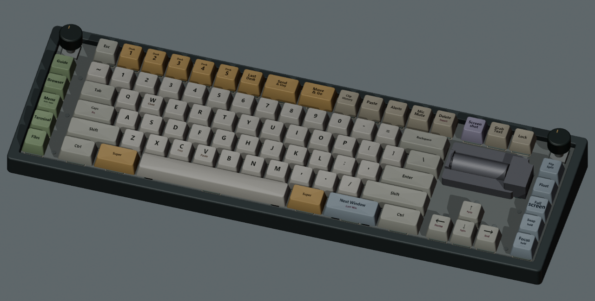

| Nominal measurement | Result and witness |
| --- | --- |
| Minimum installed part to tray | 1.721 mm at the underside SOD-123 diodes, including D82 and D87. The 405-position register measures shortest three-dimensional distance to the complete tray, including its integral supports and cable saddles. |
| Hot-swap sockets | Shortest socket-to-tray distance 2.644 mm at SW52. Shortest sampled vertical clearance below a socket 3.126 mm at SW88, relative to the 2.00 mm design target. The vertical witness is STEP (299.484, −116.290, −8.500). |
| Per-key LEDs | Minimum LED-to-tray distance 2.010 mm at LED6. The lower-face vertical ray at STEP (132.581, −4.817, −7.590) reaches an integral cable saddle. |
| Encoders and controller | Both Bourns bodies clear the T3 plate by 0.300 mm nominal and the tray by 3.379 mm. RP2040 U1 clears the plate by 2.534 mm. Confirm dial fit with the real body and finished plate opening. |
| Method and sample limit | Exported STEP packages were transformed into the closed assembly, converted to closed triangle solids and measured against the T4 tray and T3 plate. For the vertical screen, sample the lower socket and LED surfaces on a mesh of at most 0.40 mm spacing and cast rays parallel to deck −Z. Tolerances, solder buildup and load deflection consume the nominal clearances. |

[405 fitted positions and shortest distances](mechanical-rfq/rev-b2-t4/mainboard-clearances.csv) · [180 underside vertical measurements](mechanical-rfq/rev-b2-t4/underside-vertical-clearances.csv)

## 21 / Build register · Parts for one keyboard

| Assembly | Installed quantity and specification | Detail sheets |
| --- | --- | --- |
| A1 · Enclosure | 1 T4 one-piece tray, 4 feet, 12 top-entry M2 deck screws, 14 lower spacers and 12 upper spacers. Machine the two lower spacer flats at H13/H14. The 14 deck bosses, 2 USB posts and 3 cable saddles are integral to the tray. Deck fastener length, insert and torque require a material trial. | 02–02A, 09, 20A–20B |
| A2 · Plate | 1 P01 T3 plate, 405.81 × 120.06 × 1.50 mm, 5052 aluminum. 92 station openings, 12 shared deck holes, 4 roller fixings and the shaped harness passage. | 12C–12D, 19 |
| A3 · Key field | 89 Gateron KS-9E10B055NW-Y51 Browns, 1 CHERRY MX1A-21NW for Lock, 90 caps and 6 stabilizer sets. Each set has two housings and one wire. Five use 23.88 mm stem spacing and Space uses 100 mm. Cap widths, row profiles, legends and revised rim height are tabulated by station. | 03–03A, 12D–12H, 14A–14F, 20B |
| A4 · Dials | 2 Bourns PEC11R-4220F-S0024 fitted to the mainboard, 2 Ø18 × 12 knobs and 2 M3 × 6 flat-point screws. Knob bore Ø6.10, installed top Z+23.00. Dial pushes are two of the 92 matrix positions. | 04, 07C, 20B |
| A5 · Roller | 1 each R01 machined core, R02 silicone tread, R03 T3 hood, R04 T3 bearing carrier, R05 cradle, MR63ZZ bearing, Alps EC11E15204A3, T3 encoder PCB and M3 × 0.5 × 5 flat-point screw. Four M2 module fixings, three insulated conductors, solder and flexible strain relief. Purchased bearing Ø3 × Ø6 × 2.5. | 19–19B |
| A6 / A8 · Mainboard and light | 1 B.2 bare PCB, 405.81 × 120.06 × 1.60 mm. Its 405 fitted parts include 90 sockets, 90 addressable LEDs, both dial encoders, RP2040 and R12/R13. Integral wire pads, test pads and holes are board features. | 07A–07C, 13–15B, 19A, 21A–21B |
| A7 · USB and wiring | 1 T4 four-layer carrier PCB, 5 fitted electronic parts, 2 M2 × 4 carrier screws, 1 four-conductor USB data harness and 1 external USB data cable. The roller's three conductors can be cut from the same donor cable. | 06–06B, 20–20C, 21C |
| A9 · Controls | Rev B QMK target for B.2. SW88 sends Right Ctrl, both Super keys remain desktop modifiers and the Omar host profile defaults to five workspaces per monitor. Two push dials and one roller retain their existing actions. | 07–08, 12H, 14F, 22–22B |

The complete STEP contains 783 physical instances. This includes PCB substrates, modeled solder, wire ends and cap receivers. Use fitted quantities in this register when purchasing. The STEP component tree and the purchasing quantities serve different purposes.

## 21A / B.2 mainboard · Fitted parts and references

Quantities are per board. A repeated order code identifies the D75 alternate land pattern. All designators in these two tables match the current B.2 manufacturing BOM and placement file.

| Part and order code | Fitted references | Top / bottom |
| --- | --- | --- |
| Controller · SC0914(13) · C2040 | U1 | 1 / 0 |
| QSPI flash · W25Q16JVSSIQ · C131025 | U2 | 1 / 0 |
| 3.3 V regulator · AP2112K-3.3TRG1 · C51118 | U3 | 1 / 0 |
| LED data buffer · SN74AHCT1G125DBVR · C7484 | U4 | 1 / 0 |
| Clock crystal · ABM8-272-T3 · C20625731 | Y1 | 1 / 0 |
| BOOTSEL / RUN buttons · PTS810SJK250SMTRLFS · C221896 | SW93–SW94 | 2 / 0 |
| MX hot-swap sockets · CPG151101S11-16 · C41430893 | SW2–SW18, SW20–SW92 | 0 / 90 |
| Corner push encoders · PEC11R-4220F-S0024 · C143797 | ENC1–ENC2 | 2 / 0 |
| Matrix diodes · 1N4148W-7-F · C83528 | D1–D74, D76–D92 | 0 / 91 |
| Matrix diodes · 1N4148W-7-F · C83528 | D75 | 0 / 1 |
| Per-key backlight and indicators · SK6812MINI-E · C5149201 | LED1–LED90 | 0 / 90 |

## 21B / B.2 mainboard · Passives and power switching

| Part and order code | Fitted references | Top / bottom |
| --- | --- | --- |
| Supply capacitors · 0603B105K160CT · C108463 | C1–C4, C17, C20 | 4 / 2 |
| Decoupling capacitors · CC0603KRX7R9BB104 · C14663 | C5–C13, C16, C18–C19, C101–C190 | 2 / 100 |
| Crystal load capacitors · CL10C150JB8NNNC · C1644 | C14–C15 | 2 / 0 |
| USB data series · RC0603FR-0727RL · C137753 | R1–R2 | 2 / 0 |
| BOOT and crystal series · RC0603FR-071KL · C22548 | R3, R5 | 2 / 0 |
| Flash, reset and buffer-enable pull-ups · RC0603FR-0710KL · C98220 | R4, R6, R9 | 3 / 0 |
| LED data series · RC0603FR-07330RL · C105881 | R7 | 1 / 0 |
| Lighting pull-down resistors · RC0603FR-07100KL · C14675 | R8, R10–R11 | 3 / 0 |
| LED rail load switch · TPS22919DCKR · C2149796 | U5 | 1 / 0 |
| Roller input pull-ups · 0603WAF2701T5E · C13167 | R12–R13 | 1 / 1 |

## 21C / Electronics · Carrier, roller card and interconnects

| Part or connection | Qty | Specification and assembly |
| --- | --- | --- |
| USB carrier PCB | 1 | T4, 20 × 7 × 1.00 mm, four copper layers. ENIG and two plated-over filled Ø0.20 vias at receptacle A6/B6. See sheet 20 for the stack, dimensions, origin and pad treatment. |
| Carrier J1 | 1 | GCT USB4105-GF-A, top, 180°. Solder signal contacts and four shell stakes. |
| Carrier U1 | 1 | ST USBLC6-2SC6, SOT-23-6, underside. Data protection on pins 1/6 and 3/4, ground on 2, raw VBUS on 5. |
| Carrier F1 | 1 | Littelfuse 1206L050YR, 500 mA hold PPTC, underside. Raw VBUS to fused harness supply. |
| Carrier R1, R2 | 2 | YAGEO RC0603FR-075K1L, 5.1 kΩ ±1%, 0603, underside. Separate CC1 and CC2 pull-downs. |
| USB harness and host cable | 1 each | Sanwa KU20-SL05WK donor, nominal Ø2.5, four conductors with twisted data pair. Carrier J2 to mainboard J1, pins 1–4 fused VBUS, D−, D+, GND. Adafruit 4474 is the reference external 1 m data cable. |
| Roller card and sensor | 1 each | T3 two-layer, 15.20 × 23.40 × 1.00 mm FR4 and Alps EC11E15204A3. Three signal terminals A/C/B, two isolated dummy lands D/E and two soldered mechanical lugs. Clip D/E to 0.96 mm maximum behind the pad. |
| Roller harness | 3 leads | Rear card pads 1/2/3 to mainboard J2 pins 1/2/3, A/GND/B. Maximum Ø0.60 jacket and Ø0.30 conductor bundle. Nominal formed centerlines 15.83 / 11.84 / 10.81 mm respectively. Trim after forming and strain-relieve at the card. |

**First-article items.** Record deck screw/insert selection and torque, finished plate and bearing fits, USB post torque, switch and stabilizer travel, plug engagement, and harness slack during service. Verify both USB plug orientations and maximum permitted LED load. The $277.81 reference covered five older B.1 mainboards. Current B.2, T3 and T4 pricing remains unquoted in this specification.

## 22 / Fabrication · Revision 16 release inputs

| Item | What to send or install | Verified in the files |
| --- | --- | --- |
| B.2 mainboard | B.2 Gerbers and PTH/NPTH drills, JLCPCB-BOM.csv and JLCPCB-CPL.csv from mainboard-rev-b2. Request pricing for 405 placements on both sides, including both Bourns encoders. | BOM and CPL each cover the same 405 references. Native PCB and schematic agree on 1,082 connected pad assignments. R12 and R13 are 2.7 kΩ. The $277.81 B.1 quote covered 403 placements. |
| T3 roller card | Its own two-layer Gerbers and drills. Fit the Alps EC11E15204A3 and solder the lugs, A/C/B terminals and isolated dummy lands per sheet 19A. Dress the three leads before installing R03. | A/common/B connect to J2 pins 1/2/3. GP24 and GP25 have separate pull-ups. |
| T4 USB-C carrier | Send the four-layer 1.00 mm Gerber ZIP including fabrication-notes.txt. Supply its five-position CPL and BOM for double-sided assembly. Fit J1 on the top face. Solder its surface-mount contacts and all four plated shell stakes. Have the assembler confirm its through-hole soldering process. | The PCB stackup and Gerber job both call out ENIG. Copper and drill operations match the previous routed geometry. Native DRC reports zero violations, opens and footprint errors for both regenerated boards. |
| Selective via treatment | At J1 A6 use X100.25 and at J1 B6 use X99.25. Both are D+, native KiCad Y+104.25, absolute Excellon Y−104.25 mm. Two finished Ø0.20 holes with Ø0.40 lands. Epoxy-fill, planarize and copper plate over both faces. | Both centers and nets checked in KiCad and against the PTH drill. Obtain written acceptance of selective fill/cap, ENIG and a panel drawing with tabs/tooling clear of the mouth before ordering. |
| Key and desktops | SW88 at (297.66, 109.54) mm, row 5 column 6, R4 1.75u, legend **Ctrl**, HID Right Control 0xE4. Load the supplied Omar bindings on Omarchy for five desktops per monitor. | Right Ctrl is in both default QMK builds. The five keys visit, send or follow. Super+Tab and Super+wheel wrap through 1–5, including empty slots. Numbered visit/move/send for 6–10 are unbound. Set `omar_five_desks = false` before loading to opt out. |

[T4 fab notes](usb-c-carrier/fabrication-notes.txt) · [T4 rear-pocket and H7 coupon](mechanical-rfq/rev-b2-t4/T4-rear-pocket-and-deck-boss-coupon.stl) · [B.2 fabrication inputs](mainboard-rev-b2/README.md).

## 22A / First article · Fit, fastening and service

All checks below await purchased parts. Record material, process, print orientation, measured dimensions, tool, load, torque and sample ID alongside each result. CAD figures below are nominal.

| Bench test | Method and acceptance evidence |
| --- | --- |
| Bearing and keeper | Print R04, R03 and R05 from the release in the intended process. Measure the purchased bearing and encoder bushing and their seats before fitting. The Ø6.04 seat has 0.020 mm radial allowance and the keeper gap is 0.050 mm. Finish to the measured parts. Verify retention at the outer race only, free rotation and no shield or inner-race contact. Record the finished sizes. |
| Loaded roller | Check shaft engagement 12.00 mm, tip allowance 2.00 mm and M3 × 5 flat-point seating on the flat. Inspect the recess before fitting the tread. Nominal tread gaps are 0.760 mm to hood, 1.031 to plate and 0.750 to left carrier. Rotate through 360° under measured center and end loads in both directions. Record minimum clearance, runout and end float. Pass on free rotation without rubbing, sleeve slip, screw loosening or axial walk. Lift R04 with the rotor for removal, then withdraw axially. |
| Deck and USB screws | The rear-pocket coupon reproduces both webbed carrier posts and the H7 deck boss. Print it in the intended tray material, orientation and finish. Trial M2 × 4 carrier screws, actual plug and a candidate deck insert/fastener in separate pilot holes. The Ø2.24 deck pilot requires a compatible retention design. Check available wall, depth, head and driver clearance, record installation/removal torque, repeat service cycles and inspect for cracking, stripping or bottoming. Confirm on the complete tray before assigning production hardware or torque. |
| USB service loop | The closed CAD jacket centerline is 255.38 mm. The 260–300 mm figure is a rough trial range. Use the donor at generous length, mock up both breakouts, mock solder joints and route through all three saddles. Support the unpowered deck at the minimum lift that gives finger or tool access. Measure closed and lifted paths, bend radius, free slack and termination allowances. Trim and solder off-tray only after both positions fit. Log final cut length and safe supported lift. Reopen, unplug and inspect for pad load, pinching or abrasion. |
| Case and keys | With all 14 lower spacers and 12 upper spacers, check tray rocking, deck flex, H4 driver access, Enter stabilizer clearance, all 90 switches through full travel and both dials through rotation and push. Inspect the 0.35 mm board-to-board gap and 0.30 mm dial-body-to-plate gaps on the finished assembly. Recheck with wires dressed, deck tightened and stabilized caps pressed at both ends. |

## 22B / First article · Power, USB and keyboard behavior

| Bench test | Evidence to record before production |
| --- | --- |
| First power and USB | Unpowered, verify each 5.1 kΩ CC pull-down, continuity of the twisted D−/D+ pair and fused VBUS/GND, and absence of shorts. Inspect receptacle lands and four shell stakes. Use current-limited bring-up. Record carrier and mainboard VBUS, 3V3, plug engagement and voltage drop. Enumerate, type and transfer data through both plug orientations, then repeat reconnect, suspend and wake at capped white. Record errors, resets, and signal-integrity and ESD test results separately. |
| LED rail and fuse | With 90 LEDs installed, scope GP27, GP28, VLED and far-end supply at attach and wake. Expect GP27 low / GP28 high while off, then at least 5 ms between rail enable and data-buffer enable. Record inrush, total current, steady fuse temperature and supply drop at the intended ambient extremes. Targets are ≤100 mA before configuration, ≤450 mA steady at 16/255 white, and ≤2.5 mA during suspend. The configurator and shipping firmware cap white at 16/255. The 393 mA estimate and 500 mA nominal fuse hold rating require measurements. |
| Roller and lighting | On each closed A/B contact measure 1–10 mA and clean transitions. Count 30 scroll events per full revolution in both directions. Pull toward the user for down, push away for up. Check Fn paging and scan all 90 LEDs in order, including LED90 at SW88. Exercise capture, both dial pushes, BOOTSEL and RUN. |
| Desktop behavior | Flash the Rev B target on B.2. On a live Omarchy session verify make and break for Right Ctrl, editor Ctrl+arrow, both Super keys and Guide. On two monitors visit, send and follow to desks 1–5. Test 5→1, 1→5 and Last Desk independently per monitor. Confirm keys 6–0 still type digits and their numbered workspace chords have no effect in this profile. Check active-desk and mic feedback with the optional host bridge. |
| Use by touch | Without looking, select the five desks, take a screenshot, hold Focus with the arrows and reach Right Ctrl. Record misses, reach discomfort and accidental Lock presses. Verify dial access, knob return and roller grip with the assembled caps. Record the firmware build, board IDs, host version, photos and measured results with the first article. |

