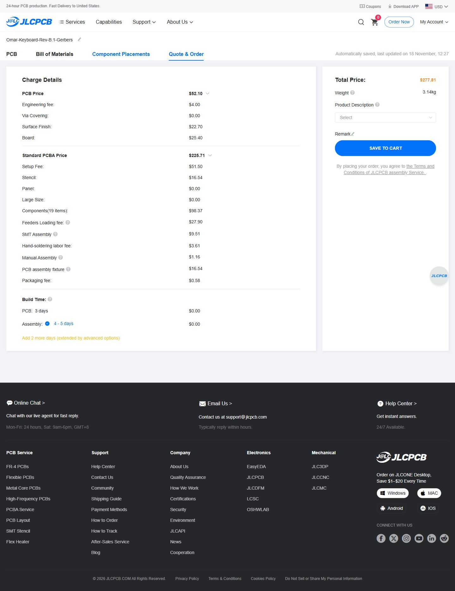

# Omar-Keyboard Rev B.1 · JLCPCB assembly quote

**$277.81 USD for five populated mainboards, or $55.56 per board.** JLCPCB accepted all 403 placements on each board, including both Bourns encoders, 90 LEDs and 90 MX sockets. Quote retrieved November 18, 2026. Shipping and taxes are additional. [Live estimate](https://cart.jlcpcb.com/smt-order/?pcbFileNo=69fe0c08dfc546d8a6f6234dd1f30ae8)

| Batch of five | USD |
| --- | ---: |
| PCB fabrication, including ENIG and engineering | 52.10 |
| Setup | 51.50 |
| Stencil | 16.54 |
| Components, 19 unique JLCPCB part numbers | 98.37 |
| Feeder loading | 27.90 |
| SMT assembly | 9.51 |
| Hand-soldering labor | 3.61 |
| Manual assembly | 1.16 |
| Assembly fixture | 16.54 |
| Assembly packaging | 0.58 |
| **Standard PCBA subtotal** | **225.71** |
| **Total** | **277.81** |

JLCPCB detected a 405.81 × 120.06 mm two-layer board. The quote specifies 1.60 mm FR4, ENIG, five PCBs and five double-sided assemblies. JLCPCB adds two 5 mm rails. The site displayed three days for PCB fabrication, four to five days for assembly and two additional days for advanced options, before transit.

## What JLCPCB will populate

All 20 BOM rows were selected in the quote and covered 2,015 installed components across five boards. D75 shares the matrix diode part number with the other 91 diodes and uses a different footprint, which accounts for the 19 unique parts. Each board has 29 top and 374 bottom components. The two corner encoders are top-mounted through-hole parts.

| Quoted line | Installed across five | Vendor-priced quantity | Included batch price |
| --- | ---: | ---: | ---: |
| Bourns PEC11R-4220F-S0024, C143797 | 10 | 10 | $23.0440 |
| OPSCO SK6812MINI-E, C5149201 | 450 | 454 | $25.7418 |
| HanElectricity CPG151101S11-16 sockets, C41430893 | 450 | 452 | $14.8256 |

The earlier $189.38 estimate covered five PCBs with two partially populated. This run populates all five, with all ten encoders installed. The quote covers mainboard assembly. The USB-C daughterboard and harness, external roller assembly, plug-in switches, keycaps, knobs and case are separate keyboard assemblies.

## Board changes and first-article fit

ENC1 and ENC2 retain the original shaft centers. The anchors move from ±4.65 to ±5.70 mm about each center. Their 2.00 × 4.40 mm plated, round-ended slots accommodate the rectangular tab envelope. The drawing's 13.20 mm outside dimension corresponds to 11.40 mm center spacing with nominal 1.80 mm-wide openings. Five Ø1.05 mm plated holes receive A, common, B and the two push contacts. KiCad verifies all 1,078 connected pad assignments across 235 nets with zero DRC violations and zero unconnected pads. The Bourns part supplies 24 pulses and 24 detents a turn. The existing four-transition QMK setting targets one adjustment per click. [Bourns drawing](https://www.bourns.com/docs/Product-Datasheets/PEC11R.pdf)

The stock 20 mm shaft and 6.5 mm body put the shaft tip 21.5 mm above the plate with the PCB at −5 mm. The assembly target is a +23 mm knob top using a Ø18 × 12 mm knob. Verify bore depth, the set screw on the flat, the full 0.5 mm push stroke and physical fit of the plate opening on the sample.

