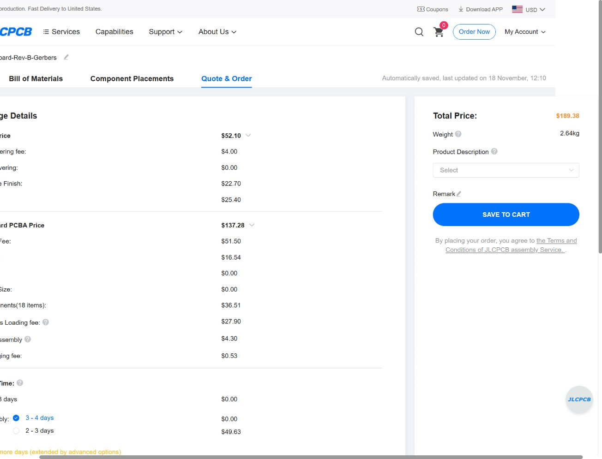

# Omar-Keyboard Rev B · JLCPCB prototype quote

**$189.38 USD before shipping, taxes and duties** for five Rev B PCBs, with standard double-sided assembly on two. Each assembled board includes all 90 SK6812MINI-E backlight LEDs, all 90 hot-swap sockets and 401 of 403 fitted components. JLCPCB leaves the two corner dial encoders empty on each assembled board. The other three PCBs are bare. This is a saved estimate dated November 18, 2026. No order was placed. [Open the live JLCPCB quote](https://cart.jlcpcb.com/smt-order/?pcbFileNo=d7a8ade119fd40438c98fb56c245360b)

| Charge for the batch | USD |
| --- | ---: |
| Five bare boards, including engineering and ENIG | 52.10 |
| Assembly setup | 51.50 |
| Stencil | 16.54 |
| Components, 18 distinct part numbers | 36.51 |
| Feeder loading | 27.90 |
| SMT assembly | 4.30 |
| Assembly packaging | 0.53 |
| **Standard assembly subtotal** | **137.28** |
| **PCB and assembly total** | **189.38** |

JLCPCB detected a two-layer board measuring 405.81 × 120.06 mm and added two 5 mm assembly rails. The site displayed three days for PCB fabrication, three to four days for assembly and two additional days for advanced options. Shipping was outside the priced subtotal. The Rev B batch is **$27.51 more** than the earlier $161.87 Rev A partial quote. Rev B includes the sockets, capacitors, service switches and 75 additional LEDs per board, so the difference covers more than lighting.

## What JLCPCB will populate

Amounts below are line totals for the two-board run and are already included in the quote. The quantity JLCPCB prices can exceed the number installed to cover setup, loss or minimum quantities. For the backlight specifically, **180 LEDs are installed, and 184 are priced at $10.4328**.

| Function | Parts per board | Selected JLCPCB part | Units priced | Line USD | Compatibility |
| --- | ---: | --- | ---: | ---: | --- |
| Addressable RGB backlight | 90 | OPSCO SK6812MINI-E, C5149201 | 184 | 10.4328 | Original reverse-mount RGB LED, driven white by firmware |
| MX hot-swap sockets | 90 | HanElectricity CPG151101S11-16, C41430893 | 182 | 6.7158 | Alternate manufacturer with the same part number. Its drawing specifies two Ø3.00 mm holes offset 6.35 × 2.54 mm and 2.55 × 2.50 mm lands, matching Rev B. |
| 1 µF capacitors | 6 | Walsin 0603B105K160CT, C108463 | 40 | 0.5840 | 0603, 16 V, X7R, ±10% |
| 100 nF capacitors | 102 | Yageo CC0603KRX7R9BB104, C14663 | 235 | 1.1515 | 0603, X7R, ±10%, 50 V versus the original 16 V rating |
| 15 pF crystal capacitors | 2 | Samsung CL10C150JB8NNNC, C1644 | 20 | 0.2220 | 0603, 50 V, C0G, ±5%. Preserves the selected crystal load capacitors. |
| BOOT and RESET service switches | 2 | C&K PTS810SJK250SMTRLFS, C221896 | 5 | 2.9810 | Same SPST-NO J-lead footprint and 2.5 mm height. Nominal press force rises from 1.6 N to 2.6 N. |

The original JLCPCB lines for the 1 µF, 100 nF and 15 pF capacitors were short by 40, 211 and 18 units, respectively. The original socket line was short by 181, the encoder by four and the original service switch by two. The replacement service switch showed 586 units in JLCPCB public inventory when checked. Review the socket orientation in JLCPCB’s placement preview and confirm insertion on the first physical board. [Socket drawing](https://datasheet.lcsc.com/datasheet/pdf/d953a8b0b623247f3341ebcfbaa2e88f.pdf?productCode=C41430893) · [Service switch drawing and force options](https://www.ckswitches.com/media/1476/pts810.pdf) · [Walsin capacitor](https://jlcpcb.com/partdetail/Walsin_TechCorp-0603B105K160CT/C108463) · [Yageo capacitor](https://jlcpcb.com/partdetail/C14663) · [Samsung capacitor](https://jlcpcb.com/partdetail/1996-CL10C150JB8NNNC/C1644)

## The two corner dial encoders

The quoted build omits **ENC1 and ENC2**. The specified TT Electronics EN11-HSM1BF20, C7464876, showed zero JLCPCB stock. Searching the EN11-HSM family returned the original and a 15 mm shaft variant, both with zero stock. The following stocked 20 mm flat-shaft push encoders would require a board change. The current PCB places the two retention slots 9.30 mm center-to-center, with an 11.10 mm outside span. [Original TT drawing](https://www.ttelectronics.com/TTElectronics/media/ProductFiles/Datasheet/EN11.pdf)

| Candidate | JLCPCB public stock observed | Fit against Rev B |
| --- | ---: | --- |
| Bourns PEC11R-4220F-S0024, C143797 | 560 | The drawing gives a 13.2 mm outside span for the retention slots. It also changes the dial to 24 detents and 24 pulses per revolution. [Bourns drawing, page 2](https://www.bourns.com/docs/Product-Datasheets/pec11R.pdf) |
| Alps Alpine EC11E18244A5, C255515 | 306 | The drawing gives a 12.5 mm outside span and 1.5 mm slot width. It also changes the dial to 36 detents and 18 pulses per revolution. [Alps mounting drawing](https://tech.alpsalpine.com/cms.media/product_detail_fig_ec11_d_83_en_1f3da99620.gif) · [Alps specifications](https://tech.alpsalpine.com/e/products/detail/EC11E18244A5/) |

**To finish two keyboards with the existing PCB**, source four original TT encoders and fit them after PCBA. DigiKey’s US listing showed $3.81 each at the single-unit tier, or $15.24 for four. At that price the board run plus four loose encoders would total **$204.62** before shipping, taxes and installation. Current distributor availability and pricing should be checked when ordering. The external USB-C carrier, plug-in switches, caps, roller and enclosure are separate assemblies. [DigiKey exact part](https://www.digikey.com/en/products/detail/tt-electronics-bi/EN11-HSM1BF20/2620667)

The [quote-specific BOM](Omar-Keyboard-Rev-B-JLCPCB-quote-BOM.csv) carries the five stocked substitutions. It includes the design's encoder line for traceability. To reproduce the saved selection, choose “Do not place” for ENC1 and ENC2 and select both diode lines and LED1–LED90. Use the original Rev B CPL. The audited design BOM remains the engineering baseline.

