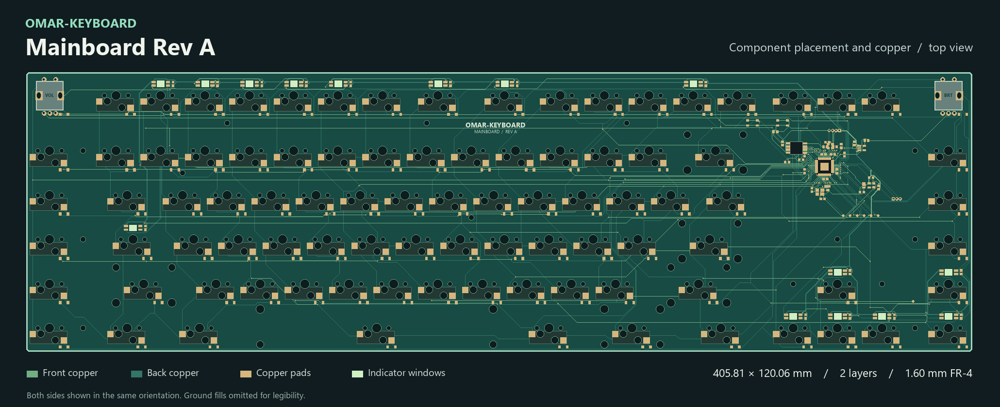

# Omar-Keyboard mainboard · Rev A

A wired, two-layer RP2040 mainboard for the 90-key Omar-Keyboard. Both corner dials can be pressed. The wide roller has its own quadrature input. Fifteen indicator lights mark Caps, desk destinations, transfer actions, microphone mute and window controls.



Open **omar-mainboard.kicad_pro** in KiCad with its standard footprint libraries installed. Open the root schematic from the project to navigate the eight sheets. The local symbol and footprint libraries sit beside the project file. The [BOM](bom.csv) lists each electrical reference, its side and quantity. J1, J2 and TP1–TP7 are copper features on the bare board. Order wire for the harnesses. The [verification report](verification.md) records the state of this revision and the checks required before ordering.

## Board specification

| Item | Rev A design |
| --- | --- |
| Outline | 405.81 × 120.06 mm, R1 corners. Datum and switch centres follow the project layout CSV. |
| Stack | Two copper layers, 1.60 mm FR-4, nominal 1 oz copper. Specify the complete outline and internal LED windows when requesting a quote. |
| Switch field | 90 bottom-mounted Kailh CPG151101S11-16 sockets for five-pin MX switches. Each switch and each encoder push has a 1N4148W diode. The cathode band faces the row net. |
| Processing | Bare RP2040 QFN-56 with exposed ground pad, 12 MHz crystal, W25Q16JVSSIQ 2 MB external flash and AP2112K-3.3 regulator. The chip scans the matrix and all three encoders directly. |
| Lighting | 15 individually addressable reverse-mounted SK6812MINI-E LEDs. U4 translates 3.3 V data to 5 V. Each LED has local bypassing. Buy the documented Rev 02 pin assignment and confirm the marked first pin on a sample. |
| Controls and service | Two TT Electronics EN11-HSM1BF20 dial encoders, a three-wire roller connection, BOOTSEL, RUN and SWD pads. |
| Mounts | Twelve Ø2.2 mm shared M2 holes plus two interior PCB-only supports. The six stabilized keys have 24 additional bores. |

The low-profile RP2040 sits at **(342.00, 40.00) mm** in the roller bay. Flash and clock parts are close to it. This area gives the 0.4 mm-pitch pins room to spread out on two layers. The USB-C port keeps its rear position behind Desk 3. J1 sits beside the controller at (348.50, 24.50) mm. Allow approximately 260–300 mm of internal USB cable, including strain relief. Make the first harness to the actual tray path. Use a USB-rated twisted data pair, power and ground conductors. The nominal roller-to-PCB gap is 3 mm. Check component tops, wire dressing and the full turn of the barrel before fixing the harness. The [assembled cutaway](../model/internals/Controller-fit.png) shows the RP2040 in its routed position. The mounted package envelope clears the tread by 2.00 mm.

The PCB omits the proposed interior boss at **(278.60, 80.96) mm**. It overlaps the Enter stabilizer bore at **(280.95, 79.695) mm**. The matching tray omits this boss. H13 and H14 remain at (66.68, 42.86) and (190.50, 61.91) mm. Blender uses the TT footprint’s actual terminal and tab positions. Check clip fit, shaft height and push travel with the purchased encoder. [Assembly dimensions](../assembly-design-specification.md)

## Signals and connectors

| Connection | Pins and behavior |
| --- | --- |
| GP0–GP7 | ROW0–ROW7. The 8 × 12 matrix has 92 populated intersections and four unused positions. |
| GP8–GP19 | COL0–COL11. QMK scans COL2ROW with 5 ms debounce. |
| GP20 / GP21 | Volume encoder A/B. Press is a separate matrix contact. |
| GP22 / GP23 | Brightness encoder A/B. Press is a separate matrix contact. |
| GP24 / GP25 | Roller A/B. J2 pins 1, 2, 3 carry A, common ground, B. Base layer scrolls, Fn sends page steps. |
| GP26 | Serial indicator data through the 5 V AHCT buffer, then LED1–LED15. GP27–GP29 are spare. |
| J1 | Pin 1 protected USB VBUS, 2 D−, 3 D+, 4 GND. Pin 1 is square. The four-conductor harness joins the rear USB-C carrier to the mainboard. Preserve the twist up to both terminations. |
| TP1–TP7 | In order, GND, 3V3, SWCLK, SWDIO, 5V, 1V1 and the last LED’s data output. |

J1 expects the separate carrier to provide a USB-C receptacle, one 5.1 kΩ pull-down on each CC pin, connector-side low-capacitance ESD protection and the protected VBUS feed. The mainboard houses the RP2040-side 27 Ω series resistors. A compatible carrier is required to plug a USB cable into this assembly.

## Cost at prototype quantities

The board width and two-sided assembly deserve their own quote. The RP2040 uses 27 GPIO and avoids an extra controller module, GPIO expander and their headers. Status lighting is limited to the 15 keys that communicate a state. Hot-swap sockets are the largest fitted line item below.

| Fitted on one mainboard | Basis in the project parts plan | Extended USD |
| --- | --- | ---: |
| 90 sockets | 90 × $0.11 | $9.90 |
| 92 matrix diodes | 92 × $0.0665 | $6.12 |
| 15 LEDs | 15/25 of a $5.99 pack | $3.59 |
| RP2040, flash, level buffer | $0.76 + $1.96 + $0.14 | $2.86 |
| Two push encoders | 2 × $3.81 | $7.62 |
| **Fitted subtotal of these lines** | | **$30.09** |

The existing bare-board allowance is **$55–150 for the prototype lot**. For a five-board quote that would allocate $11–30 per bare board if all five are used. Add the regulator, crystal, remaining passives, buttons, carrier, roller encoder, assembly, minimum-order quantities, shipping and tax. Key switches, caps, plate and case belong to the keyboard budget. The part subtotal and board-lot allowance are estimates derived from the project parts plan.

The [fabricator quote package](Omar-Keyboard-Rev-A-quote.zip) includes both copper layers, masks, legends, paste, board outline, plated slots and separate plated and nonplated drill files. Quote the full-size board with 0.175 mm nominal signal traces and clearance, 0.30 mm via drills, 1 oz copper and the specified internal windows. A physical fit sample and the USB-C carrier are still required for a complete keyboard.

Request two assembly prices for the same stack and quantities. The first covers the full two-sided population. The second covers the fine-pitch controller and support electronics, leaving the easily accessible sockets and encoders to be hand-fitted. Compare setup charges, manual assembly time and yield. ENIG is the baseline finish. Ask the assembler whether lead-free HASL meets its 0.4 mm-pitch QFN flatness and assembly requirements before using a lower-cost finish. [Detailed project parts plan](../parts-plan.md)

## Build the QMK target

Install the QMK build environment and an Arm embedded toolchain. The checked target uses QMK **0.31.0** at commit **b315b707e60f86d79d34bcb7a15084468117c1a1**. From the Omar-Keyboard repository root, run the following in Bash. The new QMK checkout is a sibling of the project. [QMK setup](https://docs.qmk.fm/newbs_getting_started) · [QMK RP2040 support](https://docs.qmk.fm/platformdev_rp2040)

```sh
git clone --branch 0.31.0 --depth 1 --recurse-submodules --shallow-submodules https://github.com/qmk/qmk_firmware.git ../omar-qmk
mkdir -p ../omar-qmk/keyboards/omar_keyboard/rev_a
cp -R firmware/qmk/omar_keyboard/rev_a/. ../omar-qmk/keyboards/omar_keyboard/rev_a/
cp firmware/qmk/omar-controls.h firmware/qmk/omar-indicators.h ../omar-qmk/keyboards/omar_keyboard/rev_a/keymaps/default/
make -C ../omar-qmk omar_keyboard/rev_a:default
```

On a verified first article, hold BOOTSEL, pulse RUN and then release BOOTSEL. Copy the [built UF2](../../firmware/builds/omar_keyboard_rev_a_default.uf2) to the RP2040 boot drive. The target declares a 500 mA USB configuration and uses private test IDs **1209:0001**. Allocate suitable product IDs before distributing devices. The desk and microphone status bridge accepts `--vid 0x1209 --pid 0x0001`. It uses the project's existing raw HID protocol. [Private USB test ID](https://pid.codes/1209/0001/) · [Omarchy host integration](../../host/omarchy/)

## Component references

- RP2040 power, QSPI, USB, crystal and boot circuits. [Raspberry Pi hardware design guide](https://datasheets.raspberrypi.com/rp2040/hardware-design-with-rp2040.pdf)
- Socket underside land pattern and orientation. [Kailh socket drawing](https://datasheet.lcsc.com/lcsc/2208291600_Kailh-CPG151101S11-16_C5156480.pdf)
- Dial terminal pattern, shaft and mechanical tabs. [TT Electronics EN11 family drawing](https://www.ttelectronics.com/TTElectronics/media/ProductFiles/Datasheet/EN11.pdf)
- Indicator window, pinout and marking. [OPSCO SK6812MINI-E Rev 02 drawing](https://cdn-shop.adafruit.com/product-files/4960/4960_SK6812MINI-E_REV02_EN.pdf)

The repository’s MIT license applies to Omar-Keyboard’s original work. QMK and the KiCad standard-library elements retain their upstream terms. [QMK license](https://github.com/qmk/qmk_firmware/blob/0.31.0/LICENSE) · [KiCad library licensing](https://www.kicad.org/libraries/license/)
