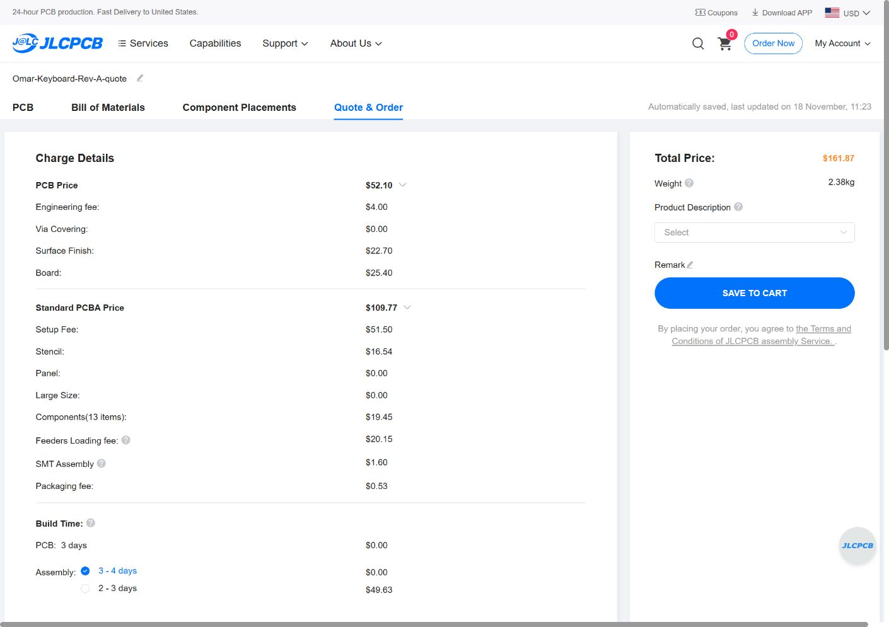

# JLCPCB prototype estimate · Rev A

November 18, 2026 · USD · Five Rev A bare boards, with standard assembly on both sides of two boards. JLCPCB accepted the Gerber archive, purchasing BOM and 248-position placement file. Five component lines lacked sufficient stock. This quote leaves those placements empty.

| Quoted item | USD |
| --- | ---: |
| Five PCBs, including engineering and ENIG | 52.10 |
| Assembly setup | 51.50 |
| Stencil | 16.54 |
| Parts, 13 unique items | 19.45 |
| Feeder loading | 20.15 |
| SMT placement | 1.60 |
| Assembly packaging | 0.53 |
| **Fabrication and partial assembly** | **161.87** |

The initial US shipping estimate was $37.64. Combining that estimate with the quoted subtotal gives $199.51 before any tax or duties. The final assembly screen priced shipping separately. The quoted build times were three days for PCB fabrication and three to four days for assembly.

| Omitted line | Exact manufacturer part | JLCPCB shortfall for this quote, including setup quantities |
| --- | --- | ---: |
| 90 Kailh hot-swap sockets per board | CPG151101S11-16 | 181 |
| Two panel encoders per board | EN11-HSM1BF20 | 4 |
| 1 µF capacitors | GRM188R71C105KA12D | 40 |
| 100 nF capacitors | C0603C104K4RECTU | 61 |
| 15 pF capacitors | C0603C150J5GACTU | 18 |

The selected components included the RP2040, flash, regulator, level shifter, matrix diodes and Rev A's 15 SK6812MINI-E LEDs per board. The LED line was $2.7404 for 34 units, including setup quantity. The external USB-C carrier, switches, keycaps, case and final keyboard assembly are outside this quote. Rev B's 90-key backlight requires another fabrication and assembly quote. No order was placed.

