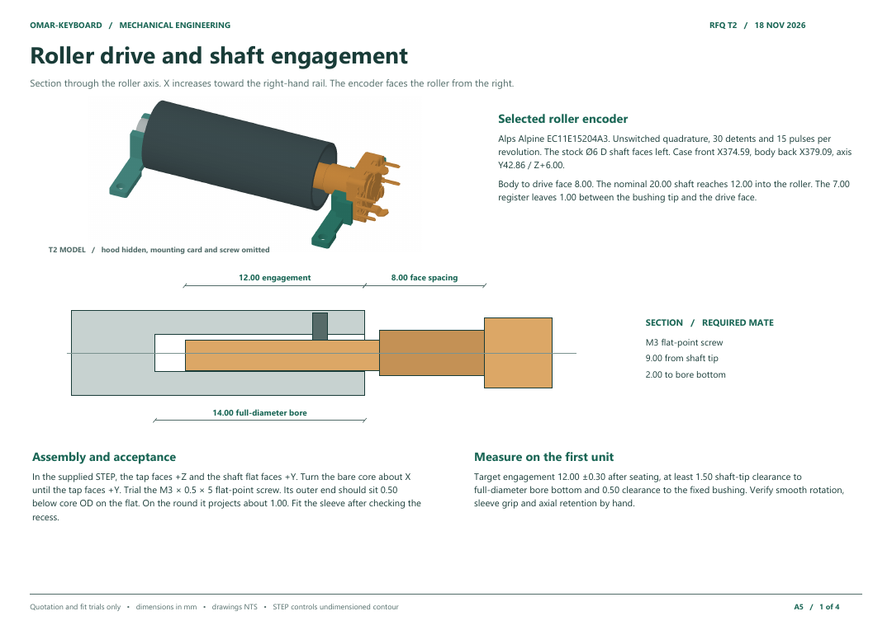

# Omar-Keyboard switch plate and roller drive

**Earlier mechanical revision.** Use the [T3 assembly](../rev-b2-t3/README.md) with the B.2 mainboard and roller card. The prices on this page apply to T2.

**Mechanical prototype T2 · Rev B.1 mainboard · 18 November 2026.** Dimensions are in millimetres. Open the [positioned plate and roller assembly](A5-Plate-and-roller-fit-T2.step) in SolidWorks. Hide R03 to expose the encoder and supports. [Dimensioned roller assembly](R02-R05-Roller-assembly-T2.pdf)

**Use of these files.** Use T2 to quote P01 and make fit coupons. Release the production plate and roller only after the encoder card, harness and service path clear the assembled deck. The T2 assembly shows a simplified encoder and a tap clocked 90° away from its shaft flat. The corrected mate, mounting card and pull-ups are requirements for the next model and electrical release.

## Switch plate quotations

One flat 405.81 × 120.06 × 1.50 plate in bare 5052 aluminum with 122 through-openings. The finished dimensions of the 92 switch and dial windows are 14.00 to 14.05 on both axes. The total nominal cut path is 6.893994 m. The 122 internal contours plus one outer contour require 123 starts. The two calculators received aggregate measurements. Neither received the CAD. Neither estimate confirms finish tolerance or flatness.

| Supplier | Quantity-one result and scope |
| --- | --- |
| JLCCNC | JLCCNC recognized the STEP as 405.81 × 120.06 × 1.50 mm and 43,456.99 mm³. Quantity one, bare 5052. The saved specification requested deburring, finished 14.00–14.05 windows, stock thickness and free-state flatness. The portal requires a shipping address and telephone to release a manual RFQ. No submission reference or fabrication price was issued. [Portal capture](JLCCNC-manual-review.jpg) · [Sheet-metal quoting](https://jlccnc.com/sheet-metal-quote) |
| Urban Metal Laser Cutting, New York | **US$706.48** estimated. Supplier range **$600.51–$847.78**. Reference **UMLCI-MWMIDANG**. The calculator used 271.4171 inches of cut, 123 pierces, the 30+ cutout category, 1.50 mm aluminum, deburred, quantity one and standard timeline. It assigned $325.70 to material, $307.50 to holes, $40.71 to cutting and $32.57 to finishing. Its result displays free pickup. Freight and tax have no quoted amount. The public service lists cutting tolerance as tight as ±0.005 in (±0.127 mm). Ask the shop to confirm the critical windows. [Price capture](Urban-Metal-plate-estimate.jpg) · [Shop calculator](https://metallasercutnyc.com/calculator) |
| IoT Control Solution, Malaysia | **RM 114.12** estimated for one plate, material included. Input 5052, 1.50 mm, 405.81 × 120.06, 6.893994 m cut, 123 pierces, 85% nesting and standard urgency. The price includes programming and handling. Deburring, dimensional inspection, freight, taxes and duties have no separate price or acceptance. [Price capture](IoT-Control-plate-estimate.jpg) · [Shop calculator](https://iotcontrolsol.com/laser-cutting-services/) |

Fabworks did not receive the plate. Its upload permission was declined. Its listed 0.063 in aluminum is approximately 1.60 mm. The T1 core and tray prices belong to the earlier quotation package.

## Files for pricing and prototype fit checks

| Item | Drawing and geometry |
| --- | --- |
| P01 · full switch plate | Send the [plate-only RFQ ZIP](P01-T2-plate-only-RFQ.zip) containing the [STEP](P01-Switch-plate-T2.step), [flat DXF in mm](P01-Switch-plate-T2.dxf), and [two-sheet drawing](P01-Switch-plate-T2.pdf). The DXF contains one contour per cut and zero annotations. |
| P02 · optional fit coupon | [STEP](P02-Fit-coupon-T2.step) · [Drawing](P02-Fit-coupon-T2.pdf). Quote separately. Check actual switches and clips on the same sheet and finishing process. |
| R01 · turned 6061-T6 core | [STEP](R01-Scroll-roller-core-T2.step) · [Drawing](R01-Scroll-roller-core-T2.pdf). Full-diameter bore Ø6.05 × 14.00 with M3 radial tap 3.00 from drive end. Threads use tap-drill geometry in STEP. |
| R02 · silicone sleeve | [Stock reference](R02-Silicone-sleeve-reference-T2.step). Nominal Ø14 ID × Ø16 OD × 42.00. |
| R03 · removable bezel | [STEP](R03-Encoder-bezel-T2.step). Enlarged RH hood captures the stationary bushing and rear of the encoder. |
| R04 · bearing carrier | [STEP](R04-Bearing-carrier-T2.step). MR63ZZ bearing, Ø3 × Ø6 × 2.5. |
| R05 · lower encoder cradle | [STEP](R05-Encoder-cradle-T2.step). Seated register, anti-rotation cheeks, two original fixing centers. |
| R02–R05 · mating dimensions and service | [Four-sheet drawing](R02-R05-Roller-assembly-T2.pdf). The layout STEP contains eight named solids. It includes a simplified encoder for positioning. Use the [Alps Alpine drawing and STEP](https://tech.alpsalpine.com/e/products/detail/EC11E15204A3/) for the actual tabs, shoulder and shaft tolerances. |

## Fit checks and SolidWorks mates

Use the plate top as Z0. A drawing coordinate (X,Y) from the left and rear field datums becomes (X,−Y,Z) in STEP. Position the bezel at (347.665,−42.86,0), R04 at (322.565,−42.86,0), R05 at (372.765,−42.86,0), and the core and sleeve at (324.59,−42.86,+6). Orient the non-push EC11E15204A3 shaft toward the left at Y42.86 and Z+6. The shaft is supplied at full length.

| Check | T2 nominal |
| --- | --- |
| Closest web from the new 9.50 × 17.50 R0.75 relief | 2.920 to deck fixing H4. 3.059 to roller fixing M4, formerly 0.388. 4.500 to either right-rail switch opening. The other 121 openings retain their locations and shapes. Across the entire plate, the smallest internal web is 1.640 at the stabilizer-to-switch pairs. The smallest outside-edge margin is 3.020. |
| Shaft engagement and end clearance | 12.00 in a 14.00 full-diameter bore. Shaft tip X354.59. Core face X366.59. Bushing projects 7.00 from housing front X374.59, leaving 1.00 to the tread. Screw center X363.59 lands 9.00 from the tip on the 12.00 flat. |
| Retention | Split Ø7.10 register seat, 0.10 front and 0.15 rear axial play at nominal position. Housing cheeks resist rotation. Trial the M3 × 0.5 × 5 flat-point screw and the four underside M2 fasteners in the selected material. |
| Neighboring parts | Housing and tab clearance checked against the actual Alps solid. The envelope reaches Z−0.55. Bare PCB top is at Z−5.00. Hood edge X384.70 leaves 1.59 to the nominal right cap skirt. The crossbar above the encoder tops out at Z14.30. |
| CAD verification | The seven part STEP files reimport as valid single solids. The assembled STEP reimports as eight valid solids. Volume intersection tests for sensor/plate, sensor/core, sensor/cradle, sensor/hood, cradle/hood, tread/hood, tread/plate, bearing/hood, bearing/carrier, core/bearing, carrier/hood and both supports examined against the plate or hood found zero nominal interference. |

## What to verify before production

- **Encoder mounting.** Solder all metal lugs and A/C/B to a mounting card perpendicular to the roller axis. The upper terminal at X381.50 spans Z8.05–8.95 above the Z7.00 notch. Side clearance is only 0.375 mm and the rear stops begin 0.15 mm behind the case. Model the actual solder, insulation, strain relief and bend radius. Recheck the card against P01, the hood, fasteners, caps and populated PCB.
- **Electrical.** Wire the card to J2 pin 1 A/GP24, 2 GND, 3 B/GP25. The next mainboard needs two 2.7 kΩ ±1% pull-ups to 3V3. Check 1–10 mA closed current and 30 counts per turn in both directions. The 403-position Rev B.1 quote excludes these resistors and the separate card.
- **Drive and service.** Turn the bare core until the tap faces the shaft flat (+Y in the documented pose). Verify the 5 mm flat-point screw sits below core OD and fit the sleeve. Free the deck and J2, remove the four underside screws and hood, then trial lifting R04 with the coupled rotor and encoder. Separate the bearing carrier axially on the bench. Its 4.923 mm opening captures the Ø6.00 bearing.
- **Clearances.** Tread-to-hood and tread-to-plate distances are 0.433 and 0.485 mm at closest approach. Encoder-to-hood and encoder-to-cradle distances are 0.050 mm, encoder-to-plate is 0.253 mm, and the bearing-seat radial allowance is 0.020 mm. Trial coupons and measure finished seats. Check full rotation under end load. Obtain written shop acceptance for the 92 finished 14.00–14.05 windows.

See the [roller assembly drawing](R02-R05-Roller-assembly-T2.pdf), sheets 3–4, for removal and inspection. The card fit and physical trial are open.
