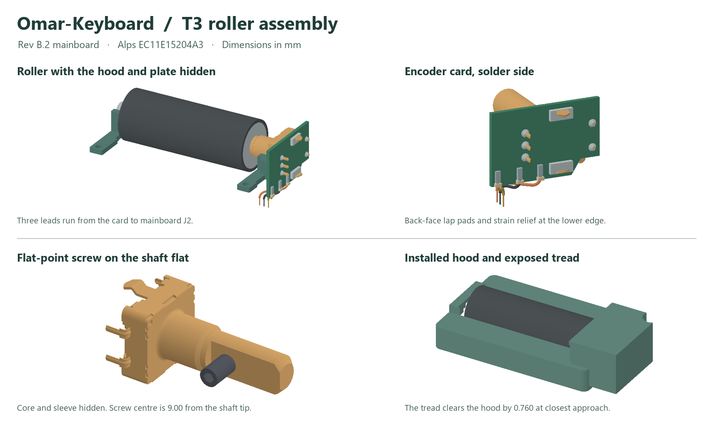

# T3 roller assembly and switch plate

Open the [positioned STEP assembly](A5-Plate-and-roller-T3.step) in SolidWorks. Hide R03 and P01 to inspect the encoder card, three wire routes and their J2 ends. Hide R02 and R01 to see the M3 screw on the shaft flat. The tree includes the native B.2 mainboard substrate, the native card substrate, individual wire jackets and bare ends, solder and strain-relief envelopes, four mounting screws and nearby electronic component envelopes.

## Part files and datums

| Part | Geometry and assembly reference |
| --- | --- |
| P01 | [T3 switch plate](P01-Switch-plate-T3.step). 405.81 × 120.06 × 1.50. The tread opening is 44.40 × 13.50 R0.55. The shaped harness opening leaves 3.391 to H4 and 2.133 to M4. All 92 station centres and the 12 shared deck holes retain their KiCad positions. |
| R01, R02 and R05 | Use the [T2 bare-core machining drawing](../rev-b1-t2/R01-Scroll-roller-core-T2.pdf), [bare-core STEP](../rev-b1-t2/R01-Scroll-roller-core-T2.step), [sleeve](../rev-b1-t2/R02-Silicone-sleeve-reference-T2.step) and [cradle](../rev-b1-t2/R05-Encoder-cradle-T2.step). The T3 installed positions are in this assembly. The stand-alone R01 machining STEP retains the Ø2.50 tapping pilot. The assembly suppresses the M3 mating threads. |
| R03 and R04 | [T3 hood](R03-Encoder-hood-T3.step) and [T3 bearing carrier](R04-Bearing-carrier-T3.step). Each standalone part uses its original local mounting datum. The revised hood contains the card stop and clears the tails and pigtail. R04 relieves the stationary shoulder to Ø5.26 under the shield and inner race. Verify contact on the purchased bearing’s outer race. |
| Coordinate system | Dimensions below are field X right, field Y toward the spacebar, plate top Z0. STEP uses (X, −Y, Z). The T3 roller group sits 3.10 mm left of T2. Tread spans X321.49–363.49. Axis Y42.86, Z+6.00. M2 centres X319.465 or 369.665, Y27.26 or 58.46. |
| Encoder and card | Encoder housing front X371.49 and rear X375.99. Mounting face X375.99, solder side X376.99. H4 stays (381.00, 33.34) with a Ø6.80 vertical hood relief. Trim the two dummy tails per the [card drawing notes](../../roller-encoder-card/README.md). |
| Shaft and screw | Tip X351.49, drive face X363.49, screw X360.49. Engagement 12.00, full-bore depth 14.00, tip allowance 2.00. The M3 × 0.5 × 5 flat point contacts the +Y shaft flat in STEP. The outer face is 0.50 below core OD at its centre. Its outer rim clears the sleeve by 0.329. |

## Nominal minimum distances

| Pair | Minimum in mm |
| --- | ---: |
| Card to hood / plate | 0.370 / 1.100 |
| Wire jackets, ends, lap joints and strain relief to hood / plate | 1.501 / 1.256 |
| Encoder-terminal and lug solder envelopes to hood / plate | 0.990 / 2.350 |
| Tread to hood / plate / left carrier | 0.760 / 1.031 / 0.750 |
| Bare encoder to plate / Ø5.40 H4 tool envelope | 0.763 / 1.117 |
| Hood to nearby key travel boxes / Ø5.40 H4 tool | 2.660 / 0.700 |
| Wire assembly to nearby component envelopes / four module screws | 3.564 / 3.088 |
| Closest wire jacket to another wire jacket or bare end | 0.614 |

The 0.370 card gap is at an intentional axial stop. The nominal encoder-to-keeper fit is 0.050. Use a coupon and finish the stationary seat to the measured bushing. The Ø6.04 bearing seat has 0.020 nominal radial allowance to the Ø6.00 MR63ZZ. These are fitted interfaces. Use the first article to establish finished seat tolerances, torque, sleeve grip and loaded runout.

## Assembly and service

1. Solder the encoder to the card, trim the two dummy pins, attach the three leads and strain-relieve the jackets. Inspect for bridges. Check A, ground and B to J2 and confirm the tabs cannot rock in their lands.
2. Assemble the bearing to the journal, supporting the inner race. Seat the shaft 12.00 into the bare roller. Turn the core tap to the shaft flat and tighten the flat-point screw. Verify recess, 2.00 nominal tip clearance and axial retention before sliding on the silicone sleeve.
3. Fit R04, R05 and the coupled rotor/card against P01. Dress the three leads through the shaped passage, fit the hood and install the four underside M2 screws. With the board supported, solder J2 pin 1 A at X371.50, pin 2 GND at X373.00 and pin 3 B at X374.50, all at Y53.90.
4. To disassemble, unplug USB, support and split the deck, desolder the J2 ends and straighten the freed leads through the opening. Support the rotor and card as you remove the four underside screws and lift the hood. Lift R04 with the rotor and encoder, then withdraw R04 and the bearing axially on the bench. Slide off the sleeve and loosen the M3 screw to free the shaft.

An 18 mm vertical hood-removal envelope clears the card by 0.370 and the solder and lead attachments by 0.680. The straightened service leads clear the plate by 1.873. Test the complete removal and refit by hand before setting production tolerances. Measure both closed-contact currents at 1–10 mA, check 30 clean scroll events per turn in both directions, and rotate the tread 360° under centre and end loads.

The component and solder solids are fit envelopes. The selected encoder is represented by the Alps geometry with the documented dummy-tail trim. The board and card are electrically untested prototypes. [Alps reference](https://tech.alpsalpine.com/e/products/detail/EC11E15204A3/) · [B.2 PCB files](../../mainboard-rev-b2/README.md)
