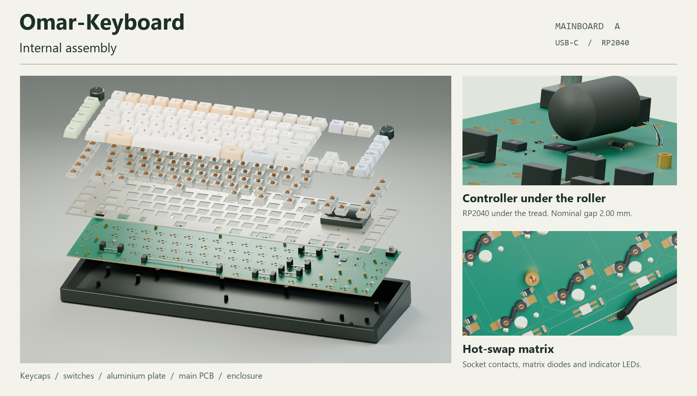

# Omar-Keyboard internal assembly

Open the [offline 3D viewer](View-Internals.html) and use **Layer spacing** to open the keyboard. **Main PCB** isolates the electronics. **Rear USB-C** moves in on the port behind Desk 3. **Under the roller** shows U1 and the tread in assembled position. **Socket side** turns the board over.

The [editable Blender assembly](Omar-Keyboard-Internals.blend) opens exploded. Frame **1** puts the components in their assembled positions. Frame **61** separates the tray, populated board, aluminium plate, switches and keycaps. The [portable GLB](Omar-Keyboard-Internals.glb) includes the same two-second animation.



| View | What to inspect |
| --- | --- |
| [Exploded assembly](Exploded.png) | The original 422.8 × 137.1 mm case, 6° typing angle, three rotary controls, 1.5 mm plate, hollow keycaps and 90 five-pin MX switch assemblies. |
| [Controller fit](Controller-fit.png) | Dimensioned section through U1 at x = 342 and an assembled Blender cutaway. The mounted RP2040 envelope clears the tread by 2.00 mm. |
| [Rear inlet](USB-and-logic.png) | Separate USB-C carrier behind Desk 3 with its protection components and cable breakout. |
| [PCB underside](PCB-underside.png) · [socket detail](Socket-detail.png) | Ninety hot-swap socket bodies, matrix diodes, reverse-mount LEDs and the routed board. |
| [Tray STL, mm](../Omar-Keyboard-Tray.stl) | Single desk-oriented shell with fourteen bosses, carrier slides and three harness saddles. |

## Fit and rebuild inputs

The model reads [geometry exported from KiCad](board-geometry.json) and checks its source hash against the [routed PCB](../../mainboard/omar-mainboard.kicad_pcb). The board, LED windows, plated and nonplated holes, tracks, package positions and both corner encoder terminal patterns share the PCB datum. Component bodies, screws, switch mechanisms and harness bend radii are nominal. The first physical build must verify shaft runout, loaded clearances, USB fit and cable retention.

The [assembly specification](../../assembly-design-specification.md) gives dimensions, mount IDs, controller and cable sections, and inspection steps. The internal viewer’s **Under the roller** preset isolates the assembled barrel and motherboard.

## Rebuild

After a board edit, run `python3 tools/export-board-geometry.py` in KiCad’s pcbnew Python environment. From the repository root, run the generator with Blender 5.2. The viewer packager needs Pillow. The browser check uses the repository’s Playwright dependency and Chromium.

```sh
blender --background --factory-startup --python-exit-code 1 --python tools/build-internals.py
blender --background --factory-startup --python-exit-code 1 --python tools/export-tray.py
blender --background --factory-startup --python-exit-code 1 --python tests/check-internals.py
python tools/package-internals.py
node tests/check-internals-viewer.cjs
```

Component references include the [RP2040](https://www.raspberrypi.com/products/rp2040/) and [GCT USB4105](https://gct.co/connector/usb4105). The offline viewer embeds the existing project runtime and its license. [Third-party notices](../../../THIRD_PARTY_NOTICES.md)
