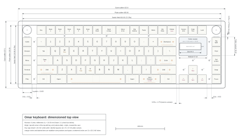

# Omar-Keyboard hardware specification

Revision 3 · first-sample values. This sheet fixes the numbers a plate, PCB, case and keycap order need. Values marked **(sample)** are starting points for the first physical build; measure them on that build before the second order. Per-switch data lives in [omar-switches.csv](layout/omar-switches.csv), the layout in [omar-kle.json](layout/omar-kle.json) for keyboard-layout-editor and plate generators, and the dimensioned top view in [dimensioned drawing](../docs/assets/omar-dimensions.svg). The [layout generator](../tools/generate-layout.py) writes all three from a single layout table, and the browser check confirms the prototype matches it.

## Coordinates and overall size

All plan dimensions use the **switch field origin**: the top-left corner of the top-left key unit (the volume dial position), x to the right, y toward the user, 1u = 19.05 mm. Switch positions are centres.

| Item | Value |
| --- | --- |
| Switch field | 21.25u × 6.25u = **404.81 × 119.06 mm** |
| Rows (top edge, y) | Top row 0 · number row 1.25u · QWERTY 2.25u · home 3.25u · shift 4.25u · bottom 5.25u |
| Gap between top row and number row | 0.25u = 4.76 mm |
| Rail gaps | Left rail to main block 0.5u = 9.53 mm. Arrow cluster to right rail 0.5u = 9.53 mm |
| Main block to arrow cluster | 0.25u = 4.76 mm |
| Left rail centre line | x = 9.53 mm. Right rail centre line x = 395.29 mm |
| Main block | x 28.58–314.33 mm (15u) |
| Arrow cluster | x 319.09–376.24 mm (3u). ↑ centre (347.66, 90.49), ← (328.61, 109.54), ↓ (347.66, 109.54), → (366.71, 109.54) |
| Plate outline | Switch field + 0.5 mm per side = **405.81 × 120.06 mm**, corner radius 1 mm |
| Case outside | **422.8 × 137.1 mm**, 8 mm walls, 0.5 mm plate clearance, 4 mm outer corner radius |
| Comparison | A typical TKL case is about 360 mm wide. A full-size 104-key case is about 440 mm |

The prototype's previous 0.23u top gap left the bottom row 0.03u outside its 6.20u board, which clipped 0.57 mm from the printed template. The 0.25u gap fixes that and keeps every row on a 1u grid.

## Key inventory

90 keys and two dial presses make **92 switch contacts**. Every key position takes an MX-compatible switch.

| Size | Count | Keys |
| --- | --- | --- |
| 1u | 75 | Letters, digits, punctuation, Esc, Desk 1–5, Last Desk, top-row utilities, both rails, arrows |
| 1.5u | 6 | Send & Stay, Move & Go, Tab, \\, Ctrl, right Super |
| 1.75u | 3 | Caps, left Super, Alt |
| 2u | 1 | Backspace |
| 2.25u | 3 | Enter, left Shift, Next Window |
| 2.75u | 1 | right Shift |
| 6.25u | 1 | Space |

## Stabilizers

PCB-mount, screw-in, Cherry-style. Use the same wire for 2u through 2.75u.

| Key | Centre (mm) | Wire spacing |
| --- | --- | --- |
| Backspace 2u | (295.28, 33.34) | 23.88 mm |
| Enter 2.25u | (292.89, 71.44) | 23.88 mm |
| Left Shift 2.25u | (50.01, 90.49) | 23.88 mm |
| Right Shift 2.75u | (288.13, 90.49) | 23.88 mm |
| Space 6.25u | (150.02, 109.54) | 100.0 mm |
| Next Window 2.25u | (259.56, 109.54) | 23.88 mm |

## Plate

| Item | Specification |
| --- | --- |
| Material | 1.5 mm 5052 aluminium for the production build. 1.6 mm FR4 is acceptable for the first sample |
| Switch cutouts | 14.00 × 14.00 mm, +0.05/−0 mm, at all 90 switch centres and both dial centres (the EC11 body passes through a switch cutout) |
| Stabilizer cutouts | Standard Cherry/Costar-compatible cutouts at the spacings above. Generate them from [omar-kle.json](layout/omar-kle.json) with a plate generator and check them against the chosen stabilizer's drawing |
| Roller slot | 44.0 × 12.0 mm, centred on the barrel at (345.59, 42.86) |
| Roller module fixings | Two M2 holes for the bearing block and two for the encoder bracket, located from the roller drawing below |
| Mounting holes | 12 × Ø2.2 mm for M2, listed below. The PCB uses the same positions |

| Mounting hole | Position (mm) | Location |
| --- | --- | --- |
| 1–3 | (23.81, 33.34), (23.81, 71.44), (23.81, 109.54) | Left rail gap |
| 4–6 | (381.00, 33.34), (381.00, 71.44), (381.00, 109.54) | Right rail gap |
| 7–9 | (85.73, 21.43), (171.45, 21.43), (257.18, 21.43) | Gap between top row and number row |
| 10 | (347.66, 71.44) | Empty space under the roller |
| 11–12 | (328.61, 90.49), (366.71, 90.49) | Empty spaces beside ↑ |

A 405 mm span needs interior support under the typing block. The PCB layout adds three more M2 standoffs at switch-body junctions in the main block. Check each against stabilizer wire paths and hot-swap socket outlines before fixing them.

## Height stack

z is measured from the top of the plate, positive up. **(sample)** values need measuring on the first build with the chosen switches and caps.

| Layer | z (mm) |
| --- | --- |
| Roller barrel top | +14.0 **(sample)** |
| Dial knob top | +16.0 ±1, level with the Esc cap top **(sample)** |
| Typical keycap top, Cherry profile R3 | about +14 **(sample)** |
| Roller bezel top | +8.0 |
| Roller axle | +6.0 |
| Case top edge | +5.0 |
| Plate | 0 to −1.5 |
| Roller barrel bottom | −2.0 (passes through the plate slot, 3 mm above the PCB) |
| PCB | −5.0 to −6.6 (MX standard plate-to-PCB spacing, 1.6 mm board) |
| Hot-swap sockets | to −8.4 |
| Case floor top | −10.4 (2 mm clearance) |
| Case bottom | −12.9 (2.5 mm floor) |

The case sits on 2 mm feet. Typing angle is **6°**. The front edge is about **20 mm** above the desk, and the back edge about 34 mm.

## Roller

| Item | Specification |
| --- | --- |
| Module envelope | x 319.09–376.24 mm, y 23.81–61.91 mm (3u × 2u above the arrows) |
| Barrel | Ø16.0 mm, 42.0 mm tread, x 324.59–366.59 mm, axis at y = 42.86 mm. Aluminium with a fine circumferential rib, or a printed core with a 1 mm silicone sleeve |
| Axle height | +6.0 mm above the plate top, set by a shim under the encoder bracket |
| Exposure | 6 mm above the bezel. Bezel window 46 × 16 mm |
| Left support | Printed or machined block, 4 mm, x 320.09–324.09 mm, holding an MR63ZZ bearing (3 × 6 × 2.5 mm) on a Ø3 mm barrel stub |
| Right support and sensor | Horizontal-shaft (right-angle) EC11-series encoder, no push switch, 30 detents / 15 pulses, 6 mm D shaft into the barrel bore with an M3 set screw. Bracket and body x 367.09–374.59 mm |
| Feel | 30 detents per turn, about 1.7 mm of tread per detent. One detent is one wheel step |
| Direction | Pulling the top surface toward the user scrolls down |
| Bezel | Printed cover 56.2 × 37.2 mm, 1.2 mm top skin, top at +8.0 mm, fixed by the support screws |
| Wiring | A, B and common from the encoder to PCB pads through the plate slot |

## Dials

| Item | Specification |
| --- | --- |
| Positions | Volume (9.53, 9.53). Brightness (395.29, 9.53) |
| Encoder | Vertical EC11E with push switch, 20 detents / 20 pulses, 6 mm D shaft, 20 mm shaft length from the mounting face, PCB-mounted through a 14 × 14 mm plate cutout |
| Knob | Ø18.0 × 12 mm knurled aluminium with a set screw. Top level with the Esc cap. At least 1 mm clearance to every cap |
| Labels | Printed or engraved on the plate in the 4.76 mm band under each dial, 2.4 mm cap height: "Mute" under the left dial and "Layout · Fn Resize" under the right, with "Fn Resize" in the Fn legend colour |

## Switches

| Position | Switch |
| --- | --- |
| All keys except Lock | MX-compatible, 5-pin, plate-mount. Reference feel: tactile, 55–62 gf |
| Lock | MX-compatible linear, 80 gf spring |
| Sockets | Kailh MX hot-swap sockets on the first PCB, so switch weights can be changed after the reach tests |

## Keycaps

Cherry profile, 1.5 mm PBT, dye-sublimated legends. Rows follow the physical row: top row and number row R1, QWERTY R2, home R3, shift and bottom rows R4. Rail keys take the row they sit in. Arrows are R4.

| Item | Specification |
| --- | --- |
| Custom sizes | Two R1 1.5u caps (Send & Stay, Move & Go) are outside standard kits. Next Window uses an R4 2.25u blank (left-Shift size). Alt uses an R4 1.75u blank |
| Homing bars | F and J (standard), plus Menu (R3), Focus (R4) and Desk 5 (R1) |
| Lock | 1u DSA cap, about 2 mm lower than its R1 neighbours, giving a recessed top that a finger crossing the top row does not catch. An 80 gf linear switch adds resistance. A rim cannot fit, because neighbouring caps are only 1.05 mm apart |
| Primary legends | Condensed grotesk, centred. Single glyphs 4.0 mm cap height. Words 2.8 mm, at most two lines on a 3.3 mm line pitch. Desk caps: "Desk" 1.9 mm above a 4.0 mm numeral |
| Secondary legends | 1.9 mm bold, second line under the primary. **Fn legends** (Fn, Home, End, PgUp, PgDn, Insert, Last Win) in plum. **Super legends** (Close, Copy, Paste) in dark amber |

| Cap group | Prototype colour | Legend ink |
| --- | --- | --- |
| Alphanumerics, Space | #f6f2e7 | #272e23 |
| Modifiers, arrows, Esc | #e0e0d3 | #272e23 |
| Desk 1–5, Last Desk, transfers, both Super | #f2cd8f | #382810 |
| Left rail (launchers) | #bdd4aa | #162e18 |
| Right rail, Next Window | #cad7e0 | #1d3140 |
| Top-row utilities | #dfd7c2 | #312b1e |
| Screenshot | #d4cbe4 | #31253f |
| Fn legend | — | #7a1346 |
| Super legend | — | #6b3d00 |

Match the prototype colours to the keycap vendor's dye or plastic colour chart before ordering. The dark-mode values in the prototype are for the screen only.

## Electrical

| Item | Specification |
| --- | --- |
| PCB | 2-layer FR4, 1.6 mm, ENIG, outline equal to the plate outline. Check the fab's size limit and price tier for boards longer than 400 mm |
| Controller | RP2040, 12 MHz crystal, W25Q16JV 2 MB QSPI flash or larger (set boot2 to match), BOOTSEL and RUN buttons, SWD pads, following the RP2040 hardware design guide |
| USB | USB-C receptacle (USB 2.0), 5.1 kΩ on CC1 and CC2, 27 Ω series on D+ and D−, USBLC6-2 ESD, 500 mA PTC. Port on the back edge, centred at x = 95.25 mm. Case opening 12 × 7 mm |
| Regulator | 3.3 V LDO, at least 300 mA |
| Matrix | 8 rows × 12 columns, COL2ROW. One 1N4148W (SOD-123) per contact, anode on the column side. 92 diodes |
| Encoders | Volume A/B GP20/GP21, brightness GP22/GP23, roller GP24/GP25. Dial push contacts are in the matrix |
| Rows and columns | Rows GP0–GP7, columns GP8–GP19 |
| LEDs | 15 × SK6812MINI-E, reverse-mounted under the switch LED windows (north-facing switches, LED 5.08 mm north of the switch centre). 5 V supply, 100 nF each. Data from GP26 through a 74AHCT1G125 level shifter |
| Spare | GP27–GP29 |
| Power budget | Firmware caps LED brightness at 80/255, which keeps the LEDs under about 250 mA at full white. The total stays under the 500 mA USB 2.0 limit |

| LED index | Key | Shows |
| --- | --- | --- |
| 0 | Caps | Caps Lock on |
| 1–5 | Desk 1–5 | Amber while a transfer is pending. Otherwise dim white on the host-reported active desk |
| 6, 7 | Send & Stay, Move & Go | Amber while that transfer is armed |
| 8 | Mic Mute | Red while the host reports the microphone muted |
| 9, 10 | Swap, Focus | Blue while held |
| 11–14 | →, ↓, ←, ↑ | Blue while Focus or Swap is held |

Local gesture feedback overrides host state. Host state that has not been confirmed in the last 3 seconds turns off.

### Switch matrix

The reference matrix fills each physical row's first 12 contacts from the left into one electrical row. The remaining right-hand contacts share rows 6 and 7. The PCB designer may swap any assignment, provided the CSV and the QMK layout macro are updated together.

<!-- MATRIX:BEGIN -->
| Row | C0 | C1 | C2 | C3 | C4 | C5 | C6 | C7 | C8 | C9 | C10 | C11 |
|---|---|---|---|---|---|---|---|---|---|---|---|---|
| R0 | Volume dial press | Esc | Desk 1 | Desk 2 | Desk 3 | Desk 4 | Desk 5 | Last Desk | Send & Stay | Move & Go | Clipboard | Paste |
| R1 | Guide | ~ | 1 | 2 | 3 | 4 | 5 | 6 | 7 | 8 | 9 | 0 |
| R2 | Browser | Tab | Q | W | E | R | T | Y | U | I | O | P |
| R3 | Menu | Caps | A | S | D | F | G | H | J | K | L | ; |
| R4 | Terminal | Left Shift | Z | X | C | V | B | N | M | , | . | / |
| R5 | Files | Ctrl | Left Super | Space | Right Super | Next Window | Alt | ← | ↓ | → | Focus | — |
| R6 | Alerts | Mic Mute | Delete | Screenshot | Grab Text | Lock | Brightness dial press | Right Shift | ↑ | Swap | — | — |
| R7 | - | = | Backspace | Flip Split | [ | ] | \ | Float | ' | Enter | Fullscreen | — |
<!-- MATRIX:END -->

## Firmware configuration

| Setting | Value |
| --- | --- |
| Firmware | QMK, keymap from [build pilot](../docs/build/pilot.md), [omar-controls.h](../firmware/qmk/omar-controls.h) and [omar-indicators.h](../firmware/qmk/omar-indicators.h) |
| Matrix | `MATRIX_ROWS 8`, `MATRIX_COLS 12`, `DIODE_DIRECTION COL2ROW` |
| Debounce | `sym_defer_pk`, 5 ms |
| Tap-hold | `TAPPING_TERM 200`, `HOLD_ON_OTHER_KEY_PRESS`, `QUICK_TAP_TERM 0` |
| Encoders | `ENCODER_MAP_ENABLE`. Resolution 4 for the dials and 2 for the roller (set from the encoders' detent and pulse counts) |
| Features | `EXTRAKEY_ENABLE`, `MOUSEKEY_ENABLE` (roller wheel), `RAW_ENABLE` (indicator bridge), `NKRO_ENABLE`, `RGB_MATRIX_ENABLE` with the WS2812 PIO driver and `RGB_MATRIX_MAXIMUM_BRIGHTNESS 80` |
| Polling | 1000 Hz |
| USB IDs | A pid.codes test PID for the first sample. Request an assigned PID before any release |

## Host setup

| Item | Specification |
| --- | --- |
| Target | Omarchy v4.5.0 with stock bindings. Output map in [keymap](../docs/design/keymap.md) |
| Optional bindings | [omar-bindings.lua](../host/omarchy/omar-bindings.lua), loaded from `~/.config/hypr/bindings.lua` |
| Indicator bridge | [omar-indicators.py](../host/omarchy/omar-indicators.py), Python 3 with `hidapi`, run as the logged-in user |
| hidraw access | udev rule `/etc/udev/rules.d/70-omar.rules`: `KERNEL=="hidraw*", ATTRS{idVendor}=="<vid>", ATTRS{idProduct}=="<pid>", TAG+="uaccess"` |

## First-sample bill of materials

| Part | Quantity |
| --- | --- |
| MX-compatible tactile switches | 89 |
| MX-compatible 80 gf linear switch (Lock) | 1 |
| Kailh MX hot-swap sockets | 90 |
| 1N4148W diodes | 92 |
| EC11E vertical encoders with push switch | 2 |
| EC11 horizontal encoder, 30 detents, no switch | 1 |
| Knobs, Ø18 mm | 2 |
| Roller barrel, MR63ZZ bearing, Ø3 mm axle stub, supports, bezel | 1 set |
| Stabilizers, PCB screw-in: 2u / 6.25u | 5 / 1 |
| SK6812MINI-E | 15 |
| RP2040, 12 MHz crystal, 2 MB QSPI flash, 3.3 V LDO, USB-C receptacle, USBLC6-2, PTC, 74AHCT1G125, buttons, passives | 1 set |
| Plate and PCB | 1 each |
| Case, printed in two halves joined at x ≈ 200 mm with an internal bar, or machined | 1 |
| M2 standoffs and screws | 15 |
| Feet, 2 mm | 4 |
| Keycap set as specified above | 1 |

## Before the second order

1. Measure keycap, knob and roller heights against the stack table and adjust the knob shaft length and the roller shim.
2. Run the paper fit and reach tests in [validation guide](../docs/design/validation.md) on the printed template.
3. Check roller drag, skipped detents and axle deflection at the centre and both ends of the tread.
4. Confirm the LED brightness cap against measured USB current.
5. Confirm the stabilizer and roller-slot cutouts against the parts actually bought.
